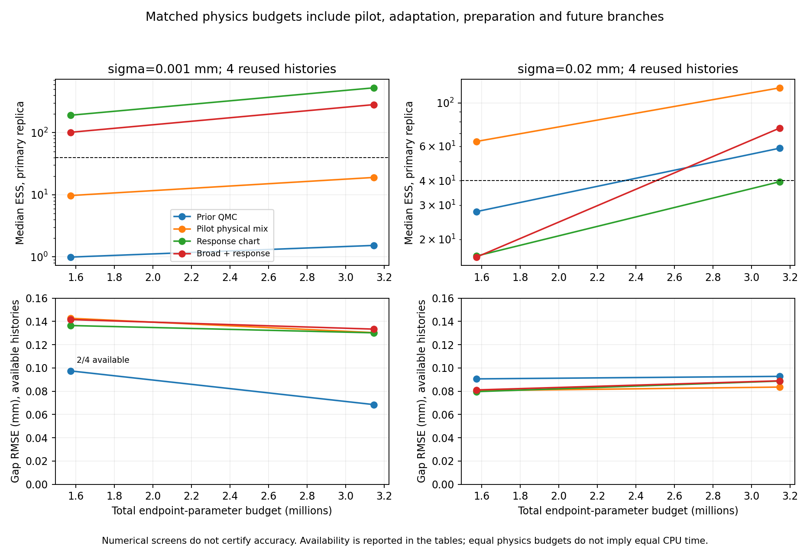
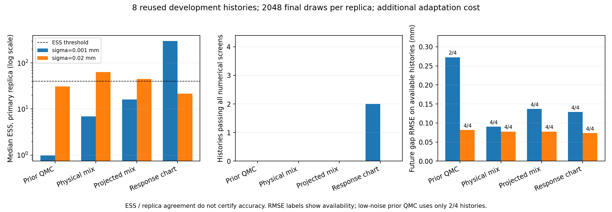
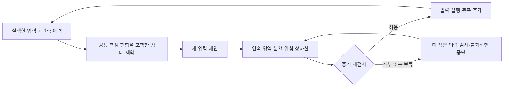
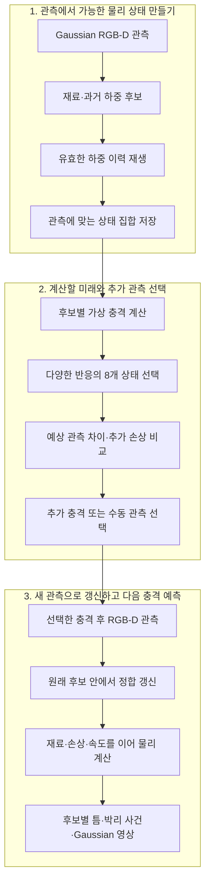
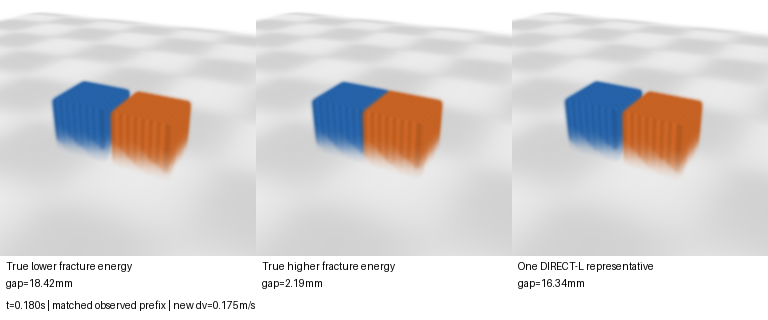
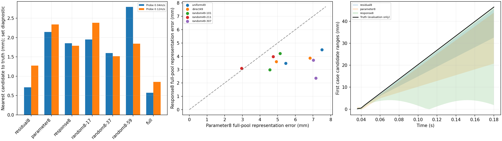
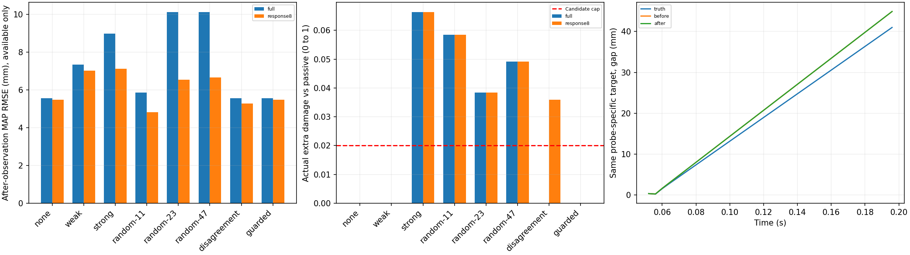
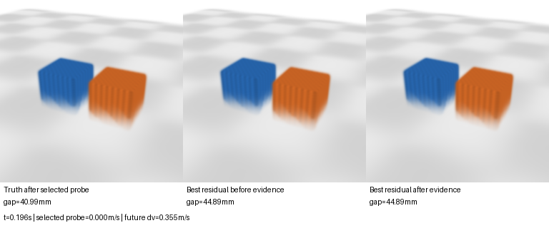

# Gaussian Fracture World Model

**관측으로 재료·손상 이력의 여러 가설을 유지하고, 새 충격의 결과를 물리 계산과 Gaussian 영상으로 예측하는 연구 프로토타입.**

물체는 비슷하게 보여도 과거 하중과 재료에 따라 다음 충격의 결과가 달라진다. 이 프로젝트는 관측에 맞는 여러 물리 상태를 보존하고, 필요한 추가 관측과 미래 계산을 연결한다.

기존 주요 추론 실험은 **두 강체 블록·접합면 하나·1차원 병진 운동**이다. 후속 단계에서 세 구역 접합면·이동과 회전·유한 후보 기반 관측과 탐침을 연결했다. Gaussian은 기존 영상 표현, 표준 cohesive/contact 법칙은 물리 계산에 사용한다. 일반 3D 균열이나 새로운 학습 월드모델을 완성한 결과는 아니다. **좋아진 결과와 실패한 결과를 함께 공개한다.**

[전체 결과표](docs/RESULTS.md) · [재현 안내](docs/REPRODUCING.md) · [구현 기록](IMPLEMENTATION.md) · [연구 판단](RESEARCH_DIRECTION.md)

## 최근 구현: 전체 물리 예산 비교 — 단순 혼합의 우위 미확보

pilot·적응·준비 이력·미래 분기의 계산을 모두 청구하는 예산 비교를 구현했다. 기존 8개 개발 이력에서 두 예산·두 독립 적응 반복을 비교했다. 아래는 최대 예산 3,145,728회에서 네 이력의 주 추정값이다. 수렴은 두 예산과 두 반복 모두로 검사한다.

| nominal sigma (mm) | 방법 | 미래 gap RMSE (mm) | 수렴 통과 / 4 |
| ---: | --- | ---: | ---: |
| 0.001 | pilot만 쓰는 물성 혼합 | 0.13034 | 0 |
| 0.001 | 정합된 물성+반응 혼합 | 0.13333 | 0 |
| 0.020 | pilot만 쓰는 물성 혼합 | 0.08353 | **1** |
| 0.020 | 정합된 물성+반응 혼합 | 0.08891 | 0 |

**이번 고정 혼합은 단순 물성 기준선보다 나아지지 않았다.** 낮은 잡음에서 ESS가 커지는 현상은 남았지만, 앞선 두 사례의 수렴 통과는 이번 독립 난수·총 예산 조건에서 유지되지 않았다. 현재 수렴 검사는 대부분 실패하며, 작은 RMSE 차이를 일반 성능 차이로 해석하지 않는다. [네 방법·두 예산·회계·개별 실패·시간·다음 판단](docs/SPATIAL_BUDGET.md)



## 이전 구현: 반응 기반 샘플링과 밀도 보정

관측 반응을 따라 샘플을 배치하고 전체 제안 밀도로 가중치를 보정하는 경로를 추가했다. 원래 균일 물성 prior와 유계 오차·지속 편향의 관측 우도를 유지한다. 기존에 본 **네 상태×두 잡음의 8개 개발 이력**에서 비교했으며 새 보류 실험은 아니다.

| nominal sigma (mm) | 방법 | 중앙 ESS | 수렴 검사 통과 |
| ---: | --- | ---: | ---: |
| 0.001 | 같은 정합 중심 + 물성 공분산 | 16.22 | 0/4 |
| 0.001 | 같은 정합 중심 + 반응 공분산 | 298.77 | **2/4** |
| 0.020 | 같은 정합 중심 + 물성 공분산 | 45.15 | 0/4 |
| 0.020 | 같은 정합 중심 + 반응 공분산 | 21.50 | 0/4 |

**낮은 잡음의 일부 적분은 안정화했지만 높은 잡음에서는 실패했다.** 수렴한 사례도 정답 오차가 남았고, 적응 비용이 추가되므로 정확도·속도·위험 판단의 우위를 확보한 결과는 아니다. 위험 상한은 이번에 바꾸지 않았다. [파이프라인·네 기준선·개별 실패·추가 비용·재현](docs/SPATIAL_TRANSPORT.md)



## 이전 구현: 연속 prior 추정과 조건부 위험 판정

목록 밖 실패를 이어서 연속 E·좌우 준비 입력의 균일 prior로 기존 관측 32개를 재추정했다. 높은 잡음 16조건 모두에서 추정값은 나왔지만, **노드 수·난수 묶음·유효 표본 수의 수렴 검사를 통과한 이력은 0/32개**였다. 추정값을 얻은 것을 안정적인 성능 개선이라고 계산하지 않는다.

별도 구간 검사에서는 기존 위험점 8개의 관측 정합과 손상 하한을 재확인해 거부했다. 명시적으로 매우 좁게 준 영역의 대조군 3개는 허용했으나, 넓은 영역 두 질의는 7개·31개 상자 예산 모두 **상한이 커서 보류**했다. 허용은 전체 영역 덮개와 가능한 점이 함께 있어야 하고, 샘플 탐색 실패는 허용 근거가 아니다.

검사는 **고정 64증분의 안정 준정적 모형**에 한정된다. 후속으로 위의 국소 반응 제안을 구현했으며, 이력 상관관계를 보존하는 전체 영역 표현과 유용한 위험 상한은 아직 미해결이다. [파이프라인·수치·근거·실패·재현](docs/SPATIAL_CONTINUOUS.md)

## 공간 관측 → 추정 → 탐침, 그리고 목록 밖 실패

참 물성·준비 이력을 정책에 주지 않고, **실행 입력과 두 위치의 관측**으로 후보를 추정해 다음 탐침을 정하는 단계를 연결했다. 미리 고정한 29개 이산 후보와 별도의 목록 밖 4상태를 사용했다. 총 2,640개 조건 반복이며 독립 시편 2,640개가 아니다. 공개 관측만으로 결정 5,258개를 재생했다.

아래는 목록 안·nominal sigma 0.020mm·양 끝 관측의 결과다. 각 행은 같은 29상태×2편향×2잡음 반복의 116조건이다.

| 규칙 | 미래 gap RMSE (mm) | 실제 추가 손상 한도 위반 / 116 |
| --- | ---: | ---: |
| 무하중 반복 | 0.12991 | 0 |
| 고정 좌→우 | 0.07979 | 96 |
| 기울기로 방향 선택 | 0.07421 | 48 |
| 가능한 유한 후보 전체 검사 | 0.11879 | 0 |

**목록 밖에서는 유한 검사도 실패했다.** 같은 높은 잡음·양 끝 관측의 16조건 중 4번 손상 한도를 넘었고 예측은 12번만 가능했다. 네 위반은 물체 하나의 조건 반복이다. 사후 진단에서 공개 관측에 맞는 다른 위험 상태를 찾았지만, 이를 안전 상한이나 새 정책의 성공으로 계산하지 않았다. 다음은 연속 물성·준비 이력의 가능한 영역을 다루는 추정과 위험 판단이다. [전체 결과·관측 모형·반례·한계](docs/SPATIAL_OBSERVATION.md)

## 세 구역의 손상 이력과 이동·회전

좌우 두 구동 스프링으로 물체를 움직이거나 기울이고, 세 접합 구역이 각자의 손상 이력을 보존하는 순방향 모형을 구현했다. 손상값을 직접 넣지 않고 같은 장치의 하중·제하로 준비했다. 다섯 설계 사례에서 8/4/2마이크로미터 증분·195개 분기 계산의 평형·에너지·수렴 검사를 통과했다.

약한 입력에 거의 같은 응답을 내는 두 설계 상태는 중간 한쪽 탐침에서 **최대 gap 차이 0.03654mm, 추가 D 0.01224**를 냈다. 강한 탐침은 차이를 키웠지만 추가 D가 0.05402로 한도 0.02를 넘었다. 두 상태에서 확인한 결과이며 전체 가능 집합의 안전 보장이나 새 추정 정책의 성능이 아니다. 후속 유한 후보 추정은 위 최신 결과에서 다뤘다. [모형·파이프라인·표·검증](docs/SPATIAL_FIXTURE.md)

## 식별 가능성 진단: 실패 원인을 물리적 불가능으로 단정할 수 없었다

외부 평가를 검토하고, 같은 약한 응답을 갖는 두 상태를 손상 한도 안에서 구분할 수 있는지 직접 계산했다. 두 상태만 아는 경우 최대 gap 차이는 **0.0099~0.1625mm**로, 안전한 신호가 항상 0.001mm라는 설명은 맞지 않았다. 반면 높은 잡음을 가정한 네 초기 관측에서는 전체 가능 집합의 위험 검사 때문에 해당 두 상태를 가를 입력을 허용할 수 없었다. 허용 입력·임계 입력의 증거 **16개**를 재검사했다.

특정 법칙·설계 상태 쌍·초기 관측의 진단이며 새로운 정책의 우위나 일반적인 식별 불가능성 정리가 아니다. 진동이나 회전을 추가해도 자동으로 해결되지 않는 이유를 확인했다. 후속 후보는 **공간 접합면에서 위치별 탐침과 시각 관측을 연결하는 파이프라인**이다. 공간 순방향 모형을 구현했으며 시각 관측·추정의 결합과 기여 입증은 남아 있다. [계산·수치·조건](docs/PROBE_IDENTIFIABILITY.md) · [평가문 검토·선행연구·다음 구현 계획](docs/RESEARCH_REVIEW_NEXT.md)

## 단순 교대 규칙과 비교

같은 12개 개발 상태·잡음에서 **무하중과 검증된 큰 입력을 교대하는 규칙**을 두 순서로 추가했다. 288개 실행이 모두 8회 관측을 마쳤고, 실행 증거 2,304개와 최종 적분 검사를 통과했다. 미래 점수 정책도 다시 실행해 이전 입력·관측과 평가 수치를 재현했다.

주 비교인 nominal sigma 0.020mm·8회에서 미래 RMSE는 독립 잡음의 미래 점수/무하중 우선 교대 **0.20595/0.20591mm**, 상관 잡음 **0.20616/0.20600mm**였다. 단순 규칙의 평균 정책 시간도 작았다. **이 조건에서는 복잡한 미래 점수의 우위를 확보하지 못했다.** 낮은 잡음·짧은 관측 예산의 차이는 큰 입력을 초기에 배치하는 효과와 추가로 구분해야 한다. [전체 결과·순서 대조·시간·한계](docs/ALTERNATING_FRONTIER.md)

## 안정화한 추정을 실제 관측 선택에 연결

**상태 적분 → 검증된 입력 후보 → 가상 관측 → 목표 미래의 예상 예측 위험 감소 → 실제 입력·관측 갱신**의 폐루프를 구현했다. 새로운 같은 법칙의 12개 상태에서 여섯 정책·576개 실행을 수행했고, 모두 8회 관측을 채웠다. 실행 증거 **4,608개**를 재검사했으며 실제 누적 손상 한도 위반은 0건이었다.

주 비교인 nominal sigma 0.020mm·8회 관측에서 미래 벌어짐 RMSE는 아래와 같다. 각 칸은 12개 상태×2편향의 24조건이며 독립 시편 수가 아니다.

| 정책 | 독립 잡음 (mm) | 상관 잡음 (mm) |
| --- | ---: | ---: |
| 고정 증가 입력 + 검증 | 0.20536 | 0.20539 |
| 목표 미래 점수 + 검증 | 0.20595 | 0.20616 |

**실제 입력 선택은 달라졌지만 주 비교의 성능 우위는 확보하지 못했다.** 저잡음에서는 작은 점 추정 개선과 기준보다 큰 입력 횟수의 감소가 있었으며, 강한 단순 교대 계획과 추가 비교가 필요하다. [파이프라인·전체 표·점수/위험 검증·한계](docs/TASK_AWARE_PILOT.md)

## 예측 계산의 수치 안정화

관측 반응에 맞는 적분 좌표와, 관측식으로 구한 물성 방향의 구간 분할을 구현했다. 기존 **2,304개 관측 이력 모두** 해상도 비교 기준을 통과했고, 선택한 **48개**도 다른 바깥 적분기와 일치했다. 최고 두 해상도의 미래 평균 예측 차이는 최대 **0.00000083mm**였다. 이 값은 수치 계산의 차이이며 실물 예측 정확도나 엄밀한 오차 보장은 아니다.

안정화한 계산에서 0.001mm·8회 관측의 미래 RMSE는 독립 잡음의 고정/적응 입력 **0.1413/0.1448mm**, 상관 잡음 **0.1427/0.1411mm**였다. 두 방법 모두 반복 관측보다 낮았지만 적응 선택의 우위는 확보하지 못했고, 0.020mm의 예측 문제도 남았다. 입력 선택과 물리 위험 검증은 이번 재계산에서 변경하지 않았다. [원리·수렴 검사·전체 결과](docs/RESPONSE_QUADRATURE.md)

## 관측을 더 늘려도 해결되지 않은 예측 문제

같은 누적 손상 한도에서 4개 정책의 추가 관측 2·4·8회를 비교했다. **768개 합성 실행이 모두 8회를 완료했고 손상 한도 위반은 0건**이었다. 그러나 nominal sigma 0.020mm에서는 현재 적응 선택의 예측 이득을 확보하지 못했다. 아래는 추가 관측 8회·321² 예측 격자의 미래 벌어짐 RMSE다.

| 정책 | 독립 잡음 (mm) | 상관 잡음 (mm) |
| --- | ---: | ---: |
| 무하중 반복 | 0.2064 | 0.2057 |
| 약한 입력 반복 | 0.2083 | 0.2086 |
| 고정 제안 + 검증 | 0.2077 | 0.2084 |
| 적응 선택 + 검증 | 0.2108 | 0.2079 |

각 칸은 같은 **24개 개발 상태×2편향의 48조건**이며 독립 시편 48개가 아니다. 0.001mm에서는 개선이 보였지만, 당시 예측 격자 161²→321²에서 방법 순위가 바뀌고 개별 예측도 크게 달라졌다. 그 문제를 위의 후속 적분 실험에서 다뤘다. **검증된 입력 실행과 유용한 예측 개선은 별개**로 기록한다. [이 단계의 원본 수치·한계](docs/OBSERVATION_BUDGET.md)

## 연속 입력을 실행하기 전에 검증하기

관측에 맞는 유한 후보만 검사하면 실제 위험 상태를 놓칠 수 있었다. 후속 단계에서는 **가능한 물성·이력의 연속 영역 전체를 덮는 증거**를 계산하고, 그 증거를 다시 검사한 뒤 입력을 실행한다. 현재 이 단계의 관측은 합성 벌어짐 값이며, 알려진 안정 준정적 스칼라 법칙을 사용한다.



이전과 겹치지 않는 **24개 합성 상태**를 두 잡음 크기·두 편향에서 반복한, 오차 경계 안의 96조건 결과다. 손상 증가 한도는 `0.02`이며 시간은 **2단계 실행 한 회의 합계**다. 96개의 독립 시편 실험은 아니다.

| 정책 | 손상 한도 위반 / 96 | 미래 벌어짐 RMSE | 평균 계획·검증 시간 |
| --- | ---: | ---: | ---: |
| 아무 입력도 추가하지 않음 | 0 | 0.2110mm | 약 0ms |
| 고정 입력 | 56 | 0.0547mm | 약 0ms |
| 전체 유한 후보 검사 | 0 | 0.2109mm | 17.10ms |
| 검증 없는 연속 입력 | 4 | 0.1658mm | 23.52ms |
| **연속 영역 증거로 필터링** | **0** | **0.1822mm** | **255.85ms** |

예측 이득은 주로 nominal sigma **0.001mm**에서 나타났고, **0.020mm**에서는 유용한 개선을 확보하지 못했다. 고정 입력의 낮은 오차는 높은 손상을 동반한다. 같은 알려진 법칙 안의 개발 평가이며, 실물 안전이나 새로운 알고리즘의 신규성 증거는 아니다. [상세 조건·한계](docs/CONTINUOUS_RISK_EVALUATION.md) · [공개 수치](docs/results/continuous-risk-evaluation.json)

계산 재사용 비교에서는 **같은 행동·판정·선택 증거 구조**를 유지하면서 평균 시간이 **291.37→206.35ms**로 약 29.2% 감소했다. 두 번의 균형 순서 재생에서 얻은 CPU 결과이며, 위 표와는 측정 실행·집계 조건이 다르다. [재사용 비교·공개 재현 입력](docs/RISK_REUSE.md)에 자세히 기록했다. 아래 기록에는 이 단계에 이르기까지의 성공과 실패를 함께 남겼다.

후속 로컬 pilot은 [같은 장치의 연속 하중과 카메라 측정](docs/CAMERA_PILOT.md)에 정리했다. 수치적인 과제 가능성과 측정 도구를 구현한 단계이며 실물·카메라 gate는 아직 통과하지 않았다. 아래 기존 주요 결과와 별도로 관리한다.

촬영과 외부 엔진 없이 수행한 후속 [합성 상태 추정 비교](docs/SYNTHETIC_FILTER_BENCHMARK.md)는 26개 상태·312개 관측 조건에서 고정 후보, 표준 SMC, 후보 이동을 비교한다. 측정 bias·추가 손상·격자 수렴 실패도 함께 기록했다. 벌어짐 값 기반의 개발 진단이며 아래 Gaussian 영상 실험과 구분한다.

추가 [측정 편향 기준선](docs/BIAS_AWARE_FILTER.md)은 같은 관측에서 편향 무시·잡음 확대·공통 편향 추정을 비교한다. 무하중 관측 1회를 추가하는 단순 보정도 포함했다. 관측 구간 폭·포함률·계산 비용을 함께 기록하며 새로운 알고리즘 기여를 주장하지 않는다.

[누적 손상 검사와 순차 행동 선택](docs/FINITE_DAMAGE_GUARD.md)은 보정된 관측 이후 전체 후보·top8·위험 증거 기준선을 비교한다. 소수 후보의 실제 손상 한도 위반, 전체 검사의 보수성, 세밀한 격자에서 바뀌는 판정을 함께 기록했다. 표준 기준선의 2단계 폐루프이며 연속 상태 안전 보장은 아니다.

[행동 간격·정밀도 진단](docs/ACTION_CEILING_DIAGNOSTIC.md)은 기존 행동 격자와 연속 입력을 비교했다. 낮은 합성 잡음에서 예측이 좋아졌지만 실제 손상 위반도 발생했고, 기존 동적 계산기로 재현했다. 가능한 연속 물성·이력 영역을 유한 후보가 빠뜨리는 문제를 다음 개발 대상으로 확인했다.

[연속 영역 위험 검증](docs/CONTINUOUS_RISK_PROBE.md)은 사각 파라미터 영역을 분할해 조건부 상한을 계산하고 허용·거부·보류를 구분한다. 전체 영역 덮개와 위반 지지점을 다시 검사할 수 있게 저장했다. 기존 반례를 막은 단일 회귀 실행이며 일반 동역학·실물 안전이나 예측 이득을 입증한 결과는 아니다.

후속 [새 상태 평가](docs/CONTINUOUS_RISK_EVALUATION.md)는 이전과 겹치지 않는 24개 합성 상태에서 6개 정책을 비교했다. 경계 안의 96조건에서 검증 필터의 손상 위반은 0건, 검증 없는 연속 입력은 4건이었다. 낮은 잡음에서 예측이 좋아졌지만 더 큰 관측 오차와 검증 비용의 한계도 확인했다.


## 파이프라인



각 후보에는 위치·속도·최대 벌어짐 이력·누적 외부 일·물리 시계·재료 값이 있다. 관측과 충격 이후에도 이를 초기화하지 않는다. 여러 후보를 평균한 값을 하나의 물리 상태로 사용하지 않는다.

## 구현 범위

| 구성요소 | 하는 일 | 현재 상태 |
| --- | --- | --- |
| 순방향 물리 | 손상, 분리, 분리 후 압축 접촉 | 축약 문제의 분석해·시간 간격 검증 |
| 상태 추정 | 관측에 맞는 재료·하중 이력 탐색 | 균일·DIRECT·무작위 기준선 구현 |
| 상태 집합 압축 | 가능한 미래를 소수 상태로 요약 | 8개 상태 선택·재사용 가능 |
| 능동 관측 | 관측 차이와 손상으로 충격 선택 | 폐루프 구현, 예측 개선 미확보 |
| 새 외력 질의 | 저장한 상태에서 충격 크기·시각 변경 | 실행 및 독립 물리 대조 완료 |
| V-JEPA 2 연결 | frozen encoder/predictor로 선택·학습 보조 | 실행 완료, 추가 이득 미확인 |

아래 주요 실험은 **신경망 없이 물리·Gaussian 파이프라인만** 사용한다. V-JEPA 실험은 [별도 보고서](docs/results/world-model.json)에 있다.

## 왜 여러 상태를 남기나

재료와 과거 최대 벌어짐이 다르지만 작은 움직임에 대한 강성이 같은 상태 쌍을 구성했다. 약한 충격의 RGB·깊이·alpha가 8쌍 모두 정확히 같았는데, 이후 3개 충격의 24개 쌍 비교 중 8개에서는 최종 박리 여부가 달랐다.



설계한 합성 대조군이다. 새로운 역학 현상의 발견은 아니며, 이 관측만으로 상태 하나를 유일하게 맞히겠다는 목표가 성립하지 않음을 확인하는 기준이다.

## 결과 1 — 표준 DIRECT가 기존 탐색법보다 좋았다

한 개의 미지 하중 파라미터를 같은 49회 관측 평가 예산으로 추정했다. 오차는 미래 접합면 틈의 RMSE이며 낮을수록 좋다.

| 방법 | 첫 시험 | 추가 시험 |
| --- | ---: | ---: |
| 균일 탐색 49 | 0.612mm | 2.428mm |
| 여러 구간 세분화 49 | 0.336mm | 0.322mm |
| **DIRECT 49** | **0.262mm** | **0.117mm** |

세분화는 균일 탐색보다 나았지만, 표준 전역 최적화보다 좋은 새 탐색법이라는 근거는 없었다. 앞선 시험 관측을 재사용한 기준선 확장이다.

## 결과 2 — 다양한 미래를 남기는 것과 정답을 잘 맞히는 것은 달랐다

49개 후보를 생성한 뒤 관측에 맞는 후보에서 8개를 고른다. `반응 다양성`은 가상 충격의 틈 궤적·박리 여부를 기준으로 기존 farthest-first k-center 방식을 사용한다.

| 균일 후보에서의 선택법 | 전체 미래의 표현 오차: 약한 관측 | 전체 미래의 표현 오차: 강한 관측 |
| --- | ---: | ---: |
| 관측 오차가 작은 8개 | 5.533mm | 12.890mm |
| 파라미터가 다양한 8개 | 5.461mm | 7.499mm |
| **반응이 다양한 8개** | **3.470mm** | **4.497mm** |

표현 오차는 **전체 후보의 가능한 곡선들을 8개가 얼마나 잘 대표하는지**다. 정답 예측 오차가 아니다. 정답에 가까운 후보를 남기는 지표에서는 관측 오차 순서가 더 좋은 조건도 많았다. 후보 범위는 보정된 신뢰구간이 아니다.



## 결과 3 — 손상 제한 관측은 구현됐지만 개선에는 실패했다

추가 충격은 물체를 바꾼다. 각 충격을 받은 물체의 정답을 따로 만들고, **같은 충격 조건에서 새 관측 전·후**를 비교했다.

아래는 DIRECT 전체 후보 조건이다. 8개 재료·이력 상태에 미래 충격 3개씩을 평가했다. `추가 손상 D`는 추가 충격 없이 같은 시간 동안 진행한 경우에 대한 0~1 손상도 증가다.

| 정책 | 새 관측 전 RMSE | 새 관측 후 RMSE | 평균 추가 손상 D | 손상 증가 0.02 초과 |
| --- | ---: | ---: | ---: | ---: |
| 충격 없이 관측 | 4.605mm | 5.028mm | 0.0000 | 0/8 |
| 고정 약한 충격 | 6.409mm | 6.659mm | 0.0000 | 0/8 |
| 고정 강한 충격 | 8.482mm | 5.658mm | 0.0664 | 6/8 |
| 후보 간 불일치 최대화 | 6.807mm | 5.751mm | 0.0360 | 2/8 |
| 손상 제한 + 과제 관련 관측 차이 | 4.605mm | 5.028mm | 0.0000 | 0/8 |

**손상 제한 정책은 이 조건에서 모두 충격 없이 관측하기를 선택했다.** 일부 다른 조건에서는 비영 충격을 골랐지만 일반적인 예측 개선은 없었다. 강한 충격이 예측을 개선한 조건도 있으나 손상 비용이 컸다. 균일 전체 후보에서는 강한 충격의 관측 후 오차도 커졌다. 무작위 3개 seed와 모든 조건은 [전체 표](docs/RESULTS.md)에 공개했다.

사후 진단에서 정답 미래에 가까운 후보가 관측 잔차 필터로 제거되는 경우도 확인했다. 후보 수 감소가 정확도 개선을 뜻하지 않는다. 손상 제한은 **현재 후보 집합 안의 검사**이며 참 물체의 안전 보장이 아니다. 결과를 본 뒤 임계값을 조정하지 않았다.



## 영상으로 보기

사전에 지정한 첫 시험 사례다. 정답을 보고 잘 나온 장면을 고르지 않았다.



[능동 관측 MP4](docs/media/active-probe-active-probe-futures.mp4) · [8개 상태 압축 MP4](docs/media/response-diversity-compressed-futures.mp4) · [같은 관측·다른 파괴 미래 MP4](docs/media/joint-damage-material-matched-observation-futures.mp4)

## 실행하기

검증한 환경은 **RTX 4090 24GB, Windows + Ubuntu WSL2**다. CUDA Toolkit 11.8, `uv`, C++ 빌드 도구와 `ffmpeg`가 필요하다. Ubuntu WSL에서 저장소 폴더로 이동해 실행한다.

```bash
bash scripts/wsl.sh bootstrap
bash scripts/wsl.sh doctor
bash scripts/wsl.sh test -q

# 작은 순방향 검증부터 시작
bash scripts/wsl.sh cohesive-probe

# 각각 데이터를 생성하는 독립 실험
bash scripts/wsl.sh joint-damage-material
bash scripts/wsl.sh response-diversity
bash scripts/wsl.sh active-probe
```

PowerShell에서는 `bash scripts/wsl.sh` 대신 `.\scripts\run-wsl.ps1`을 쓴다. 최신 물리 파이프라인에 대형 V-JEPA 가중치·수박 에셋은 필요하지 않다. 실행 중 출력되는 `OUTPUT=...` 경로로 새 충격을 질의한다.

```bash
bash scripts/wsl.sh python scripts/active_probe_branch.py \
  --run /absolute/path/to/your-active-probe-run \
  --impact 0.275 --impact-time 0.064
```

새 관측에 맞는 후보가 없으면 예측을 강제로 만들지 않고 실패로 보고한다.

CUDA 없이 핵심 법칙·탐색·관측 입력 차단을 검사하려면 다음을 실행한다. GitHub Actions도 같은 핵심 테스트를 실행한다.

```bash
python -m pip install -r requirements/test-core.txt
python -m pytest -q tests/test_cohesive.py tests/test_cohesive_inference.py \
  tests/test_budgeted_direct.py tests/test_joint_state.py \
  tests/test_hypothesis_selection.py tests/test_active_probe.py \
  tests/test_fixture_reference.py tests/test_response_diversity_io.py \
  tests/test_compliant_fixture.py tests/test_camera_measurement.py
```

환경 차이·과거 실험 재현·감사 명령은 [재현 안내](docs/REPRODUCING.md)에 있다.

## 검증 범위와 남은 일

최신 로컬 전체 테스트는 **215개 통과**다. 기존 공개 단계에서 별도 환경 관련 **39개**, compliant/camera pilot 단계에서는 별도 환경 관련 **44개**도 통과했다. 기존 추가 관측 실험의 정답을 독립 scalar 계산과 대조한 틈 차이는 0이었고, 새 충격의 상태 필드 최대 차이는 약 1.1×10⁻¹²였다. 구현 일치 검사이며 실물 정확도나 새 pilot의 성능을 뜻하지 않는다.

- 관측·추가 충격·미래 충격을 이어도 재료와 내부 이력이 유지되는지 독립 계산과 대조했다.
- 정책은 새 관측 전에, 상태 갱신은 평가 충격·정답 전에 해시로 고정한다. 비공개 실험 파일 읽기도 단계별로 제한한다.
- 실물 RGB-D, 일반 형상·카메라·재료, 임의 3D 균열 경로는 미검증이다.
- 가상 충격 계산 비용이 있으므로 8개 압축으로 전체 실행이 빨라졌다고 주장하지 않는다.
- 표준 재료 법칙·DIRECT·집합 압축·실험 설계 원리 자체의 신규성을 주장하지 않는다. **논문 기여와 일반적 성능 우수성은 아직 확보하지 못했다.**

다음 과제는 관측 필터가 필요한 미래 가설을 버리는 문제와 압축 집합이 최악 손상을 보존하지 못하는 문제다. 현재 결과는 고정하고 후속 설계는 새 보류 조건에서 비교해야 한다.

## 저장소 구성

| 경로 | 내용 |
| --- | --- |
| `wmfracture/` | 재료 법칙, 배치 물리, 후보 선택, 관측 정책 |
| `scripts/` | 환경·실험·새 충격 질의·독립 감사 |
| `config/` | 실행 전에 고정한 설정과 비교 규약 |
| `tests/` | 물리·저장/재개·입력 격리 테스트 |
| `docs/results/` | 결과 JSON과 공개 파일 해시 |
| `docs/media/` | 그림·결과 영상 |
| `docs/EXPERIMENT_LOG.md` | 초기 환경부터의 상세 실험 기록 |

모델 가중치·원본 에셋·관측 원본·전체 실행 폴더·외부 저장소는 포함하지 않는다. 실행 시 별도 연구 폴더에 생성·다운로드한다. 출처와 이용 조건은 [THIRD_PARTY_NOTICES.md](THIRD_PARTY_NOTICES.md)를 참조한다.
