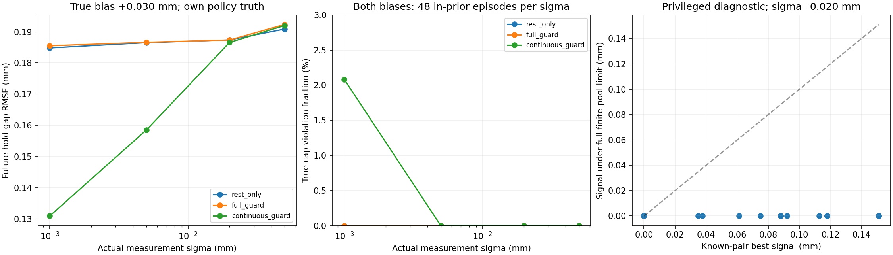

# 행동 간격·관측 정밀도·두 상태 진단

**행동 간격은 일부 원인이었지만, 연속 입력으로 예측이 좋아진 것을 같은 안전 조건에서의 개선이라고 할 수는 없다.** 새로운 연속 입력 기준선이 실제 한도를 넘긴 사례가 1개 있었고, 그 참 상태는 사전·관측 오차 조건을 만족했다. 기존 동적 계산기로도 위반을 재현했다. 가장 먼저 해결할 문제는 유한 후보의 연속 영역 누락이다.



기존 26개 합성 상태에서 새 paired noise를 생성했다. 각 sigma 조건에서 실제 생성 잡음과 추정기의 sigma를 같이 바꿨다. 잡음은 유지한 채 허용 오차만 줄이는 실험이 아니다. 같은 표준정규 난수를 정책과 정밀도 조건에 공유하므로 독립 반복으로 세지 않는다.

coarse는 기존 7개 입력, continuous는 같은 유한 후보에서 누적 손상 한도까지의 입력 범위를 계산하고 관측 차이 proxy를 전역 최대화한다. 위험 후보는 두 정책 모두 161²다. 파라미터 영역은 여전히 유한 격자다.

## 범위 안 24개 상태, 실제 편향 +0.030mm, 2단계 폐루프

| 실제 잡음 sigma (mm) | 정책 | 미래 RMSE (mm) | 실제 손상 한도 위반 | 최대 추가 D | 321² 금지 선택 수 / 48 | 감사 후보 최대 추가 D | 빈 집합 단계 |
| --- | --- | ---: | ---: | ---: | ---: | ---: | ---: |
| 0.001 | rest_only | 0.1848 | 0.0% | 0.00000 | 대상 아님 | 대상 아님 | 0 |
| 0.001 | full_guard | 0.1855 | 0.0% | 0.00000 | 0 | 0.01759 | 0 |
| 0.001 | continuous_guard | 0.1309 | 0.0% | 0.01942 | 30 | 0.03434 | 0 |
| 0.005 | rest_only | 0.1865 | 0.0% | 0.00000 | 대상 아님 | 대상 아님 | 0 |
| 0.005 | full_guard | 0.1866 | 0.0% | 0.00000 | 0 | 0.01544 | 0 |
| 0.005 | continuous_guard | 0.1585 | 0.0% | 0.01155 | 31 | 0.04210 | 0 |
| 0.020 | rest_only | 0.1874 | 0.0% | 0.00000 | 대상 아님 | 대상 아님 | 0 |
| 0.020 | full_guard | 0.1874 | 0.0% | 0.00000 | 1 | 0.02080 | 0 |
| 0.020 | continuous_guard | 0.1866 | 0.0% | 0.00000 | 25 | 0.06835 | 0 |
| 0.050 | rest_only | 0.1909 | 0.0% | 0.00000 | 대상 아님 | 대상 아님 | 0 |
| 0.050 | full_guard | 0.1924 | 0.0% | 0.00000 | 0 | 0.01862 | 0 |
| 0.050 | continuous_guard | 0.1920 | 0.0% | 0.00000 | 26 | 0.05146 | 0 |

## 실제 한도 위반도 발생했다

범위 안 전체 조건에서 연속 입력 정책의 실제 한도 위반은 1회였다. 대표 +0.030mm 조건 표만으로 안전성을 판단하면 안 된다. counterexample-audit.json에 참 파라미터의 관측 제약 부합, 후보 격자별 최댓값, 기존 동적 계산기의 같은 준비/행동 재생을 남겼다. 성공한 예측 오차를 같은 연속 안전 조건에서의 개선이라고 주장하지 않는다.

실제 위반은 `case-012`, 측정 잡음 0.001mm, 실제 편향 0 조건에서 발생했다. 기준 손상은 최초 약한 관측 직후 값으로 고정했다. 두 결정 시점 모두 실제 참 파라미터가 관측 제약을 만족했고, 발생한 잡음과 편향도 가정한 경계 안이었다.

| 결정 단계 | 선택 입력 (mm) | 161² 후보 최대 추가 D | 321² 후보 최대 추가 D | 641² 후보 최대 추가 D | 실제 추가 D |
| --- | ---: | ---: | ---: | ---: | ---: |
| 1 | 1.186565 | 0.020000 | 0.034236 | 0.041654 | 0.010328 |
| 2 | 1.196110 | 0.020000 | 0.032756 | 0.039354 | **0.036392** |

기존 동적 적분기에 같은 구동부 준비 입력과 실제 선택한 행동을 순서대로 재생했다. 위치·속도·최대 벌어짐·시계·일/소산을 초기화하지 않았다. dt=4e-5/2e-5초의 최종 추가 D는 각각 0.0363911409/0.0363911412였고, 준정적 계산과 차이는 약 5.78e-7이었다. 현재의 느린 하중 프로토콜에서 위반이 준정적 근사만으로 생겼다고 보기 어렵다. 641² 결과도 연속 영역의 유효 상한이라는 뜻은 아니다.


## 정확히 최대화한 것은 관측 차이 proxy다

후보별 다음 출력은 입력에 대해 구간별 affine이다. 조건부 센서 offset을 더해도 affine 구조는 유지된다. 후보 분산은 각 구간에서 convex quadratic이므로 최대는 끝점이나 모드 경계에서 생긴다. 정렬한 경계에서 가중 moment를 갱신하는 표준 계산으로 후보 수의 제곱 크기 rollout을 피했다.

손상 한도 입력은 기존 bilinear D 법칙의 역함수로 계산한다. 분리는 작은 수치 여유로 배제한다. 이는 현재 안정 단조 스칼라 모형과 유한 후보에 한정된다. 진짜 mutual information·미래 오차 감소·연속 물리 상태의 안전 상한은 아니다.

## 정답 두 상태만 안다는 특권 진단

같은 약한 반응을 보이는 18개 설계 상태 쌍을 사용했다. 초기 관측은 잡음이 실현된 값이 아닌 평균값으로 고정했다. 두 상태만 가능한 경우와 전체 사전 격자를 유지하는 경우의 허용 입력·반응 차이를 비교한다. 이 정보는 실제 정책에 주지 않았다. 아래 주 표는 기존 입력 범위 1.85mm 이하다. 각 통계 열을 따로 요약했으므로 신호 중앙값을 오류 식에 넣으면 오류 중앙값과 다를 수 있다.

| sigma (mm) | 전체 집합의 bias 범위 (mm) | 두 상태만 아는 경우: 반응 차이 중앙값 (mm) | 전체 집합 제한: 차이 중앙값 (mm) | 두 상태 단일 관측 오류 중앙값 | 전체 제한 오류 중앙값 |
| --- | --- | ---: | ---: | ---: | ---: |
| 0.001 | ±0.000 | 0.08805 | 0.00621 | 0.000 | 0.250 |
| 0.001 | ±0.150 | 0.08805 | 0.00610 | 0.000 | 0.250 |
| 0.005 | ±0.000 | 0.08805 | 0.00000 | 0.000 | 0.500 |
| 0.005 | ±0.150 | 0.08805 | 0.00000 | 0.000 | 0.500 |
| 0.020 | ±0.000 | 0.08805 | 0.00000 | 0.014 | 0.500 |
| 0.020 | ±0.150 | 0.08805 | 0.00000 | 0.014 | 0.500 |
| 0.050 | ±0.000 | 0.08805 | 0.00000 | 0.189 | 0.500 |
| 0.050 | ±0.150 | 0.08805 | 0.00000 | 0.189 | 0.500 |

입력 최대치를 2.30mm로 넓힌 특권 두 상태 진단도 별도로 계산했다. 이는 실행 정책의 행동 범위를 사후에 바꾼 결과가 아니다.

| 입력 범위 | 두 상태 최적 반응 차이 중앙값 (mm) | 동일 반응 쌍 / 18 |
| --- | ---: | ---: |
| ≤1.85mm | 0.08805 | 3 |
| ≤2.30mm | 0.09663 | 0 |

입력 범위가 제한돼서 생기는 동일 반응을 손상 한도의 근본 한계라고 부르지 않는다. 현재 폐루프 정책은 1.85mm 범위 그대로이며 넓은 범위는 진단용이다.

## 초기에 약한 반응을 완벽하게 알아도 남는 모호성

알려진 bias와 정확한 초기 unloading 강성 q를 가정하면 D=1-q를 알 수 있다. 하지만 Gc와 과거 최대 벌어짐은 하나로 정해지지 않고 연속 곡선을 이룬다. 이 제한된 무잡음 곡선에서는 손상 한도 입력이 Gc에 따라 증가하므로 최소 Gc 끝점에서 한 번의 행동 허용치를 해석적으로 계산할 수 있다. 일반적인 잡음 있는 2D 영역의 보장은 아니다.

| 강성 비율 q | 정확한 초기 반응으로 허용되는 입력 상한 (mm) | 그 범위에서 다음 반응이 같은 설계 쌍 / 6 |
| --- | ---: | ---: |
| 0.06 | 1.75000 | 3 |
| 0.08 | 1.61345 | 3 |
| 0.10 | 1.52113 | 3 |

이는 다음 한 번의 반응에 대한 진단이다. 다른 저에너지 가설을 먼저 배제한 뒤 더 큰 입력을 허용하는 다단계 전략까지 불가능하다는 뜻은 아니다. 단순한 행동 세분화·큰 encoder만으로 모든 모호성이 사라진다고 볼 수 없다는 근거로 한정한다.

## 해석의 범위

단일 관측 오류 Phi(-|차이|/(2 sigma))는 두 상태·동일 사전확률·알려진 센서 bias·Gaussian scalar 관측에서의 이진 판별 오류다. 전체 연구의 정보 한계나 여러 번의 적응 관측에 대한 하한이 아니다. 18쌍도 독립 시편이 아니며 재료/이력 설계 상태들을 공유한다. 미래 분리 결과가 다른 쌍과 아닌 쌍도 JSON에서 구분한다.

더 낮은 sigma는 가상 조건이며 실제 카메라에서 달성했다고 하지 않는다. 관측 집합이 비거나 격자 간 판정이 바뀌면 정밀도 향상의 효과와 후보 해상도 부족을 구분해야 한다. 기존 결과를 덮어쓰지 않았고 새 하이퍼파라미터를 시험 정답으로 선택하지 않았다.

## 구현과 재현

실행 `20261028T134814998946Z-action-ceiling-diagnostic`에서 26개 상태×4개 정밀도×2개 편향×3개 정책=624개 정책 실행을 수행했다. 18개 상태 쌍×4개 sigma×2개 bias 경계=144개 특권 진단도 계산했다. 독립 시편 수를 늘린 결과가 아니다. 제어·예측·감사·실패 재생까지 CPU에서 약 29.1초였다.

```powershell
.\scripts\run-wsl.ps1 python scripts/action_ceiling_diagnostic.py
.\scripts\run-wsl.ps1 test -q
```

설정은 `config/action-ceiling-diagnostic.json`, 입력 한도·관측 분산 proxy 최적화·정확한 초기 unloading 곡선 진단은 `wmfracture/action_ceiling.py`, 실제 제어는 `wmfracture/damage_guard.py`, 실행기는 `scripts/action_ceiling_diagnostic.py`다. `artifacts/action-ceiling-diagnostic/`에 결과·결정·특권 진단·실패 재생을 저장했다. 원본 실행에는 public/private 데이터·posterior·고정된 미래 예측·소스 snapshot·물리 설정이 있다. 현재 소스와 실행 시 소스 해시의 일치도 확인했다.

기존 합성 실행의 관측과 결과는 바꾸지 않았다. 특권 쌍과 정확한 초기 강성 곡선 정보는 실행 정책에 제공하지 않는다. 세밀한 파라미터 격자 감사와 실제 실패 재생도 결정 이후의 진단이다. 입력 최적화의 추가 direct query·해석적 한도 계산 후보 수·moment 경계 갱신 수는 결정별 비용에 별도로 남겼다. logical cycle 조회량을 전체 실행 시간으로 바꾸어 해석하지 않는다.

전체 테스트 **141개**가 통과했다. 새 11개 검사는 해석적 한도와 직접 위험 이분법의 일치, 빈/기존 위반 집합 처리, 구간 경계 sweep과 조밀한 행동 탐색의 일치, 0 입력에서 공유 bias 처리, 같은 prefix에서 coarse 대비 proxy 최댓값 유지, 내부 모드 경계의 최댓값, 정확한 unloading 곡선의 연속 Gc 구간·준비 입력 경계를 포함한다. 실패 사례는 별도 실제 실행에서 두 dt의 동적 계산으로 확인했다.

## 연구 판단과 다음 개발

- **행동 격자 문제는 일부 해결 가능했다.** 0.005mm 잡음의 대표 조건에서 기존 7개 입력의 RMSE 0.1866mm가 연속 입력의 0.1585mm로 줄었다. 0.020mm 조건에서는 0.1874→0.1866mm로 개선이 작았다. 추정/관측 문제가 모두 제어 해상도 때문인 것은 아니다.
- **관측을 더 정확히 한다고 유한 후보 위험 검사가 자동으로 유효해지지는 않았다.** 0.001mm 조건에서 실제 한도 위반이 나왔다. 참 상태가 범위 밖이거나 잡음이 가정을 벗어난 사례가 아니다.
- **특권 두 상태의 구별 가능성을 일반 정책의 성능으로 쓰지 않는다.** 1.85mm 범위와 2.30mm 범위도 분리했다. 현재 모형에서는 넓은 가설 집합을 유지하는 비용이 있으며, 한 번에 같은 반응이 나온다고 긴 순차 실험 전체가 불가능한 것은 아니다.
- **후속 주개발은 연속 위험 검증 기준선이다.** 유한 샘플을 더 늘리는 것과, 가능한 연속 파라미터 영역의 위험을 유효하게 제한하는 것을 구분한다. 현재 반례를 회귀 사례로 보존했고 아래 후속 기록처럼 관측 제약·상태 이력·분기 경계를 포함하는 조건부 상한 계산을 구현했다.

새 검증기가 생기더라도 원래 full-grid 기준선·단순 위험 증거·정보 top8과 전체 비용 및 예측/기권을 비교해야 한다. 이 단계의 해석식·표준 moment sweep·실패 진단 자체를 높은 신규성의 논문 기여로 확정하지 않는다.

이후 [조건부 연속 영역 검증기](CONTINUOUS_RISK_PROBE.md)를 구현해 이 반례의 입력을 거부하고 허용 증거가 있는 작은 입력으로 바꾸는 회귀 실행을 수행했다. 현재 모형/오차 가정에 한정된 기준선이며 새로운 시험 집합의 성능은 별도 평가가 필요하다.
