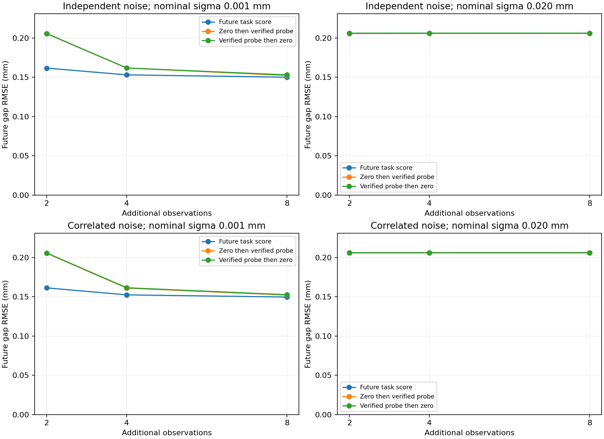

# 무하중과 검증 입력을 교대하는 강한 기준선

앞선 [목표 미래용 폐루프](TASK_AWARE_PILOT.md)가 고정 증가 계획보다 적은 큰 입력을 사용했다는 관찰을 점검한다. 별도의 미래 점수 없이 **무하중과 검증된 큰 입력을 번갈아 선택하는 규칙**으로 비슷한 결과를 얻는지 비교한다. 이전과 같은 12개 개발 상태와 잡음을 재사용하는 후속 기준선 실험이다.

**8회 관측의 주 비교에서 미래 점수의 우위를 확보하지 못했고, 단순 교대 규칙의 계산 시간이 더 작았다.** 낮은 잡음·짧은 관측 예산에서는 미래 점수가 더 낮은 오차를 보였지만 큰 입력을 더 일찍 사용했다. 그 차이를 복잡한 목적함수의 독자 기여로 해석하려면 초기 집중 입력 계획과 추가 비교가 필요하다.



## 결과

288개 실행이 모두 추가 관측 8회를 완료했다. 실행 증거 **2,304개**를 새 cold 검사기로 재검사했고 실제 손상 한도 위반과 예산 미충족은 0이었다. 864개 checkpoint의 최종 예측도 32·64 해상도 비교를 모두 통과했다. 전체 테스트 **215개**를 통과했다.

8회 관측의 미래 벌어짐 RMSE는 다음과 같다. 단위는 mm다. 각 칸은 같은 12개 상태를 두 편향에서 반복한 24조건이며 독립 시편 24개가 아니다.

| nominal sigma | 잡음 | 미래 점수 | 무하중 우선 교대 | 큰 입력 우선 교대 |
| --- | --- | ---: | ---: | ---: |
| 0.001mm | 독립 | 0.15011 | 0.15233 | 0.15307 |
| 0.001mm | 상관 | 0.14970 | 0.15216 | 0.15263 |
| 0.020mm | 독립 | 0.20595 | 0.20591 | 0.20617 |
| 0.020mm | 상관 | 0.20616 | 0.20600 | 0.20612 |

주 비교인 0.020mm·8회에서 `미래 점수 − 무하중 우선 교대`의 RMSE 차이는 독립 +0.0000445mm, 상관 +0.0001596mm였다. 미래 점수의 점 추정 오차가 더 작지 않았다. 10개 생성 cluster의 서술적 재표집 95% 범위는 각각 [−0.000462, +0.000532]mm, [+0.0000681, +0.000259]mm다. 작은 같은 법칙의 개발 집합이므로 일반 모집단의 우위나 비열등성 판정으로 확대하지 않는다.

0.001mm에서 미래 점수는 무하중 우선 교대보다 점 추정 오차가 약 1.5~1.6% 작았지만 두 재표집 범위 모두 0을 포함했다. 큰 입력 우선 교대와의 보조 비교에서는 저잡음 차이 범위가 음수였지만, 주 비교를 바꾸거나 일반적인 우위를 주장하는 근거로 쓰지 않는다.

## 계산 시간과 초기 입력 배치

같은 캠페인의 평균 **8단계 정책 합계 시간**이다. 제안·증거 검사·적분·점수·선택 증거 저장을 포함하며 관측 생성과 공통 최종 예측은 제외한다.

| nominal sigma | 잡음 | 미래 점수 | 무하중 우선 교대 | 큰 입력 우선 교대 |
| --- | --- | ---: | ---: | ---: |
| 0.001mm | 독립 | 2.263s | 1.275s | 1.173s |
| 0.001mm | 상관 | 1.978s | 1.163s | 1.165s |
| 0.020mm | 독립 | 1.343s | 0.856s | 0.698s |
| 0.020mm | 상관 | 1.515s | 0.711s | 0.767s |

여기서 시간 절감은 미래 점수 계산만의 제거 효과로 분해한 값이 아니다. 교대 규칙은 무하중 단계의 큰 입력 후보 검색도 생략하므로 전체 정책 절차와 입력 이력이 다르다. 균형 있게 실행 순서를 바꾼 한 번의 CPU 측정이며 독립 하드웨어 반복 실험은 아니다.

짧은 예산에서는 다른 양상이 있었다. 0.001mm·독립 잡음의 2회 관측 RMSE는 미래 점수 **0.16171mm**, 무하중 우선 **0.20551mm**, 큰 입력 우선 **0.20578mm**였다. 다만 약한 기준보다 큰 입력 횟수는 각각 평균 **1.29회 / 1회 / 1회**였다. 4회에서는 미래 점수가 2.375회, 두 교대 규칙은 2회였다. 같은 관측 수와 손상 한도로 비교했지만 큰 입력의 횟수와 시점이 완전히 일치하지 않는다.

따라서 초기의 큰 입력을 앞쪽에 모아 쓰고 나중에 무하중 관측을 하는 고정 계획과 대조해야 한다. 현재 결과는 **관측 예산이 짧을 때의 입력 배치 효과**라는 후속 가설을 제공한다. 미래 점수의 성능 이득이나 단순 규칙과의 동등성을 입증한 결과는 아니다.

## 기존 결과 재현과 검증 범위

future_task의 이전 입력·관측 checkpoint **288개**가 정확히 재현됐고, 두 적분 해상도의 기존 평가 **576행**도 수치 허용 범위 안에서 일치했다. 원본 참조 네 파일의 해시는 유지됐다. 각 정책은 첫째·둘째·셋째 실행 위치에 각각 **32회**씩 배치됐다.

관측 상태와 잡음은 이전 pilot에서 본 같은 12개이며 새 독립 물리 상태 검증이 아니다. 높은 잡음에서 모든 정책의 실제 추가 손상은 0이었지만, 이를 정보 획득이 원리적으로 불가능하다는 근거로 해석하지 않는다. 현재 법칙·사전·관측·행동 탐색 절차 안의 결과다.

실행은 `20261029T053250932172Z-alternating-frontier`다. 순차 실행 359.22초, 공통 최종 예측 25.76초였으며 추가 cold 증거 재검사와 평가는 별도다. [전체 보고서](results/alternating-frontier.json) · [조건별 평가](results/alternating-frontier-evaluation-rows.json) · [짝지은 비교·시간](results/alternating-frontier-analysis-summary.json) · [정확 재생·실행 위치](results/alternating-frontier-control-replay.json) · [비교 설정](results/alternating-frontier-comparison-config.json)

## 비교를 고정한 방법

| 정책 | 추가 관측의 순서 | 큰 입력의 크기 |
| --- | --- | --- |
| future_task | 가상 관측으로 미래 예측 분산 감소를 비교 | 검증된 후보 중 점수로 선택 |
| alternating_zero_first | 무하중 → 큰 입력 → 반복 | 같은 상한 제안·위험 필터가 찾은 입력 |
| alternating_probe_first | 큰 입력 → 무하중 → 반복 | 같은 상한 제안·위험 필터가 찾은 입력 |

무하중 우선 버전을 주 비교로, 큰 입력 우선 버전을 순서 민감도 비교로 실행 전에 고정했다. 결과가 좋은 순서를 나중에 골라 주 비교를 바꾸지 않는다. 추가 관측 2·4·8회에서는 두 교대 방식이 각각 같은 수의 무하중/큰 입력 기회를 갖지만, 비가역적인 손상과 새 관측 때문에 실제 크기와 이후 이력은 달라질 수 있다.

교대 규칙이 고정하는 것은 **관측 종류의 순서**다. 진폭은 공개 관측을 반영한 같은 위험 검사로 정한다. 완전히 고정된 입력 궤적이나 추론이 전혀 없는 제어라고 부르지 않는다. 생략하는 것은 Gaussian posterior 적분·가상 관측·미래 효용 점수다.

## 검증 입력이 뜻하는 범위

큰 입력은 `PublicRiskBank`의 유한 상태가 제안한 상한을 기존 연속 영역 검증기에 통과시켜 찾는다. 위험이 확인되거나 수치 예산에서 미확정이면 같은 8회 bisection을 수행한다. 그 결과는 주어진 검색 절차에서 찾은 허용 입력이며, 연속 행동 전체의 최대 안전 입력이라는 뜻은 아니다.

무하중 단계도 실제로 실행할 0 입력의 증거를 검사한다. 최초 두 관측 뒤 상태에 둔 누적 손상 한도 0.02를 유지하며, 교대하거나 제하할 때 기준 손상을 초기화하지 않는다. 검색기와 증거 재검사기의 캐시도 분리한다.

기준선의 구현은 `wmfracture/alternating_frontier.py`다. 공개 이력·알려진 법칙·잡음 경계로 후보를 검사한다. 미래 명령이나 posterior 설정을 읽지 않는지 테스트했다.

## 같은 데이터에서 다시 비교하기

이전 pilot의 12개 물리 상태, 2개 nominal sigma, 2개 공통 편향, 2개 잡음 상관 조건을 그대로 사용한다. 각 조건의 세 정책은 같은 초기 준비와 같은 관측 시점별 잡음 스트림을 공유한다. 새 정책의 관측은 해당 정책이 실제로 선택한 입력에서 물리 계산으로 생성한다.

future_task도 새 실행으로 다시 계산한다. 2·4·8회 checkpoint의 입력과 관측이 이전 공개 기록과 정확히 같은지 확인하고, 예측을 고정한 뒤 정답 평가 수치도 이전과 일치하는지 검사한다. 단순한 기준선의 새 시간과 과거 future_task의 실행 시간을 섞어 속도비를 계산하지 않는다.

세 정책의 실행 위치는 조건마다 회전시켜 균형을 맞춘다. 각 정책은 매번 새로운 컨트롤러·캐시로 시작한다. 시간은 같은 캠페인의 CPU wall 기록이며 여러 하드웨어의 반복 성능 검증은 아니다.

12개 물리 상태는 설계한 10개 생성 cluster를 공유한다. 조건별 표의 24개는 같은 상태를 두 편향에서 반복한 수다. 이전 결과를 본 뒤 추가한 강한 기준선 점검이며 새로운 독립 물리 상태 시험이나 비열등성 검증을 주장하지 않는다.

## 재현

참조용 공개 기록도 저장소에 포함한다. 과거 개인 실행 폴더 없이 같은 물리 상태와 잡음을 다시 생성할 수 있다. [CPU 환경과 변수](REPRODUCING.md)를 준비한 뒤 실행한다.

```powershell
.\scripts\run-wsl.ps1 python scripts/alternating_frontier_evaluate.py
# 출력된 OUTPUT 경로를 RUN에 넣는다.
.\scripts\run-wsl.ps1 python scripts/report_alternating_frontier.py --run RUN
.\scripts\run-wsl.ps1 test -q
```

일반 CPU 환경에서는 같은 Python 파일을 직접 실행한다. 설정과 주 비교·순서 대조·실행 순서 규칙은 `config/alternating-frontier.json`에 있다. 선택과 관측을 고정한 뒤 모든 정책의 미래를 같은 guided 적분기로 예측하고, 새 cold 검사기로 실행 증거를 다시 확인한다.
