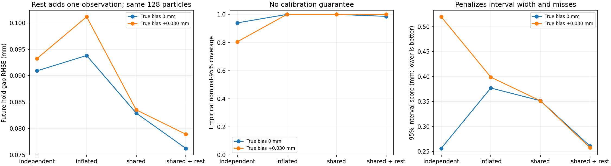

# 공통 측정 편향을 고려한 추론 기준선

동일한 이전 관측을 유지하고 오차 가정만 바꾼 개발 진단이다. 참 편향·물성을 추정기에 제공하지 않는다. 26개 물리 사례·312개 관측 조건이며 독립 시편 312개가 아니다.



- independent: 기존 독립 잡음만 가정.
- inflated: 매 관측의 잡음 폭을 sqrt(sigma²+tau²)로 확대. 공통 편향의 시간 상관은 무시.
- shared: 관측 구간 전체에서 같은 b를 사용. b~N(0,tau²)를 적분해 공분산 sigma²I+tau²11ᵀ를 사용.

- shared_rest: 실제 하중 관측 3회에 더해, 무하중 틈이 0이라는 모형의 기준점에서 합성 관측 1회를 추가. 추가 손상은 없지만 관측 예산은 1회 더 쓴다.

주 결과는 tau=0.050mm로 고정했다. 0.010/0.100mm 민감도 결과도 별도 방법으로 남겼고, 정답으로 최적 폭을 선택하지 않았다. 같은 물리 사전분포·하중·SMC 예산을 사용한다.

## 범위 안 24개 사례, 관측 sigma=0.020mm, 고정 탐색 입력, 관측 3회

| 실제 조건 | 방법 | 미래 RMSE (mm) | 명목 95% 포함률 | 평균 구간 폭 (mm) | 구간 점수 ↓ (mm) | 분리 Brier | 편향 RMSE (mm) |
| --- | --- | ---: | ---: | ---: | ---: | ---: | ---: |
| 실제 편향 없음 | grid81_independent | 0.0703 | 100.0% | 0.2141 | 0.2141 | 0.0156 | — |
| 실제 편향 없음 | grid81_inflated | 0.0891 | 100.0% | 0.3880 | 0.3880 | 0.0213 | — |
| 실제 편향 없음 | grid81_shared | 0.0775 | 100.0% | 0.3569 | 0.3569 | 0.0238 | 0.0221 |
| 실제 편향 없음 | grid81_shared_rest | 0.0755 | 100.0% | 0.2601 | 0.2601 | 0.0182 | 0.0156 |
| 실제 편향 없음 | smc128_independent | 0.0909 | 94.0% | 0.2132 | 0.2562 | 0.0295 | — |
| 실제 편향 없음 | smc128_inflated | 0.0938 | 100.0% | 0.3772 | 0.3772 | 0.0235 | — |
| 실제 편향 없음 | smc128_shared | 0.0829 | 100.0% | 0.3517 | 0.3517 | 0.0253 | 0.0268 |
| 실제 편향 없음 | smc128_shared_rest | 0.0762 | 98.6% | 0.2594 | 0.2608 | 0.0227 | 0.0164 |
| +0.030mm 편향 | grid81_independent | 0.0842 | 80.6% | 0.2342 | 0.4610 | 0.0545 | — |
| +0.030mm 편향 | grid81_inflated | 0.0949 | 100.0% | 0.4106 | 0.4106 | 0.0347 | — |
| +0.030mm 편향 | grid81_shared | 0.0754 | 100.0% | 0.3703 | 0.3703 | 0.0323 | 0.0275 |
| +0.030mm 편향 | grid81_shared_rest | 0.0744 | 100.0% | 0.2642 | 0.2642 | 0.0204 | 0.0158 |
| +0.030mm 편향 | smc128_independent | 0.0932 | 80.6% | 0.2186 | 0.5198 | 0.0520 | — |
| +0.030mm 편향 | smc128_inflated | 0.1012 | 100.0% | 0.3990 | 0.3990 | 0.0352 | — |
| +0.030mm 편향 | smc128_shared | 0.0835 | 100.0% | 0.3515 | 0.3515 | 0.0318 | 0.0279 |
| +0.030mm 편향 | smc128_shared_rest | 0.0789 | 100.0% | 0.2576 | 0.2576 | 0.0223 | 0.0159 |

## 해석과 한계

공통 편향 추정은 정확한 Gc·손상 이력·편향의 유일 식별을 보장하지 않는다. 약한 입력만 반복하면 물리 변화와 offset을 분리하지 못할 수 있다. 편향 posterior는 여러 물리 가설을 섞은 분포라 평균·표준편차만 저장하고 이를 Gaussian 95% 구간이라고 부르지 않는다.

95% 구간 점수는 폭 + 40×구간 밖 정답까지의 거리다. 작을수록 좋으며, 넓히기만 한 구간과 과도하게 좁은 구간을 모두 벌점화한다. 경험 포함률이 100%라는 사실만으로 보정됐다고 하지 않는다.

rest 관측은 원래 데이터에 없던 추가 합성 값이다. 무하중 출력=0·동일 offset 유지·독립 측정 잡음을 가정한다. 실제 장치에서 기준점이 불명확하거나 편향이 시간에 따라 변하면 이 보정이 성립하지 않는다. 이 단순 보정을 먼저 비교하지 않고 능동 개입의 필요성을 주장하지 않는다.

실제 편향 0인 조건에서는 공유 편향을 허용한 만큼 불확실성이 커지거나 점 예측이 나빠질 수 있다. 각 조건·잡음·프로토콜을 나눠 읽어야 한다. 이 데이터의 조건은 알려진 고정 bias이므로 사전분포에서 bias를 무작위 추출한 보정 시험과도 다르다.

기존 고정 탐색 하중은 그대로여서 손상을 줄인 실험이 아니다. 모델링한 것은 한 구간 내 일정 offset뿐이며 scale·drift·추적 실패·물리 법칙 불일치는 다루지 않는다. 표준 Gaussian nuisance 추론/SMC로 새로운 방법이나 논문 기여를 주장하지 않는다.

조밀한 격자도 수렴 정답이 아니며, 81²→321² 최종 단계 민감도는 grid-refinement.json에 별도로 기록했다. 원래 실험의 결과/관측은 변경하지 않았다.

추가 격자 검사는 rest를 제외한 independent/inflated/shared의 최종 관측 단계만 대상으로 한다. 평균 미래 벌어짐의 81²→321² 최대 차이는 각각 0.14743/0.00479/0.00503mm였고, 분리 질량 차이는 0.24753/0.03043/0.03236이었다. 특히 원래 독립 잡음 모델의 좁은 posterior에서는 81²를 연속 정답으로 볼 수 없다. 같은 조건의 두 격자 비교만으로 연속 영역 보장이 생기는 것도 아니다.

## 구현과 재현

2026-10-28 실행 `20261028T113748852131Z-bias-aware-filter`의 결과다. 추정 약 16.0초, 예측·평가·격자 검사까지 약 51.2초였다. CPU 실행이며 실제 카메라 성능이나 GPU 처리량을 측정한 값이 아니다.

```powershell
.\scripts\run-wsl.ps1 python scripts/bias_aware_filter.py
# 다른 기존 synthetic-filter 실행을 입력으로 지정할 수도 있다.
.\scripts\run-wsl.ps1 python scripts/bias_aware_filter.py --source-run /home/richard/research/world-model-research/runs/20261028T112246469806Z-synthetic-filter-benchmark
.\scripts\run-wsl.ps1 test -q
```

설정은 `config/bias-aware-filter.json`, 공통 편향 계산은 `wmfracture/measurement_bias.py`, 실행기는 `scripts/bias_aware_filter.py`다. `artifacts/bias-aware-filter/`에서 최신 요약·전체 조건 표·개별 평가·편향 추정·격자 차이를 볼 수 있다. 원본 실행에는 소스 snapshot과 해시, 물리 설정, 별도 추정 입력, 평가 전용 metadata/정답, posterior 및 고정한 미래 예측을 보관한다.

추정 입력에서 실제 편향 조건 이름·case ID·정답 파라미터를 제거했다. 미래 행동도 추정 후 별도 예측 단계에서 적용하며, 물리 벌어짐 예측에 센서 편향을 더하지 않는다. 공통 편향이 있는 SMC는 새 관측의 독립 likelihood 대신 전체-prefix likelihood 비율로 갱신한다. 이전 관측을 중복 계산하지 않고 각 MCMC 제안마다 물리 이력을 다시 만든다.

전체 테스트 **120개**가 통과했다. 추가 검증은 직접 공분산 풀이와의 일치, bias posterior의 수치 적분 대조, 반복 관측에서 공통 편향이 사라지지 않음, 상관 관측의 순차/일괄 가중치 일치, 초기 다중 관측 갱신, 무하중 관측의 물리 이력 보존, 정답 없는 추정 실행과 센서/물리 출력 분리를 포함한다.

## 연구 판단과 다음 단계

이번에 확보한 것은 더 강한 표준 기준선이다. 알려진 영점이 있는 현재 합성 과제에서는 손상을 주는 탐색보다 먼저 무하중 관측을 활용할 수 있다. 이 쉬운 경로를 사용하지 않은 채 새 능동 관측법의 필요성을 주장하지 않는다. 초기 계획의 ‘공통 bias 처리’ 단계 이후, [유한 후보 위험 검사와 2단계 폐루프](FINITE_DAMAGE_GUARD.md)도 구현했다. 연속 영역 위험 경계는 아직 없다.

후속 실험에서 이 보정을 포함해 유한 후보의 누적 추가 손상을 검사하는 기준선을 만들고, 정보 계산용 소수 후보와 위험 검사 집합을 분리했다. 이어 [현재 준정적 모형의 조건부 연속 영역 검사](CONTINUOUS_RISK_PROBE.md)를 구현했다. 관측/물리 모델이 틀린 경우까지 안전하다는 주장은 하지 않는다. 유용한 정보 획득과 더 넓은 역학으로의 확장은 남은 과제다.
