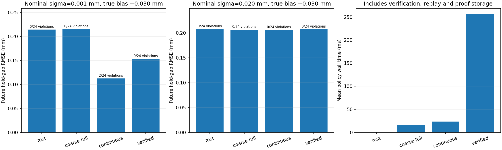

# 새로운 합성 상태에서의 연속 위험 필터 평가

**새 상태에서도 손상 제한과 예측 오차를 함께 비교했다.** 경계를 만족하는 96조건에서 검증 필터는 위반 0건, 검증 없는 연속 입력은 4건이었다. 낮은 가정 잡음에서는 보수적인 coarse 검사보다 예측이 좋아졌지만 0.020mm 조건의 이득은 작았고 계산 부담은 커졌다. 같은 알려진 스칼라 법칙 안의 결과이며 실물·일반 역학·새 방법의 신규성 증거로 확장하지 않는다.



물성·준비 이력이 이전 26개 상태와 겹치지 않는 24개 상태를 새로 생성했다. uniform 8개, 손상 시작 근처 8개, 같은 약한 반응을 갖는 4쌍(8개)이다. 20개 생성 cluster를 공유하므로 모든 관측 조건을 독립 시편으로 세지 않는다.

설정·seed·코드를 고정한 뒤 2개 sigma×2개 실제 bias×2개 잡음 방식×6개 정책을 실행했다. 총 1,152개 실행이며 같은 정책 비교에는 동일한 관측 잡음을 사용했다. 같은 sigma/bias 조합도 같은 상태를 반복 사용하므로 독립 반복이 아니다. 알려진 동일 물리 법칙 안의 개발 평가다.

## 오차 경계를 만족하는 주 평가

bounded_normal은 Gaussian 제안을 ±3 nominal sigma에서 rejection sampling한다. 실제 측정 표준편차를 실물에서 측정한 값이 아니며, 잘린 분포의 표준편차는 nominal sigma와 정확히 같지 않다. 추론기의 Gaussian weighting은 모든 정책에 같은 근사로 사용했고 posterior 보정 정리를 주장하지 않는다.

| 정책 | 실제 한도 위반 / 96 | 미래 RMSE (mm) | 최대 추가 D | 평균 계획·검증 시간 (ms) | 중간 질의 보류 | 중단 실행 |
| --- | ---: | ---: | ---: | ---: | ---: | ---: |
| rest_only | 0 / 96 | 0.2110 | 0.00000 | 0.00 | 0 | 0 |
| fixed_probe | 56 / 96 | 0.0547 | 0.92242 | 0.00 | 0 | 0 |
| full_guard | 0 / 96 | 0.2109 | 0.00028 | 17.10 | 0 | 0 |
| witness_guard | 0 / 96 | 0.2109 | 0.00028 | 14.34 | 0 | 0 |
| continuous_guard | 4 / 96 | 0.1658 | 0.06375 | 23.52 | 0 | 0 |
| verified_filter | 0 / 96 | 0.1822 | 0.01764 | 255.85 | 8 | 0 |

중간 질의 보류는 bisection 도중의 미확정 판정이다. 정책이 실제 행동을 하지 못해 중단한 실행 수와 다르다. 검증 필터는 판단 보류를 위험 증거로 바꾸지 않고, 마지막으로 검증된 입력만 실행한다.

96조건은 24개 상태를 두 nominal sigma와 두 실제 bias에서 반복한 수다. 96개의 독립 시편으로 해석하지 않는다. 이 주 평가에서는 실제 오차가 선언한 범위 안에 있었고, 참 파라미터도 각 정책의 관측 제약에 부합했음을 별도로 확인했다. 0건은 이 조건부 모형·평가에서의 결과다.

## 정밀도를 나눈 대표 조건: bounded normal, 실제 bias +0.030mm

| nominal sigma (mm) | 정책 | 미래 RMSE (mm) | 한도 위반 / 24 | 평균 전체 정책 시간 (ms) |
| --- | --- | ---: | ---: | ---: |
| 0.001 | rest_only | 0.2143 | 0 / 24 | 0.00 |
| 0.001 | full_guard | 0.2153 | 0 / 24 | 15.98 |
| 0.001 | continuous_guard | 0.1125 | 2 / 24 | 20.08 |
| 0.001 | verified_filter | 0.1533 | 0 / 24 | 326.50 |
| 0.020 | rest_only | 0.2076 | 0 / 24 | 0.00 |
| 0.020 | full_guard | 0.2063 | 0 / 24 | 17.85 |
| 0.020 | continuous_guard | 0.2058 | 0 / 24 | 26.50 |
| 0.020 | verified_filter | 0.2071 | 0 / 24 | 187.19 |

## 자르지 않은 Gaussian 대조군

| 정책 | 실제 한도 위반 / 96 | 실제 오차 경계 이탈 실행 | 미래 RMSE (mm) |
| --- | ---: | ---: | ---: |
| rest_only | 0 / 96 | 0 | 0.2109 |
| fixed_probe | 56 / 96 | 0 | 0.0497 |
| full_guard | 0 / 96 | 0 | 0.2134 |
| witness_guard | 0 / 96 | 0 | 0.2134 |
| continuous_guard | 2 / 96 | 0 | 0.1671 |
| verified_filter | 0 / 96 | 0 | 0.1800 |

이번 Gaussian 표본에는 실제로 3 sigma 경계를 넘은 오차가 없었다. 따라서 잡음 경계가 깨진 상황에 대한 안전 검증을 한 결과가 아니다. 정책과 sigma/bias에 공유한 난수를 독립 표본으로 곱해 계산하지 않는다. 경계 밖 잡음을 자르지 않는 동작은 별도 테스트로 확인했다.

## 비용과 추론/평가 분리

데이터 생성과 순차 제어는 65.73초, 공통 미래 예측은 11.12초, 평가까지 80.93초였다. CPU 구현이다. 정책 시간은 제안·warm bank·영역 검증·모든 중간 proof replay·실행 증거 저장을 포함한다. 관측 생성과 미래 예측은 이 정책 시간에서 제외하고 별도 집계했다.

warm bank의 논리 root 조회, 영역 수, proof replay 시간도 개별 평가에 있다. 고정된 정책 실행 순서와 프로세스 캐시 영향을 포함한 한 번의 CPU wall 측정이며, 속도 우위를 검증한 반복 timing 시험은 아니다. full과 witness의 작은 시간 차이를 성능 차이로 주장하지 않는다.

시간 표는 **행동 한 번이 아니라 2단계 실행 한 회의 합계**다. 주 평가 평균은 full 약 17.10ms, verified 약 255.85ms였다. 미래 예측 비용과 이상적인 관측 생성·실제 기계 이동 시간은 제외돼 있다. 서로 다른 형태의 연산인 float root 조회와 유리수 영역 검증을 같은 계산 단위로 취급하지 않고 wall 시간과 별도 카운터를 함께 기록했다.

예측은 실제 실행한 자기 정책의 마지막 상태에서 계산했고 private 정답을 읽기 전에 고정했다. 지연/중단도 실제 사용한 관측 수를 유지한다. 모든 실제 실행 allow proof를 행동 전에 재검사하고 평가 단계에서도 관측·입력과 대조했다. 중간 판정의 덮개는 즉시 검사했지만 저장하지 않고, 실제 실행한 입력의 전체 덮개만 원본 실행에 보관한다.

## 판단

1. 검증 없는 연속 입력의 실제 누락이 새 상태에서도 발생했다. 연속 영역 필터는 선언한 범위 안의 주 평가에서 한도를 지켰다.
2. 0.001mm 가상 정밀도에서는 coarse/rest 대비 예측 오차가 줄었지만, 검증 없는 연속 입력보다 보수적이었다. 같은 안전 요구를 만족하지 않는 방법의 낮은 오차를 공정한 안전 성능 우위라고 부르지 않는다.
3. 0.020mm 조건에서는 의미 있는 예측 이득을 확보했다고 보기 어렵다. 이 정도 오차에서도 유용한 관측을 얻는지는 여전히 해결되지 않았다.
4. 검증 시간 부담이 크다. 현재 구현은 제안/지지점의 물리 계산을 일부 반복하고 모든 중간 증거도 재검사한다. 실행 증거만 검사하는 개선이나 영역 재사용은 다음 비교 대상으로 두되 성능을 미리 주장하지 않는다.
5. 현재 결과는 같은 알려진 법칙의 scalar gap 입력이며 RGB·Gaussian splatting·실제 카메라·일반 3D/관성 운동의 결과가 아니다. 이 표준 proposal/backtracking/box verification 결합으로 높은 신규성이 확정되지 않는다.

## 구현·재현·검증

실행은 `20261028T153751462086Z-continuous-risk-evaluation`이며 한국 시각으로 2026-10-29에 해당한다. 설정은 `config/continuous-risk-evaluation.json`이다. 생성 전에 설정·seed·소스 snapshot을 저장했고 결과를 보고 물리/검사 파라미터를 다시 고르지 않았다. 이후 보고서 생성은 원본 결과의 해시를 확인하는 읽기 전용 분석으로 분리했다.

```powershell
# 기존 26개 상태와의 중복 검사에 이전 합성 실행 결과를 쓴다.
# 해당 결과가 없는 새 환경에서는 먼저 실행한다.
.\scripts\run-wsl.ps1 synthetic-filter-benchmark

.\scripts\run-wsl.ps1 python scripts/continuous_risk_evaluate.py
# 위 명령이 출력한 새 OUTPUT 경로를 --run에 넣는다.
.\scripts\run-wsl.ps1 python scripts/report_continuous_risk_evaluation.py --run /home/richard/research/world-model-research/runs/20261028T153751462086Z-continuous-risk-evaluation
.\scripts\run-wsl.ps1 test -q
```

`wmfracture/verified_policy.py`는 proposal과 검증된 지지점 후보만 받아 연속 검증·증거 재검사·보수적 bisection을 수행한다. 지지집합이나 zero 입력도 확인할 수 없으면 검증 없는 fallback을 실행하지 않고 중단한다. `scripts/continuous_risk_evaluate.py`는 새 데이터 생성·정책 실행·미래 예측·private 평가를 분리한다. `scripts/report_continuous_risk_evaluation.py`는 결과를 바꾸지 않고 표와 그림만 생성한다.

`artifacts/continuous-risk-evaluation/`에 요약·전체 조건별 수치·개별 평가·설정과 해시가 있다. 원본 실행에는 새 private states, public 관측, 실제 정책별 궤적, posterior와 고정된 미래 예측, 실행 proof 384개, 결정 해시와 소스 snapshot을 보관한다. 기존 26개 데이터/결과의 해시도 그대로 유지했다.

전체 테스트 **163개**가 통과했다. 새 검사는 위반 proposal 뒤에도 allow 증거가 있는 입력만 실행함, 지지집합 모순 시 무검증 zero fallback을 실행하지 않음, 예산 보류의 처리, 실제 bounded sampler의 tail rejection과 Gaussian의 비절단, 새 상태의 재현성·격자 밖 생성·이전 상태와 중복 거부, matched 쌍의 약한 반응 일치, 정답 파일 없이 정책이 실행됨을 포함한다. 실행 전에 모든 중간 증거를 검사했고, 평가 때 실제 실행 proof 384개도 현재 관측/행동과 대조해 다시 검사했다. 전체 테스트를 통과했다는 사실이 실물이나 미지 법칙의 안전성을 증명하는 것은 아니다.

## 다음 개발 판단

이 단계에서 얻은 것은 **한 반례를 막은 것을 넘어, 새 합성 상태에서의 제한된 예측/손상 절충을 확인한 표준 기준선**이다. 저오차 결과만을 근거로 관측 조건이나 적용 범위를 확대하지 않는다. 낮은 잡음 조건의 이득과 0.020mm 조건의 한계, 검증 비용을 함께 남긴다.

다음에는 같은 조건부 보장을 유지하면서 관측 영역·기준 이력·행동별 계산을 재사용해 비용을 줄일 수 있는지 비교한다. 새 관측이 들어올 때 예전 허용 영역을 그대로 신뢰하지 않고 갱신된 관측 및 실제 행동 이력과 함께 재검사해야 한다. 계산 재사용 자체도 표준 기준선과 비교하며, 단순 캐시 최적화를 새로운 논문 기여로 부르지 않는다. 관측 정밀도를 개선하는 추가 데이터 수집은 실제 관측 예산을 늘린 것으로 별도 평가해야 한다.
