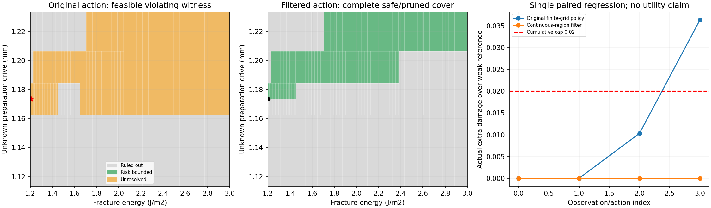

# 연속 파라미터 영역의 조건부 위험 검증

**이전 후보 격자의 누락을 잡는 연속 영역 검증기와 입력 필터를 구현했다.** 알려진 안정 준정적 법칙과 유계 관측 오차에 조건부인 첫 기준선이다. 형식 정리 증명·임의 동적 운동·실물 안전·새 방법의 신규성을 입증한 단계는 아니다.



왼쪽 두 그림은 준비 구동량 축을 확대했다. 증거 파일은 원래 파라미터 영역 전체를 다룬다. 회색은 관측과 모순돼 제외한 영역, 초록은 손상 상한이 확인된 영역, 주황은 미해결 영역이다. 주황 영역 전체가 위험하다는 뜻은 아니다. 빨간 별은 실제 관측 제약을 만족하는 위험 사례, 검은 점은 관측 지지점이다.

현재 안정 준정적 단일 접합면 모형에서 E=Gc와 관측하지 못한 준비 구동량 H의 연속 사각 영역을 다룬다. 점 몇 개의 최댓값을 상한으로 사용하지 않는다. Gaussian 잡음 대신 선언한 유계 오차·고정 bias 가정에 조건부인 계산이다.

## 기존 반례 입력 검사

| 질의 | 예산 | 결과 | 검증된 위험 하한 | 영역 전체 위험 상한 | 검사한 영역 수 |
| --- | ---: | --- | ---: | ---: | ---: |
| recorded-counterexample-round-0-small-budget | 1 | abstain | 0.020000 | 0.631286 | 1 |
| recorded-counterexample-round-0 | 4095 | reject | 0.041658 | 0.086023 | 225 |
| recorded-counterexample-round-1-small-budget | 1 | abstain | 0.020000 | 0.657063 | 1 |
| recorded-counterexample-round-1 | 4095 | reject | 0.032449 | 0.118488 | 103 |
| initial-rest-control | 4095 | allow | 0.000000 | 0.000000 | 1 |
| initial-weak-control | 4095 | allow | 0.000000 | 0.000000 | 1 |

하한은 모든 관측을 같은 물성·이력·bias로 만족시키는 실제 매개변수 점의 위험이다. 첫 입력의 실제 시편 손상은 0.0103이었지만 다른 가능한 상태에서 0.0417 이상의 손상을 보였으므로 최악 조건 기준으로 거부했다. 실패 검색에서 반례를 못 찾았다는 사실은 허용 근거가 아니다.

allow는 남은 전체 영역의 상한이 0.02 이하이며 새 분리도 배제하고, 관측에 맞는 점 하나도 확인했을 때만 반환한다. reject는 관측에 맞는 위반 점이 있을 때 반환한다. abstain은 예산 또는 지지집합 확인 부족이다. inconsistent는 전체 영역을 관측과 모순된다고 제외했을 때이며 안전 허용으로 바꾸지 않는다.

## 반례의 두 단계 입력을 실제로 걸러낸 회귀 실행

| 단계 | 원래 정책의 새 제안 (mm) | 검증 후 실행 (mm) | 허용 증거의 전체 영역 위험 상한 |
| --- | ---: | ---: | ---: |
| 1 | 1.186565 | 1.177295 | 0.018247 |
| 2 | 1.186565 | 1.177295 | 0.015751 |

같은 시편 매개변수와 난수를 사용한 새 준정적 궤적의 실제 추가 D는 0.000000, 원래 정책은 0.036392였다. 새 관측은 선택한 새 입력에서 다시 생성했으며 예전 행동의 관측을 재사용하지 않았다.

여기서 추가 손상 0은 정보를 잘 얻었다는 뜻이 아니다. 원래 실패한 한 사례를 막은 회귀 검증이며, 새로운 시험 집합의 예측·수행률 개선은 평가하지 않았다. 보수적인 bisection은 검사한 허용 입력을 선택할 뿐 최대 안전 입력이나 최적 정책을 보장하지 않는다. 판단 보류도 검색 상한을 줄이는 데 사용하며 이를 위험 증거라고 부르지 않는다.

## 영역을 빠뜨리지 않는 계산

안정적인 비음수 완전 하중/제하 주기에서는 현재 손상은 지금까지의 최대 구동량 R=max(H,관측 행동들)로 표현된다. D는 R에 따라 증가하고 E에 따라 감소한다. 따라서 각 관측 벌어짐도 H에 따라 증가하고 E에 따라 감소해 사각 영역의 대각 끝점으로 모든 관측을 감쌀 수 있다.

관측 y_i에 대해 공통 bias b가 [y_i-gap_max-radius, y_i-gap_min+radius]와 선언한 bias 범위 모두에 들어야 한다. 이 교집합이 비면 그 영역은 전부 제외할 수 있다. 남겨진 영역은 실제로 가능한 점을 포함할 수 있는 바깥 근사이며 임의로 feasible이라고 단정하지 않는다.

누적 손상은 동일한 준비량 H에서 기준 경로와 새 경로를 비교한다. 이 차이는 H에 대해 감소한다. 두 경로 모두에 H의 아래 끝점을 사용한 뒤 E 의존성은 이후 손상의 최댓값−기준 손상의 최솟값으로 감싼다. 영역을 쪼개면 이 차이가 좁아진다. 접착 시작·완전 분리의 분기는 정확한 비교로 처리하며 매 행동마다 손상 기준을 재설정하지 않는다.

계산은 입력으로 주어진 유한 숫자를 정확한 유리수로 해석하고 사칙연산·비교를 수행한다. float 보고값만 바깥 방향으로 반올림한다. 영역 경계와 이분할 증거는 유리수 문자열로 저장해 직렬화 반올림으로 틈이 생기지 않게 했다.

## 증거 재검사와 비용

각 결과는 관측 입력·실제 검사한 입력·지지점/bias·전체 분할 트리와 SHA를 포함한다. 재검사기는 분할이 원래 영역 전체를 덮는지, 제외가 타당한지, 허용 leaf의 상한과 분리 배제가 맞는지, 지지점이 실제 관측을 만족하는지 다시 계산한다. 사용처의 예상 관측·행동과도 대조한다. 정리 증명기로 구현의 수학까지 형식 검증한 것은 아니다.

유한 161² 후보 bank는 지지점과 위험 하한 후보 제안에만 쓴다. 모든 제안점은 유리수 계산으로 다시 검사한다. 그 bank가 빠뜨린 상태도 영역 상한에서는 제거되지 않는다. 유한 bank 구성·지지점 질의 비용은 warm-costs.json, 영역/점 수와 solve/replay 시간은 queries.json에 저장했다. 이 프로토타입으로 속도 우위나 새 알고리즘 기여를 주장하지 않는다.

## 적용 범위와 다음 평가

상한은 알려진 안정 준정적 스칼라 법칙·알려진 구동 입력·선언한 재료/준비 범위·유계 관측 오차에 조건부다. 임의 관성 운동, 시간에 따라 바뀌는 bias, 미지 물리 법칙, Gaussian 꼬리, 실제 물체를 보장하지 않는다. 이전 동적 재생에서 위반이 확인됐다는 사실도 새 허용 증거를 동역학 전체의 증명으로 만들지 않는다.

다음에는 새로운 상태·잡음에서 full-grid / 위험 증거 / 연속 영역 검증을 같은 조건으로 비교하고, 추가 손상뿐 아니라 예측 오차·수행/기권·전체 계산 비용을 평가한다. 이번에는 기존 반례와 공개된 초기 관측 8개의 회귀 진단을 했으므로 미사용 성능 시험으로 부르지 않는다.

이후 [새 합성 상태 평가](CONTINUOUS_RISK_EVALUATION.md)를 수행했다. 낮은 가정 잡음에서 제한된 예측/손상 절충을 확인했지만 높은 관측 오차와 검증 비용의 한계가 남았다. 이 문서의 단일 회귀 결과와 후속 평가를 구분한다.

## 상한 계산식과 가정

수치 입력을 정확한 실수 상수로 해석하는 현재 법칙에서 `d0=peak_traction/tensile_stiffness`, `c=area*peak_traction/spring`, `U0=d0+c`, `f=2*Gc/peak_traction`으로 둔다. 전체 사전 영역에서 `f>U0`인 안정 분기만 지원한다. 비음수 구동으로 완전 제하한 주기들의 최대 구동량이 R이면 손상은 다음과 같다.

```text
D(Gc,R) = 0                                            (R <= U0)
          1                                            (R >= f)
          f*(R-U0) / (f*(R-c) - R*d0)                   (otherwise)
```

이는 기존 bilinear cohesive 법칙을 구동량으로 다시 쓴 식이다. `D`는 R에 대해 증가하고 Gc에 대해 감소한다. 현재 행동의 유지 벌어짐은 그 행동까지의 최대 R을 사용한 `action*spring/(spring+area*stiffness*(1-D))`다. 관성·불완전 제하·음의 입력에서는 이 축약을 적용하지 않는다.

기준까지의 최대 입력을 M0, 지금까지와 새 행동을 합친 최대 입력을 M1이라고 하자. 같은 준비량 H에서 누적 손상 차이는 `D(Gc,max(H,M1))-D(Gc,max(H,M0))`다. H가 M0 아래에서는 일정하고, 두 최대 입력 사이에서는 감소하며, M1 이상에서는 0이다. 따라서 영역 `[Elo,Ehi]×[Hlo,Hhi]`의 상한은 두 경로 모두에 Hlo를 대입하고 E의 단조성을 적용해 구한다.

```text
upper = D(Elo,max(Hlo,M1)) - D(Ehi,max(Hlo,M0))
```

두 최대 입력이 같으면 정확히 0을 사용한다. 새 분리 가능성도 따로 배제한다. 이 상한이 느슨하면 영역을 쪼개고, 관측에서 완전히 제외되는 영역만 제거한다. 모드 경계에서도 유리수 비교로 분기를 결정하므로 샘플 사이 경계를 건너뛰지 않는다.

## 실행과 증거 재검사

실행은 `20261028T150654222647Z-continuous-risk-probe`다. 한국 시각으로 2026-10-29에 해당한다. 검증·증거 재검사·단일 회귀 입력 필터 실행은 CPU에서 약 1.44초였고 시각화 작성은 이 시간에서 제외된다. 공유 warm bank와 캐시를 사용했으므로 이 수치를 새 미사용 문제의 cold 성능이나 속도 우위로 해석하지 않는다. 반례의 최초 두 관측이 원래 실행과 정확히 같았음도 확인했다.

```powershell
.\scripts\run-wsl.ps1 python scripts/continuous_risk_probe.py

# 이 실행의 첫 번째 실제 실행 입력 증거를 재검사한다.
# PowerShell에서 소수 입력의 모든 자릿수를 보존하려고 문자열로 전달한다.
.\scripts\run-wsl.ps1 python scripts/replay_continuous_risk_proof.py /home/richard/research/world-model-research/runs/20261028T150654222647Z-continuous-risk-probe/proofs/query-022.json --expected-action '0.0011772948344993613'

.\scripts\run-wsl.ps1 test -q
```

설정은 `config/continuous-risk-probe.json`, 핵심은 `wmfracture/continuous_risk.py`, 실행은 `scripts/continuous_risk_probe.py`다. 재검사 CLI는 Python 표준 라이브러리만 사용한다. 실제 호출에서는 `replay_proof(result, expected_inputs=현재관측, expected_action=실행입력)`으로 다른 맥락의 증거를 재사용하지 못하게 검사한다.

이번 34개 질의는 허용 18·거부 14·보류 2였다. 첫 반례의 위반 지지점은 225개 영역 평가에서, 두 번째는 103개에서 찾았다. 마지막 허용 입력의 상한은 각각 0.018247/0.015751이었다. 거부 시에는 위반 지지점만으로 중단할 수 있으므로 상한을 최댓값에 가깝게 수렴시켰다는 뜻은 아니다.

`artifacts/continuous-risk-probe/`에는 요약·질의·warm 비용·새 궤적을 저장했다. 원본 실행에는 각 질의의 전체 proof, 분할 트리, 소스 snapshot, 원래 반례, 물리 설정을 보관한다. proof 경로와 SHA는 queries.json에서 찾을 수 있다. 입력과 행동에 묶인 증거 재검사 CLI도 실제 실행해 통과했다. 기존 데이터와 결과의 해시를 보존했다.

전체 테스트 **156개**가 통과했다. 새 15개 검사는 기존 순방향 계산과 정확한 이력 축약의 일치, 분기 내부 위험의 영역 포함, 같은 기준/새 경로의 의존성 유지, 허용/거부/보류/모순 구분, 분할 틈과 위조 상한 거부, 새 분리 처리, 빈 지지집합을 안전으로 취급하지 않음, 입력 snapshot과 맥락/행동 바인딩, 지원하지 않는 역학 거부를 포함한다. 테스트와 proof replay는 구현을 점검하지만 수학 자체를 정리 증명기로 형식 검증한 것은 아니다.
