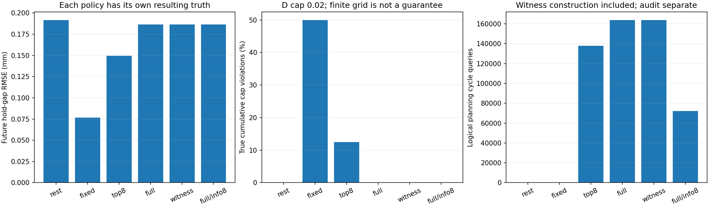
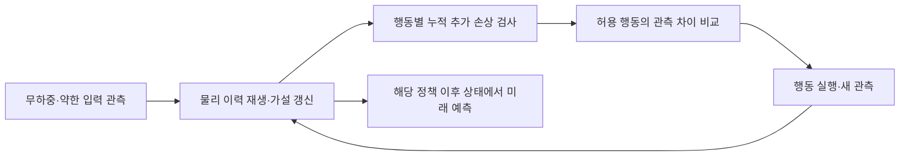

# 유한 후보의 누적 손상 검사

현재 안정 준정적 모형에서 무하중+약한 입력 관측 뒤 두 번 행동을 다시 선택한다. 실제 영상·엔진·신경망을 쓰지 않는다. 26개 물리 상태 × 3개 잡음 × 3개 실제 편향 = 234개 조건에 6개 정책을 적용했다. 1,404개 정책 실행을 독립 시편 수로 세지 않는다.



이전 실험의 26개 상태를 다시 사용하고 새로운 관측 잡음 seed와 음의 편향 조건을 추가한 개발 진단이다. 새로운 미사용 물리 시험 집합이라고 주장하지 않는다.



손상 한도 0.02는 최초 약한 관측 후 D 대비 누적 추가 D다. 매 행동마다 기준을 초기화하지 않는다. 후보마다 준비부터 실제 정책 행동 전체를 재생한다. 정책별 미래 정답도 해당 정책의 손상 이후 상태에서 따로 계산한다.

## 정책

- rest_only: 추가 하중 없이 무하중 관측만 두 번 더 한다.
- fixed_probe: 기존 1.65/1.85mm 입력을 그대로 실행한다.
- top8_guard: 관측 집합 안에서 posterior 가중치가 높은 최대 8개만 위험 검사.
- full_guard: 관측 조건을 만족하는 전체 유한 후보를 위험 검사.
- witness_guard: 전체 위험을 먼저 계산해 금지 행동마다 위반 후보 하나를 top8에 추가. 원래 행동 격자의 허용/금지 판정을 보존하지만 전체 탐색 비용이 필요하다.
- full_guard_info8: 위험은 전체 후보, 정보 목적함수는 상위 8개만 사용.

정보 목적은 공통 편향을 조건부로 반영한 다음 관측 평균의 분산에 기반한 표준 disagreement proxy다. 정확한 mutual information 또는 새 방법이라고 부르지 않는다.

## 대표 조건: 범위 안 24개 상태, 잡음 0.020mm, 실제 편향 +0.030mm

| 정책 | 미래 RMSE (mm) | 실제 누적 한도 위반 | 최대 추가 D | 평균 탐색 횟수 / 2 | 계획 cycle 조회 |
| --- | ---: | ---: | ---: | ---: | ---: |
| rest_only | 0.1918 | 0.0% | 0.00000 | 0.00 | 0 |
| fixed_probe | 0.0766 | 50.0% | 0.92832 | 2.00 | 0 |
| top8_guard | 0.1494 | 12.5% | 0.04613 | 1.17 | 137893 |
| full_guard | 0.1865 | 0.0% | 0.00000 | 0.88 | 163820 |
| witness_guard | 0.1865 | 0.0% | 0.00000 | 0.88 | 163946 |
| full_guard_info8 | 0.1864 | 0.0% | 0.00000 | 0.88 | 72107 |

## 유한 격자의 누락과 전체 결과

| 정책 | 범위 안 전체 조건의 실제 한도 위반 실행 | 전체/소수 격자 판정 불일치 수 | 161² 감사의 금지 선택 수 / 432회 |
| --- | ---: | ---: | ---: |
| rest_only | 0 / 216 | 0 | 검사 대상 아님 |
| fixed_probe | 108 / 216 | 0 | 검사 대상 아님 |
| top8_guard | 10 / 216 | 951 | 306 |
| full_guard | 0 / 216 | 0 | 27 |
| witness_guard | 0 / 216 | 0 | 27 |
| full_guard_info8 | 0 / 216 | 0 | 22 |

판정 불일치 수는 2단계×7개 설계 행동의 허용/금지 라벨 비교다. 실제 실행한 행동 위반 횟수와 다르다. 161² 감사는 4개 guarded 정책의 실제 선택 행동만 대상으로 한다. 더 조밀한 집합에서 금지로 바뀌어도 실제 시편이 한도를 넘었다는 뜻은 아니다.

## 보장의 범위

전체 후보는 연속 상태 전체가 아니라 81×81 사전 격자 중 유계 오차 조건을 만족하는 점들이다. 각 관측 오차 ±3σ, 공통 bias ±0.150mm의 교집합을 사용한다. 생성 잡음은 Gaussian이므로 이 경계를 벗어날 수 있다. Gaussian posterior와 이 유계 집합은 다른 목적의 표현이다.

이 집합의 최대 손상은 해당 유한 점에 대한 최댓값이다. 실제 참 상태가 격자 사이·사전 범위 밖이거나 관측/물리 모델이 틀리면 실제 한도 위반이 생길 수 있다. ‘전체 검사=실물 안전’이라고 하지 않는다. 빈 집합이면 guarded 정책은 무하중으로 기권하며, 후보를 몰래 다시 넣지 않는다.

전체 검사 정책의 실제 추가 손상은 이번 범위 안 모든 조건에서 0이었다. 안전성과 유용성을 함께 달성했다고 해석하지 않는다. 대표 조건에서 미래 오차는 rest_only와 비슷해, 의미 있는 예측 이득을 확보했다고 보기 어렵다. full_guard_info8의 적은 논리 조회량은 단순 계산 분리 기준선의 결과이며 실제 실행 시간이나 새로운 방법의 우위가 아니다.

full_guard와 witness_guard는 같은 조건에서 행동과 관측이 정확히 같음을 확인했다. 이는 단순 위험 증거 기준선이 현재 행동 격자를 보존함을 확인하는 것이며 새로운 알고리즘 효과가 아니다. 관측이 갱신될 때마다 다시 전체 탐색했고 그 비용을 포함했다.

top8의 전체 격자 감사와 선택한 행동의 161×161 감사는 행동 결정 후 수행한다. 감사 결과를 정책에 되돌려주지 않는다. 계산량에는 계획/사후 감사를 따로 기록했다. 무하중·고정 입력 대조군의 관측 집합 계산은 정책에 필요 없는 사후 진단으로 분리한다.

실제 noise/bias가 유계 가정을 만족했는지, 실제 파라미터가 연속 관측 제약과 사전 범위에 부합하는지, 유한 후보가 비었는지, 더 조밀한 격자가 위반을 찾았는지를 따로 기록한다. 연속 제약과의 부합도 실제 참 상태가 유한 격자에 포함됐다는 뜻은 아니다.

현재 같은 재료의 안정 단조 완전 분리 기준은 이력에 따라 바뀌지 않는다. 미래 분리 예측을 재료/이력의 결합 모호성 과제로 해석한다. 실제 안전 지표·일반 3D 파괴·학습 월드모델·신규 방법 기여는 검증하지 않았다.

## 구현·실행·검증

실행은 `20261028T131724534061Z-finite-damage-guard`이며 제어용 데이터 생성과 순차 실행은 약 6.0초, 미래 예측·추가 격자 감사·평가까지 약 13.1초였다. 빠른 해석식 기반 CPU 진단이다. 표의 cycle 조회량은 논리 연산 수이며 단일 동적 궤적 재생 비용과 같지 않다. 정책별 실행 시간 절감이나 동일 예산 알고리즘 우위를 측정한 것은 아니다.

```powershell
.\scripts\run-wsl.ps1 python scripts/finite_damage_guard.py
.\scripts\run-wsl.ps1 test -q
```

설정은 `config/finite-damage-guard.json`, 제어기는 `wmfracture/damage_guard.py`, 실행기는 `scripts/finite_damage_guard.py`다. `artifacts/finite-damage-guard/`에 최신 요약·개별 단계 결정·평가·세밀한 격자 감사·예측 단계 비용을 저장한다. 원본 실행에는 별도 public 관측, private 시뮬레이션 정답, posterior, 미래 예측, 단계별 결정 해시, 소스 snapshot과 물리 설정이 있다. 기존 합성 추정 실행의 관측·정답·결과 해시가 유지됐음을 확인했다.

제어기는 물리 정답이나 실제 센서 편향을 입력받지 않는다. 각 행동 결정은 새 관측 생성 전에 해시로 기록한다. 미래 예측도 고정한 뒤 private 궤적과 비교한다. 위험 증거 집합은 top8을 포함해 전체 실행에서 최대 12개, 평균 약 8.97개였으며, 매번 먼저 전체 후보를 계산하는 비용을 부담했다.

전체 테스트 **130개**가 통과했다. 새 10개 검사는 공유 bias 교집합, 관측 후 후보 집합의 축소, 누적 손상 기준 유지, 소수 후보의 위험 누락, 분리 사건 거부, full/witness 행동 일치, 빈 집합의 기권, 사후 감사가 top8 선택에 영향을 주지 않음, 정답 없는 미래 예측·세밀 격자 감사 실행을 포함한다. CPU CI 목록에도 추가했으며 이번 수치는 로컬 실행 결과다.

## 지금의 연구 판단

1. **단순 압축만으로는 위험을 보존하지 못했다.** 상위 8개가 전체 후보에서 금지되는 행동을 허용했고, 실제 합성 상태에서도 일부 누적 한도를 넘었다.
2. **전체 검사는 현재 과제에서 지나치게 보수적이었다.** 표본 내 추가 손상은 없었지만 무하중 관측 대비 의미 있는 예측 이득을 확보하지 못했다. 탐색 횟수가 0보다 크다는 것이 유효한 정보를 얻었다는 뜻은 아니다.
3. **위험 증거 몇 개를 더 넣는 것 자체로는 기여가 부족하다.** 표준 전체 탐색으로 얻은 소수 증거가 현재 full 정책을 그대로 재현했다. 계산 비용을 먼저 지불했으므로 속도 개선도 아니다.
4. **유한 격자에서의 일치는 연속 상태의 보장이 아니다.** 범위 안 216조건의 full 정책이 고른 432개 행동 중 27개는 161² 집합에서 금지로 바뀌었다. 실제 위반이 없었다는 결과와 별개로 격자 간 누락이 남는다.

다음에는 보수성의 원인을 분리한다. 더 촘촘한 행동 선택으로 해결되는지, 관측 허용 오차가 넓어서 생기는지, 허용 손상 안에서는 실제로 구별 가능한 정보가 부족한지 먼저 확인해야 한다. 세밀한 파라미터 격자도 정답으로 부르지 않고, 연속 영역 위험 계산은 별도 과제로 둔다. 이 점검 전에 새로운 압축법이나 대형 모델 결합의 효과를 확정하지 않는다.

이후 [행동 해상도·정밀도 진단](ACTION_CEILING_DIAGNOSTIC.md)을 수행했다. 연속 입력에서 일부 예측이 좋아졌지만, 유한 후보가 실제 위험 상태를 놓치는 반례도 나왔고 동적 계산으로 재현됐다. 위 0건 결과를 안전 보장으로 확장하지 않는다.
