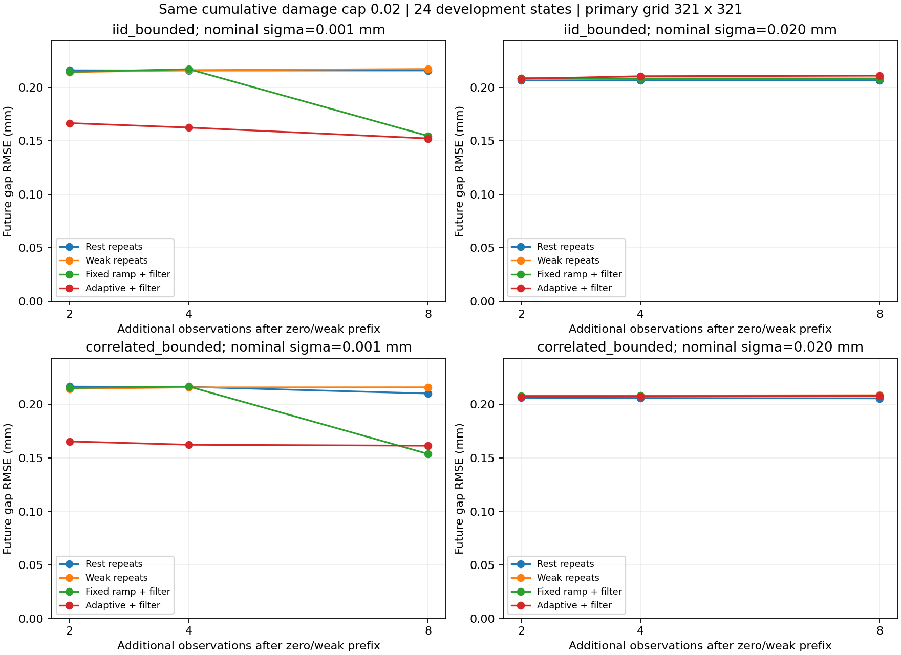

# 관측 횟수와 입력 선택의 효과

관측을 2·4·8회 추가할 때 단순 반복 관측과 적응적인 입력 선택의 미래 예측을 비교한다. 모든 방법은 같은 조건부 연속 영역 검증기를 통과하며, 최초 zero/weak 관측 뒤 **누적 추가 손상 D 한도 0.02**를 유지한다. 단계마다 손상 한도를 새로 주지 않는다.

**결과: 관측 수를 늘리는 것만으로 0.020mm 조건의 문제를 해결하지 못했다.** 현재 적응 선택은 약한 입력 반복보다 유용하다는 근거를 얻지 못했다. 낮은 잡음에서는 개선이 보이지만 예측 격자에 민감해 방법 간 우위와 관측 이득을 확정하기 어렵다. 실행·위험 검증은 성공했으며 예측 효용은 아직 미확보다.



## 주요 결과

24개 개발 상태×2잡음 크기×2편향×2잡음 상관 조건×4정책=768개 실행을 완료했다. 모두 추가 관측 8회를 채웠고, 2·4·8회 시점 2,304개를 두 예측 격자로 계산했다. 총 4,608개 예측 행이다. 새로운 독립 물리 상태를 768개 시험한 것이 아니다.

**0.020mm·추가 관측 8회·321² 격자**의 미래 벌어짐 RMSE는 다음과 같다. 각 칸은 같은 24개 상태를 두 편향에서 반복한 48조건의 결과다.

| 정책 | 독립 잡음 RMSE (mm) | 상관 잡음 RMSE (mm) |
| --- | ---: | ---: |
| 무하중 반복 | 0.2064 | 0.2057 |
| 약한 입력 반복 | 0.2083 | 0.2086 |
| 고정 제안 + 검증 | 0.2077 | 0.2084 |
| 적응 선택 + 검증 | 0.2108 | 0.2079 |

adaptive − weak의 RMSE 차이는 독립 잡음에서 +0.00254mm, 상관 잡음에서 −0.00067mm였다. 20개 생성 cluster 재표집의 서술적 95% 범위는 각각 [−0.00068, +0.00722]mm, [−0.00447, +0.00254]mm로 모두 0을 포함했다. 현재 방법의 우위를 확보한 결과가 아니다. 무하중 반복의 점 추정 오차도 adaptive보다 작았다.

같은 적응 선택의 관측 수 증가도 고잡음 문제를 해결하지 못했다.

| nominal sigma | 잡음 | 2회 RMSE | 4회 RMSE | 8회 RMSE |
| --- | --- | ---: | ---: | ---: |
| 0.020mm | 독립 | 0.2080 | 0.2103 | 0.2108 |
| 0.020mm | 상관 | 0.2070 | 0.2075 | 0.2079 |
| 0.001mm | 독립 | 0.1665 | 0.1624 | 0.1522 |
| 0.001mm | 상관 | 0.1654 | 0.1624 | 0.1615 |

오차 단위는 mm다. 더 많은 관측에 따라 이 근사 추정기의 평균 오차가 반드시 줄어들지는 않았다. 고잡음 adaptive의 최대 실제 추가 D는 독립 잡음 약 0.00000789, 상관 잡음 0이었다. 따라서 결과를 물리적으로 정보 획득이 불가능하다는 정리로 해석할 수 없다. 현재 제안기·물리 사전·오차 모델·계산 예산을 사용한 결과다.

## 낮은 잡음에서 드러난 예측 적분 문제

0.001mm·8회에서 adaptive의 미래 평균 예측은 161²→321²로 바꾸면 독립 잡음 **0.0995mm**, 상관 잡음 **0.0712mm**의 격자 간 RMS 차이를 보였다. 이는 정답 오차가 아니라 두 수치 예측의 차이다. pooled 정답 RMSE가 비슷해 보여도 개별 예측이 안정적이라는 뜻은 아니다.

독립 잡음에서 adaptive/fixed의 정답 RMSE는 161²에서 **0.1565/0.1468mm**, 321²에서 **0.1522/0.1546mm**로 **순위가 바뀌었다.** 따라서 저잡음 그래프의 개선을 검증된 adaptive 우위로 사용하지 않는다. 0.020mm·8회에서는 네 정책의 격자 간 RMS 차이가 약 0.00045~0.00061mm였다. 이 두 격자의 일치만으로 수렴을 증명하지는 않는다.

다음 개발의 우선순위는 **좁은 관측 likelihood를 안정적으로 적분하는 기준선**이다. 이후 그 예측기를 공통으로 사용해 목표 미래의 예측 오차와 관측용 손상을 함께 고려하는 입력 선택을 기존 관측 불일치 proxy와 비교해야 한다. 현재 proxy의 실패를 새 알고리즘의 성과로 바꾸어 말하지 않는다.

## 실행·검증

모든 실제 입력의 증거 **6,144개**를 새 cold 검사기로 재검사했다. 실제 손상 한도 위반과 미충족 관측 예산은 모두 0이었다. 전 조건에서 참 상태가 관측 제약에 맞고 실제 편향·잡음이 선언한 범위 안에 있음을 확인했다. 이는 알려진 안정 준정적 스칼라 모형의 조건부 결과다.

순차 제어는 382.04초, 두 격자의 공통 예측은 80.50초, 평가까지 504.92초였다. 시간은 CPU 구현의 기록이며 엄밀한 속도 우위 비교가 아니다. 전체 테스트 **185개**를 통과했다. 실행은 `20261029T031103526438Z-observation-budget`이다.

[전체 조건별 수치](results/observation-budget-evaluation-rows.json) · [보고서](results/observation-budget.json) · [짝지은 비교·격자 진단](results/observation-budget-analysis-summary.json) · [실험 설정](results/observation-budget-config.json) · [분석 항목](results/observation-budget-analysis-plan.json)

## 비교 방법

| 정책 | 검증 전 입력 제안 |
| --- | --- |
| rest_repeat | 무하중 0을 반복 |
| weak_repeat | 초기 약한 입력 1mm를 반복 |
| fixed_ramp | 사전에 고정한 1.05·1.15·1.25·1.35·1.45·1.55·1.65·1.85mm |
| adaptive_verified | 현재 관측의 물리 가설 간 예상 관측 차이로 매번 제안 |

검증기는 모든 방법에 동일하다. 거부·미확정 제안은 작은 입력으로 되돌아가 검사하고, 허용 증거가 없으면 중단한다. 제안만 고정한 fixed_ramp도 실제 실행 입력은 검증 결과에 따라 달라질 수 있다. 따라서 고정한 **제안** 기준선이며 완전히 고정된 실행 궤적이라고 부르지 않는다.

2·4·8회는 같은 8단계 실행의 중첩 prefix다. 제안기는 총 예산을 입력받지 않는 greedy 정책이며 예산 2회용·8회용 계획을 따로 최적화한 것이 아니다. 중단되면 획득한 실제 관측으로 미래를 예측하고 미충족 예산을 따로 센다. 추가 관측 수에는 맨 처음의 무하중·약한 입력 2개 관측을 포함하지 않는다.

## 데이터와 잡음

이전 새 상태 평가의 24개 개발 상태를 같은 seed로 재생성한다. uniform8·near-initiation8·matched4쌍이며 생성 cluster는 20개다. 새로운 관측 잡음 seed를 사용하지만 새 보류 물리 상태 시험은 아니다.

nominal sigma는 0.001mm·0.020mm, 실행 동안 일정한 실제 편향은 0·+0.030mm다. 모든 정책에 같은 잡음 스트림을 사용한다. sigma/편향마다 스트림을 구분하지만 같은 물리 상태를 반복 사용하므로 독립 시편 수를 늘려 세지 않는다.

- **iid_bounded:** 독립 Gaussian latent를 Gaussian CDF와 잘린 정규 inverse CDF로 변환한다.
- **correlated_bounded:** 정상 Gaussian AR(1) latent rho=0.8에 같은 변환을 적용한다. 변환 뒤 실제 Pearson 상관을 정확히 0.8이라고 주장하지 않는다.

두 조건의 주변분포는 ±3 nominal sigma로 잘린 같은 정규분포다. 따라서 hard error bound는 동일하다. 같은 조건 간에도 같은 Gaussian innovation을 공유한다. nominal sigma는 실물의 측정 정밀도나 잘린 분포의 실제 표준편차와 같지 않다.

추론 가중치와 입력의 정보 proxy는 기존 iid Gaussian+shared bias 근사를 그대로 쓴다. 상관 잡음에서는 시간 공분산을 생략한다. 따라서 명목 95% 구간의 실제 포함률과 interval score를 함께 기록하며 보정된 posterior라고 부르지 않는다. 단조 관측 제약에 의한 조건부 위험 검사는 오차의 독립성을 필요로 하지 않는다.

## 추론과 평가 분리

정책은 공개 입력·관측 이력, 알려진 물리 상수, 사전·오차 한도만 받는다. 숨은 물성·준비 이력·미래 정답·총 관측 예산은 입력하지 않는다. 모든 실제 입력의 증거를 실행 전에 재검사하고, 실행 후 별도 cold 검사기로 다시 확인한다.

모든 checkpoint의 미래 예측은 공개 이력만으로 계산해 해시로 고정한 뒤 private 정답으로 평가한다. 미래 명령은 2.6·3.1·3.5mm이며 실제 실행하지 않는 가상 예측 질의다. 손상 한도로 제한하는 관측용 입력과 구분한다. 각 정책의 관측용 입력이 물체 상태를 바꿀 수 있으므로 **각 정책이 만든 최종 상태의 미래**를 예측한다. 서로 다른 상태를 같은 정답에 비교하지 않는다.

주 예측 격자는 321²이고 161²도 계산한다. 두 해상도 사이의 평균 예측 변화와 정답 오차를 함께 보관한다. 일치해도 연속 posterior의 수렴 증명은 아니다. 추가 물리량으로 현재까지의 최대 원격 변위에서 완전 분리 원격 변위까지의 여유를 평가한다. 접합면 자체의 벌어짐 여유나 절대 물성의 유일한 복원을 의미하지 않는다.

주 비교는 sigma 0.020mm·추가 관측 8회에서 adaptive_verified와 weak_repeat의 RMSE 차이다. matched 쌍과 두 편향 조건을 생성 cluster째 묶어 재표집한다. 20개의 설계한 개발 cluster에 대한 서술적 민감도이며 독립적인 최종 검증이나 일반 모집단 신뢰구간이 아니다. 분석 항목은 결과 집계 전에 파일로 고정했으며 공개 사전등록을 주장하지 않는다.

## 재현

GPU·외부 엔진·실제 영상 없이 [CPU 환경](REPRODUCING.md)에서도 실행할 수 있다. 같은 저장소의 설정으로 상태를 재생성하므로 과거 개인 실행 파일을 요구하지 않는다.

```powershell
.\scripts\run-wsl.ps1 python scripts/observation_budget_evaluate.py
# 출력된 OUTPUT 경로를 아래 RUN에 넣는다.
.\scripts\run-wsl.ps1 python scripts/report_observation_budget.py --run RUN
.\scripts\run-wsl.ps1 test -q
```

CPU 환경에서는 `WM_PROJECT_ROOT`, `WM_RESEARCH_ROOT`, `PYTHONPATH`를 [재현 안내](REPRODUCING.md)처럼 지정한 뒤 같은 Python 파일을 직접 실행한다. 보고서 그림 생성에는 별도로 matplotlib가 필요하다. 설정은 `config/observation-budget.json`, 분석 설정은 `config/observation-budget-analysis.json`이다.

정책·유계 잡음은 `wmfracture/observation_budget.py`, 수집·예측·평가는 `scripts/observation_budget_evaluate.py`, 읽기 전용 분석은 `scripts/report_observation_budget.py`에 있다. 조건별 RMSE·박리 Brier score·명목 구간 포함률·추가 손상·실제 관측 수·중간 기권·정책 시간·캐시 항목 수를 보관한다. 캐시 항목 수는 메모리 byte 측정이 아니다.
