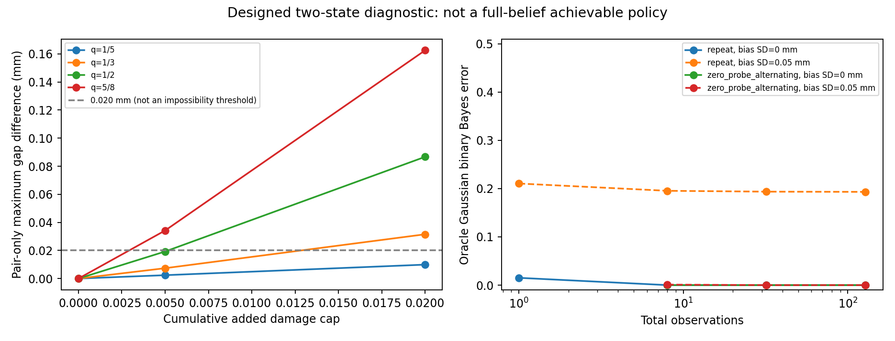

# 손상 한도와 식별 가능성: 외부 평가를 확인한 진단

2026-10-29. 기존 결과를 바꾸거나 새 정책을 학습하지 않은 후속 분석이다. 외부 엔진·실제 촬영·GPU 없이 실행했다. **유용한 확장 제안은 있지만, 평가문의 강한 novelty 주장과 실패 원인 단정은 현재 근거를 넘는다.**

## 평가문에서 채택할 부분과 고칠 부분

| 평가문의 주장·제안 | 현재 판단 | 근거와 조치 |
| --- | --- | --- |
| 비가역 손상 아래 능동 탐침이라는 문제 정의 자체가 강한 novelty | 미입증 | 안전한 정보 획득·제약 실험 설계·손상 모델 기반 순차 실험의 선행연구가 있다. 구체적 방법의 차이를 입증해야 한다. |
| 작은 입력에서 재료·이력이 비식별적일 수 있음 | 특정 조건에서 맞음 | 아래 matched-response 쌍은 손상 없는 모든 양의 완전 제하 입력에서 정확히 같은 응답을 낸다. 모든 재료·모달리티의 일반 정리는 아니다. |
| 점 추정으로는 절대 풀 수 없음 | 표현을 좁혀야 함 | 유일한 참 물리 상태 복원은 불가능할 수 있다. 그러나 여러 가설의 **평균 미래 예측**은 제곱 손실에서 타당하다. 평균 물리 상태를 만든 뒤 시뮬레이션하는 것과 다르다. |
| 높은 잡음에서 실패한 것은 물리적 정보량 한계 때문 | 원인 확정 불가 | 기존 정책 비교만으로 최적 정책의 한계를 알 수 없다. 아래에서 물리적 구분 가능성과 전체 가능 집합의 제약을 구분했다. |
| 안전한 후보 간 차이는 항상 약 0.001mm | 현재 법칙의 일반 성질이 아님 | 설계한 쌍의 두 상태만 고려하면 최대 0.0099~0.1625mm였다. |
| 신호 차이가 sigma보다 작으면 어떤 정책도 구분 불가 | 틀림 | 독립 반복에서 정보는 누적된다. 동일 반응이 정확히 유지되는 경우와 작은 양의 신호를 구분해야 한다. |
| hard residual filter를 soft likelihood로 교체 | 이미 후속 단계에서 구현 | 공통 Gaussian 편향을 적분한 soft likelihood와 반응 좌표 적분을 사용한다. 위험 검증의 유계 오차 가능 집합은 별도이며 soft posterior로 대체하면 기존 조건부 보장을 잃는다. |
| 미세 진동·감쇠를 추가하면 재료·손상 분리 | 자동으로 성립하지 않음 | 같은 유효 강성·질량·감쇠라면 아래 선형 운동방정식도 같다. 상태 정답에 따라 임의 감쇠를 부여해 구분 가능하게 만들지 않는다. |
| 위험 경계·극단 후보를 추가한 압축 | 연구 후보이나 안전 상한은 아님 | 유한 대표점은 그 사이의 최악 위험을 보장하지 않는다. 전체 가능 집합의 연속 경계 계산과 연결해야 한다. |
| 사건·구간·의사결정 지표 추가 | 채택 | RMSE를 유지하고 과도한 경고·넓은 구간·기권으로 점수를 올리는 것을 함께 제한한다. 사후 지표 변경으로 우위를 만들지 않는다. |
| Gaussian 제목과 실제 핵심 사이의 간극 | 타당 | 현재 스칼라 진단을 Gaussian 영상 모델의 성능으로 부르지 않는다. 공간 확장에서도 Gaussian이 관측에 무엇을 더하는지 따로 검증한다. |

현재 비교의 출발점은 [단순 교대 규칙](ALTERNATING_FRONTIER.md)이다. 0.020mm·8회에서 복잡한 미래 점수의 우위를 확보하지 못했고, 단순 규칙의 시간이 작았다. 예전 RGB-D 후보 필터의 실패를 최신 soft 추론의 실패 원인으로 그대로 옮기지 않는다.

## 연속 입력 전체에서의 두 상태 진단

기존 법칙·장치·사전 범위를 유지했다. 알려진 `K=10^7 Pa/m`, `S=1000 Pa`, `A=0.01 m²`, 직렬 스프링 `Ks=10000 N/m`이다. 미지수는 fracture energy `E`와 과거 **원격 구동 최대값** `H`다. `H`는 접합면 최대 벌어짐과 다른 양이다. 알려진 peak traction 자체를 추정하는 실험이 아니다.

다음을 정의한다.

```text
f = 2E/S              완전 분리 원격 변위
d0 = S/K
c = A*S/Ks
U0 = d0+c             최초 손상 원격 변위
q(E,R) = Ks / (Ks+A*K*(1-D(E,R)))
R = max(H, 현재까지의 입력 최대값)
관측 gap = a*q(E,max(R,a))
```

안정 연화 구간 `U0<R<f`에서는 `q=alpha-beta/R`이며 `alpha=(f-d0)/(f-U0)`, `beta=c*f/(f-U0)`다. 따라서 한 번의 입력 `a`에 대한 gap은 모드별 **일차식**이다. 두 gap 차이의 절댓값도 각 구간 끝점에서 최대를 갖는다. 손상 상한에서 역산한 입력 끝점과 모든 모드 경계를 유리수로 검사했다. 조밀한 샘플의 최대를 연속 상한이라고 부르지 않았다.

공통 초기 입력은 `[0, 1.0mm]`, 고정 손상 기준은 이 두 관측 이후다. `E=1.3 / 2.8 J/m²`인 두 상태의 준비 입력을 조절해 같은 q를 만들었다. 4쌍×3손상 한도 `[0, 0.005, 0.02]`의 **12행**이며 12개 독립 시편이 아니다.

| 같은 초기 q | 공통 초기 D | 두 상태만 만족하는 최대 입력 (mm) | 그 영역의 최대 gap 차이 (mm), cap=0.02 |
| --- | ---: | ---: | ---: |
| 1/5 | 0.60 | 1.188571 | 0.009905 |
| 1/3 | 0.80 | 1.323636 | 0.031515 |
| 1/2 | 0.90 | 1.560000 | 0.086667 |
| 5/8 | 0.94 | 1.820000 | 0.162500 |

위 입력은 두 상태의 정답을 아는 oracle의 제약을 만족한다. 전체 관측 가능 집합의 다른 상태가 이 입력을 금지할 수 있다. 실제 정책에 전달한 입력이나 높은 잡음에서도 얻을 수 있는 성능으로 해석하지 않는다. 동일한 두 상태도 미래 2.6/3.1/3.5mm 질의에서는 각각 약 0.667/0.556/0.467mm의 gap 차이를 보인다. 이는 식별 대상이 후속 과제에는 중요할 수 있음을 보여주는 설계 예제다.

## 전체 가능 집합을 고려하면 달라지는 점

각 q에서 잡음이 실현되지 않은 초기 관측 `[0, q*1mm]`을 만들고, 오차 허용 범위는 기존처럼 `±3sigma`, 공통 bias 범위는 `±0.15mm`로 두었다. 이는 기존 12상태 캠페인의 재평가가 아닌 **새로 설계한 8개 prefix**다. 정책에는 두 참 상태를 주지 않고 공개 입력·관측만 전달했다. 기존 유한 제안+연속 검증+8회 이분 검색을 그대로 사용했다.

| q | sigma=0.001mm 선택 입력 / 두 상태 gap 차이 (mm) | sigma=0.020mm 선택 입력 / gap 차이 (mm) |
| --- | --- | --- |
| 1/5 | 1.170703 / 0 | 1.098438 / 0 |
| 1/3 | 1.300781 / 0.001042 | 1.192383 / 0 |
| 1/2 | 1.510352 / 0.028743 | 1.358594 / 0 |
| 5/8 | 1.734375 / 0.073307 | 1.524805 / 0 |

단순히 검색이 보수적이어서 그랬는지도 구분했다. 두 상태가 처음 달라질 수 있는 작은 쪽 준비 입력의 **바로 아래 또는 정확히 같은 유리수 입력**을 추가 검사했다. 높은 잡음의 네 prefix에서는 모두 **가능한 손상 위반 지지점을 찾아 reject**했다. 이 법칙에서 위반 지지점의 손상은 입력 증가에 따라 줄지 않으므로 그 이상의 입력도 허용할 수 없다. 낮은 잡음에서는 q=1/5만 reject, 나머지는 allow였다.

즉, **이 네 높은 잡음 prefix와 현재 유계 오차·사전·법칙에서는**, 모든 가능한 상태에 같은 누적 손상 한도를 지키는 한 번의 양의 완전 제하 탐침으로 이 두 상태를 구분할 수 없다. 전체 가능 집합과 정확히 일치하는 오차 가정을 전제로 한 결론이다. 새로운 관측으로 집합이 좁혀진 이후, 다단계 적응 실험, 다른 센서, 실제 동역학의 불가능성 정리가 아니다. 이를 해결하려고 단순히 안전 한도를 몰래 완화하지 않는다.

선택 허용 증거 8개와 임계 입력 증거 8개, **총 16개**를 재검사했다. 공개 [증거 JSON](results/probe-identifiability-proofs.json)을 별도로 재검사할 수 있다. 선택된 값은 전역 최대 안전 입력이라고 주장하지 않는다.

## 반복 관측과 진동 제안의 올바른 해석



별도로 두 고정 평균 벡터의 Gaussian 구분 실험 **112행**을 계산했다. `Sigma=sigma²I+tau²11ᵀ`, `d²=deltaᵀ Sigma⁻¹ delta`이면 동일 사전확률의 최적 이진 오분류율은 `Phi(-sqrt(d²)/2)`다. 같은 큰 입력 반복과 무하중/큰 입력 교대를 **같은 총 관측 수**에서 비교했다. 독립 잡음에서는 작은 신호도 반복하면 정보가 쌓인다. 공통 bias가 있으면 같은 입력 반복은 포화될 수 있고 영점 관측이 유용해진다.

이 계산은 두 상태를 이미 아는 oracle이며 앞 표의 pair-only 입력을 사용한다. 현재 실제 수집 정책의 달성 성능이나 bounded/correlated 캠페인의 정확한 확률 모형이 아니다. 이 최대 이력 법칙에는 같은 진폭 반복에 의한 fatigue가 없으므로 첫 탐침 이후 같은 입력은 추가 손상을 만들지 않는다. 실물의 반복 손상 가능성과 다르다.

진동만 추가해도 해결되지 않는다. 두 상태가 같은 q이면 현재 법칙의 유효 접합 강성도 같다. 손상이 변하지 않는 양의 구간에서

```text
m*x'' + c_damp*x' + (Ks+Keff)*x = Ks*u
```

의 질량·감쇠·유효 강성이 모두 같다면 같은 초기 조건과 입력에서 **전체 시간 응답이 같다**. 새 손상을 만드는 overshoot를 손상 없는 진단으로 계산하면 안 된다. 다른 재료 의존 감쇠·점탄성 정보를 사용하려면 독립적인 물리 근거와 미지수·모델 불일치를 함께 검증해야 한다.

## 공간 접합면도 관측 가능성부터 확인

두 자유도 `z=[이동, 회전]`의 강체를 n개 접합 요소로 지지하면 손상 없는 구간의 접합 연산자는 다음과 같다. 좌표는 적절히 무차원화한다.

```text
B_i = [1, x_i]
K_interface = sum_i k_i * [[1, x_i], [x_i, x_i²]]
```

이 행렬은 강성 모멘트 세 개만 갖는다. 네 위치 `[-1,-1/3,1/3,1]`에서 강성 변화 `epsilon*[-1,3,-3,1]`은 세 모멘트를 모두 정확히 보존한다. 양의 강성을 유지하는 작은 epsilon이면 서로 다른 손상 분포도 같은 작은 입력의 강체 움직임을 낸다. 코드에서 세 모멘트 변화가 유리수로 모두 0임을 확인했다.

따라서 회전·Gaussian 픽셀을 늘리는 것만으로 내부 손상 분포가 식별되는 것은 아니다. 강체 픽셀은 자세 추정의 잡음을 줄일 수 있지만 독립적인 변형 자유도를 추가하지 않는다. 세 요소로 강성 모멘트를 추정해도 요소별 E와 H는 여전히 비식별적일 수 있다. 이 반례와 [수정 연구계획](RESEARCH_REVIEW_NEXT.md)을 기준으로 확장한다.

## 검증·재현

유리수 모드 끝점 계산, 독립적인 기존 평형 cycle 계산기와의 조밀 비교, 손상 기준 유지, 순차 입력 상한, Gaussian 공분산 역산 대조를 테스트했다. 새 테스트 8개다. 이는 범용 인증 solver나 새로운 식별 알고리즘의 성능 증거가 아니다.

```powershell
.\scripts\run-wsl.ps1 python scripts/probe_identifiability_evaluate.py
.\scripts\run-wsl.ps1 python scripts/probe_identifiability_evaluate.py --replay-proofs docs/results/probe-identifiability-proofs.json
.\scripts\run-wsl.ps1 test -q tests/test_probe_identifiability.py
```

[수치·가정](results/probe-identifiability.json) · [설정](../config/probe-identifiability.json) · [실행 코드](../scripts/probe_identifiability_evaluate.py) · [진단 함수](../wmfracture/probe_identifiability.py)
