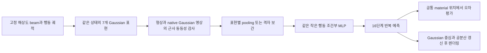
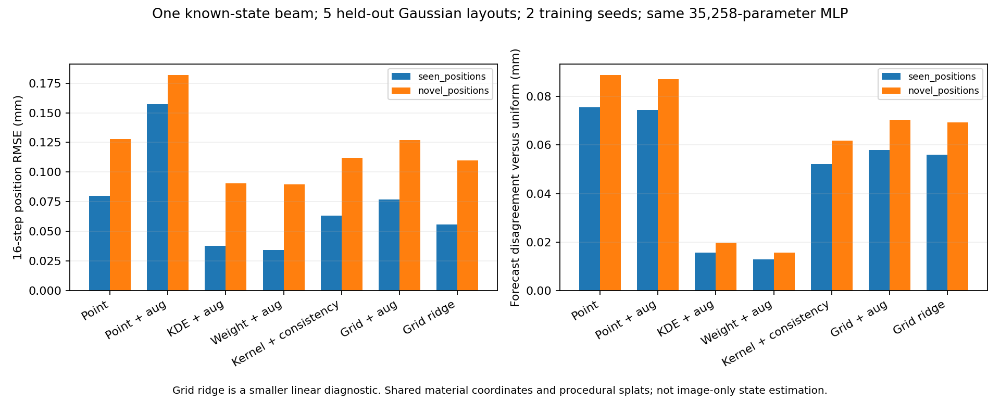
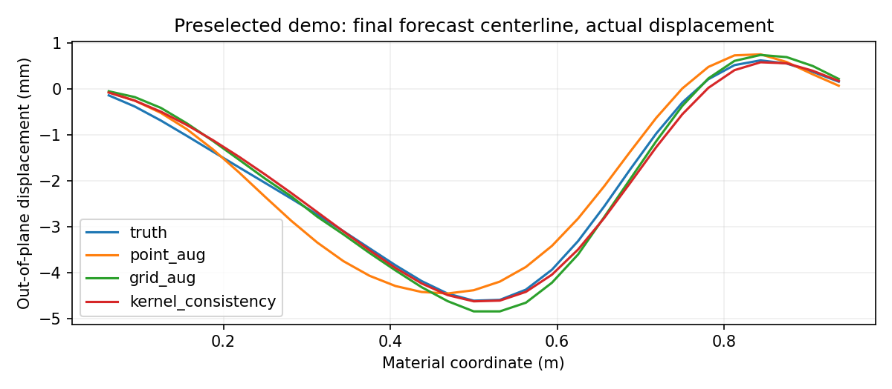
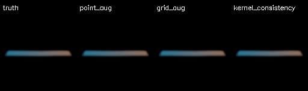

# Gaussian 표현 변화와 작은 학습 동역학: 첫 탄성 띠 pilot

**상태·행동 → 학습 전이 → 반복 미래 예측 → 실제 Gaussian rasterizer 렌더링을 구현했다.** RTX 4090에서 같은 35,258개 파라미터 MLP 14개를 학습했다. 표현 변화가 예측을 흔드는 현상은 보였지만, **표준 밀도/가중치 보정 이후 커널 encoder와 일관성 손실의 추가 이득은 확보하지 못했다.**

이번 물리는 양 끝이 고정된 선형 beam의 **1차원 중심선 변형을 좁은 3D 띠에 올린 제한된 모형**이다. 일반적인 탄성 판·비선형 접촉·파손이나 영상만으로 상태를 알아내는 시스템이 아니다. 알려진 material 좌표와 시뮬레이터 위치·속도를 사용한다. Gaussian은 실제 3D 공분산과 alpha 합성으로 렌더링하지만, 동역학 encoder는 알려진 띠의 material 축에서 작동한다.

## 구현한 파이프라인



물리 노드는 33개이며 양 끝 두 노드씩을 고정해 자유 노드는 29개다. 굽힘 강성 행렬과 감쇠를 사용하고, 시간 간격 0.025초의 선형 강제 응답을 행렬 지수로 적분했다. 입력은 위치와 폭이 지정된 공간 Gaussian 힘이며 **총힘을 일정하게 정규화**한다. 렌더링 Gaussian 수가 달라져도 물리 solver나 총힘은 바뀌지 않는다.

학습 96개·검증 16개·시험 24개 궤적을 seed로 분리한 뒤 각 궤적의 Gaussian 변형을 만들었다. 시험은 학습과 같은 누름 위치의 새 궤적 12개와 새 위치의 궤적 12개다. 학습 위치는 0.2/0.4/0.6/0.8m, 새 위치는 0.3/0.5/0.7m다. 후자는 범위 밖 외삽이 아닌 **새 위치의 보간 시험**이다.

같은 궤적의 다른 표현을 학습과 시험에 나누어 넣지 않았다. 모델은 현재 위치·속도와 예정 행동을 받아 다음 상태를 예측한다. 행동은 알려진 물리 좌표와 질량으로 계산한 29위치의 외력 가속도장으로 입력하며, 영상에서 힘을 추정하거나 접촉 역학을 학습하는 실험은 아니다. 매 반복 예측은 자신의 출력을 다시 입력한다. 시점 8·24의 알려진 상태에서 각각 16단계를 예측하며, 정답 미래는 예측 NPZ 저장·SHA256 고정 이후 점수 계산에만 사용한다.

## 표현이 실제로 비슷한가

기준 표현은 256개 Gaussian, 학습 증강은 왼쪽 밀집 512개다. 시험용 표현은 균일 고밀도 512개, 오른쪽 밀집 512개, 희소 128개, 위치 jitter 256개, 넓은 support 256개다. `refit_jitter`는 이름과 달리 독립 영상 재구성을 다시 최적화한 것이 아니라 **절차적으로 위치를 흔든 대조군**이다.

Gaussian opacity의 배율 하나만 초기 무변형 영상 세 장에 맞췄다. 이후 세 분석용 변형 자세×세 카메라에서 기준 표현과 비교했다. 미래 영상으로 opacity를 맞추지 않았다. 공분산은 변형장의 국소 기울기로 전파하고 native `diff_gaussian_rasterization`을 사용했다.

본 실행 전 고정한 허용치는 전경 RGB RMSE 0.025 이하, silhouette IoU 0.97 이상, depth RMSE 3mm 이하, 중심선 재구성 RMSE 1.5mm 이하다. **7개 모두 이 제한된 감사를 통과**했다. 변형 표현들의 최소 IoU는 약 0.9748, 최대 RGB 오차는 약 0.01087, 최대 depth 오차는 약 1.207mm였다.

이는 완전히 같은 표현이라는 증명이 아니다. 실제 초기 입력의 중심선을 Gaussian에서 다시 보간할 때 위치 RMSE가 약 **0.0073~0.0294mm**, 속도 RMSE가 **0.062~0.262mm/s** 남았다. 이 입력 근사와 반복 예측 오차를 구분해야 한다. 모든 실제 재구성·카메라·변형에서 동등함을 보장하지 않는다. [영상 감사](results/representation-pilot-appearance-audit.json) · [입력 기하 오차](results/representation-pilot-initial-geometry.json)

## 비교한 모델

모든 신경망은 두 은닉층·폭 128의 같은 MLP다. 입력 87차원, 출력 58차원이며 현재 상태에 잔차를 더한다. 학습 seed 두 개, 1,200 step, batch 256, AdamW 설정을 고정했다. 최종 step을 사용했고 시험이나 최저 검증 오차로 checkpoint를 고르지 않았다. 학습 증강 모델은 같은 물리 상태의 두 표현을 같은 지도 손실로 학습한다.

| 방법 | 입력 표현 처리 | 학습 표현 |
| --- | --- | --- |
| point | 기준 위치 주변 RBF 평균 | 균일 하나 |
| point_aug | 같은 RBF 평균 | 균일+왼쪽 밀집 |
| density_aug | 중심점 KDE 역밀도 보정 | 같은 두 표현 |
| weight_aug | 제공된 opacity·support에서 얻은 proxy 가중치로 보정 | 같은 두 표현 |
| kernel_aug | Gaussian의 축 방향 support를 pooling 폭에 포함 | 같은 두 표현 |
| kernel_consistency | 바로 위+공통 위치의 미래 예측 일관성 손실 | 같은 두 표현 |
| grid_aug | 입력 Gaussian의 상태를 균일 위치로 선형 보간 | 같은 두 표현 |

proxy 가중치는 절차적 Gaussian의 외관에서 얻는 적분 가중치이며 물리적 질량이 아니다. 물리 질량과 재료는 모든 방법에 동일하게 고정한다. 추가로 더 작은 **학습 선형 격자 전이(grid_ridge)**와 **행동을 사용하지 않는 등속도(grid_cv)**를 넣었다. 이 두 기준선은 결정적이므로 seed를 두 번 기록해도 독립적인 추가 학습으로 세지 않는다.

## 주 결과

아래는 **학습에 없던 표현 다섯 가지**의 16단계 전체 위치 RMSE다. 각 칸은 물리 궤적 12개를 두 시작 시점·두 학습 seed·다섯 표현으로 재사용해 구한 값이며 독립 시편 수가 아니다. 불일치는 같은 모델의 균일 표현 예측과 비교한 값이다. 공통 material 위치에서 평가하며 Gaussian 번호를 맞춰 비교하지 않는다.

| 방법 | 기존 위치·새 궤적 RMSE (mm) | 새 위치 RMSE (mm) | 새 위치의 표현 간 불일치 (mm) |
| --- | ---: | ---: | ---: |
| point | 0.07999 | 0.12791 | 0.08889 |
| point_aug | 0.15709 | 0.18202 | 0.08713 |
| density_aug | 0.03786 | 0.09046 | 0.01987 |
| weight_aug | **0.03429** | **0.08945** | **0.01575** |
| kernel_aug | 0.06327 | 0.11188 | 0.06183 |
| kernel_consistency | 0.06327 | 0.11188 | 0.06183 |
| grid_aug | 0.07709 | 0.12694 | 0.07031 |
| grid_ridge | 0.05604 | 0.10987 | 0.06925 |
| grid_cv | 1.24636 | 1.71220 | 0.02431 |



단순 밀도/외관 가중치 보정은 예측 오차와 표현 불일치를 함께 줄였다. 반면 커널+일관성 후보는 두 행동 집단 각각의 12개 궤적 모두에서 `weight_aug`보다 평균 MSE가 컸다. 작은 표본과 두 seed의 개발 pilot이며 통계적 유의성이나 일반 우위를 주장하지 않는다.

넓은 support만 바꾼 경우가 차이를 드러냈다. 새 위치에서 `weight_aug`의 균일/넓은 support 오차는 둘 다 약 0.08781mm였으나, 커널 후보는 약 0.08704/0.17566mm였다. 현재 구현은 외관 support를 동역학 pooling 폭에 넣으면서 표현 선택에 더 민감해졌다. 모든 covariance 활용 방식이 해롭다는 결론은 아니다. 고정한 학습 표현에 support 폭 변화가 포함되지 않았다는 조건도 유지한다.

등속도 모델은 미래끼리 비슷한 값을 내더라도 정답 오차가 크다. **일관성만으로 좋은 월드모델이라고 판단하지 않는다.** 증강만 넣은 모델의 악화 역시 이 학습 설정의 결과이며, 모든 증강 학습이 실패한다는 뜻은 아니다.

## 행동 사용과 학습 수렴의 보조 대조

주 실행 후 checkpoint를 동결한 채 행동을 0으로 바꾸거나 궤적 간 섞는 사후 sanity 검사를 추가했다. 새 모델 학습·주 비교의 설정 변경은 하지 않았다. 아래는 균일 표현과 새 누름 위치의 값이다.

| 모델 | 실제 예정 행동 (mm) | 0 행동으로 교체 (mm) | 섞인 행동 (mm) |
| --- | ---: | ---: | ---: |
| grid_aug | 0.11118 | 0.34856 | 0.43006 |
| kernel_consistency | 0.08704 | 0.33990 | 0.43079 |

이 범위에서 학습 모델은 행동 입력을 사용한다. 이 검사는 조작 정책이나 행동 선택의 개선을 입증하지 않는다. [행동 대조](results/representation-pilot-action-controls.json)

신경망 검증 손실은 1,200 step에서도 감소 중이었다. 최적화 부족으로 결론이 달라지는지 보기 위해 같은 encoder의 선형 전이를 ridge 1e-5로 직접 푼 **사후 보조 대조**를 별도로 추가했다. 기존 grid_ridge 예측도 최대 차이 1e-10 미만으로 재생했다. 같은 노출된 시험 집합이며 새 보류 시험이 아니다.

| 선형 전이의 encoder | 기존 위치 RMSE (mm) | 새 위치 RMSE (mm) |
| --- | ---: | ---: |
| density_aug | 0.01813 | 0.09024 |
| weight_aug | 0.01401 | 0.08974 |
| kernel_aug | 0.05482 | 0.11357 |
| kernel_consistency | 0.05343 | 0.11185 |
| grid_aug | 0.05604 | 0.10987 |

선형 물리·현재 encoder·이 데이터에서 직접 푼 대조도 커널 후보의 이득을 지지하지 않았다. 신경망이 완전히 수렴했다고 주장하거나 학습 시간을 결과에 맞춰 늘리지는 않았다. [선형 대조](results/representation-pilot-linear-controls.json)

## 실제 예측 영상과 실행 범위





[예측 영상](media/representation-pilot-forecast.mp4)은 첫 새 위치 궤적·첫 시작 시점·첫 seed·오른쪽 밀집 표현으로 미리 정했다. 정답/point_aug/grid_aug/kernel_consistency를 비교한다. 변위를 영상에서 과장하지 않았으며 작은 오차는 128픽셀 영상에서 거의 보이지 않으므로 위 물리 단위 곡선을 함께 본다. 영상은 10fps로 저장해 40Hz 물리보다 약 4배 느리게 재생한다.

주 실행은 환경 기동·설치를 제외하고 약 43.4초였다. MLP 한 번의 학습은 약 2.3~2.8초이며 입력과 정적 Gaussian→토큰 행렬을 캐시한 작은 실험이다. Gaussian 전체를 매번 재구성·추적하는 온라인 영상 파이프라인 시간은 아니다. Torch allocator peak는 약 70~72MiB였으며 CUDA 문맥·rasterizer 내부·다른 프로세스를 포함한 장치 전체 VRAM이 아니다. 이 수치를 일반적인 3D 영상 시스템의 메모리 요구량으로 사용하지 않는다.

## 이번 판단과 다음 관문

**작은 행동 조건부 학습·반복 예측·Gaussian 렌더링 경로는 작동한다. 현재의 커널 encoder와 일관성 추가를 논문 주기여로 개발할 근거는 얻지 못했다.** 같은 파라미터를 더 조정해 이 조건에서 후보를 이기게 만들지 않는다. 알려진 대응 관계와 절차적 Gaussian에서는 기존 보정이 강한 기준선이라는 결과로 남긴다.

이 결과만으로 ① 전체가 해결됐거나 불가능하다고 결론 내리지 않는다. 독립 영상 재구성의 실제 Gaussian, 알 수 없는 material 대응, 비선형 변형·일반 형상은 시험하지 않았다. 그런 조건에 남는 실패가 **같은 표준 보정 뒤에도 실제로 존재하는지** 확인할 근거가 생겨야 별도 후속 설계를 시작한다. 현재 단계에서 곧바로 가림·파괴·MPC까지 확장하지 않는다.

## 검증과 재현

CPU 테스트 6개는 beam 에너지·고정 경계·힘의 합·선형 보간·encoder 상수 보존·독립 궤적 생성 등을 확인했다. 전체 **276개 테스트**를 통과했다. 실제 GPU 학습·native Gaussian 감사·예측·영상은 위 실행으로 별도 확인했다.

```powershell
.\scripts\run-wsl.ps1 python scripts/representation_pilot_evaluate.py
.\scripts\run-wsl.ps1 python scripts/representation_action_controls.py
.\scripts\run-wsl.ps1 python scripts/representation_linear_controls.py
.\scripts\run-wsl.ps1 python scripts/report_representation_pilot.py
.\scripts\run-wsl.ps1 test -q tests/test_representation_pilot.py
.\scripts\run-wsl.ps1 python scripts/publish_results.py
.\scripts\run-wsl.ps1 python scripts/validate_public_docs.py
```

기존 WSL Torch 2.0/CUDA 11.8·NumPy·SciPy·Gaussian renderer 환경을 사용했으며 새 설치·외부 엔진·실제 촬영은 없다. 기존 CUDA 환경을 바꾸지 않았다. 실행은 `artifacts/representation-pilot`을 덮어쓰므로 비교 실행은 폴더를 먼저 별도 보존한다. 전체 가중치와 NPZ 예측은 로컬 산출물에 남기고, 공개 입력·개별 점수·학습 기록·감사·고정 시연을 선별 공개한다. 공개 요약만으로 전체 NPZ 예측을 재생했다고 주장하지 않는다.

[보고](results/representation-pilot.json) · [설정](../config/representation-pilot.json) · [공개 입력](results/representation-pilot-inputs.json) · [학습 기록](results/representation-pilot-training.json) · [개별 점수](results/representation-pilot-evaluation-rows.json) · [표현별 요약](results/representation-pilot-analysis-summary.json) · [진단](results/representation-pilot-diagnostics.json) · [해시 확인](results/representation-pilot-integrity.json) · [핵심 소스 해시](results/representation-pilot-code-sha256.json) · [그림 소스 해시](results/representation-pilot-report-source-sha256.json)
