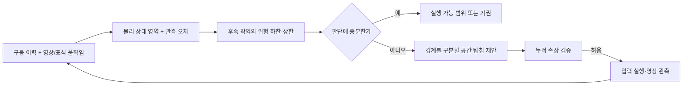

# 외부 평가를 반영한 다음 연구 설계

2026-10-29. **논문 기여가 확보됐다는 평가는 채택하지 않는다.** 현재 좋은 자산은 검증 가능한 작은 물리·추론 파이프라인과 정직한 실패 기록이다. 다음 목표는 사용자가 원한 새로운 파이프라인을 만들고, 필요한 이유를 강한 단순 기준선과 대조하는 것이다. [식별 가능성 진단](PROBE_IDENTIFIABILITY.md) 이후 [세 구역 공간 순방향 모형](SPATIAL_FIXTURE.md)과 [유한 후보 기반 공간 관측·추정·탐침](SPATIAL_OBSERVATION.md)을 연결했다. 목록 밖의 가능 영역과 공간 위험 상한·영상 연결은 아직 남아 있다.

후속 [연속 prior·조건부 구간 판정](SPATIAL_CONTINUOUS.md)도 구현했다. 수치 추정과 넓은 영역의 상한은 실패했고, 이후 [국소 반응 기반 제안](SPATIAL_TRANSPORT.md)을 추가했다. 전역 좌표 역변환 대신 전체 혼합 밀도로 원래 prior를 보정한다. 기존 8개 개발 이력 중 낮은 잡음 2개가 수치 검사를 통과했지만 높은 잡음은 0/4였다. 다음은 넓은 제안과 같은 총 예산의 강한 기준선 비교이며, 전체 영역의 이력 상관관계 보존·정확도·효율 개선은 아직 미해결이다.

## 선행연구와 실제 차별화 과제

2026-10-29에 Exa Search로 손상 실험 설계, 안전한 시스템 식별, cohesive 역문제, conformal 가정을 검색하고 아래 원문·공식 초록을 확인했다. 이는 범위를 좁힌 근접 연구 확인이며 완전한 신규성 조사가 아니다. 검색 결과에 같은 이름이 없다는 이유로 novelty를 확정하지 않는다.

| 직접 확인한 1차 자료 | 겹치는 내용 | 확인한 범위에서의 차이와 주의점 |
| --- | --- | --- |
| [Väntänen et al., Bayesian Sequential Experimental Design for Fatigue Tests, 2017](https://rakenteidenmekaniikka.journal.fi/article/view/64924) | 비선형 연속 손상 모델과 D-optimal 순차 실험 설계 | 공식 초록은 시험 수준 선택을 다룬다. 같은 손상 시편을 보존하는 우리 과제와 동일하다고 단정할 수 없지만, 손상·순차 설계의 결합 자체가 새롭다는 주장은 약하다. |
| [Ewen et al., Not All Actions Are Created Equal, 2023 preprint](https://arxiv.org/abs/2308.01829) | Bayesian 정보 획득과 reachability 기반 안전한 비선형 시스템 식별 | 차량의 충돌 안전을 다룬다. 접합 손상과는 다르지만 정보 대 안전의 구조 자체를 주기여로 삼기 어렵다. |
| [Hu et al., Adaptive Experiment Design for Nonlinear System Identification with Operational Constraints](https://arxiv.org/html/2502.20941) | 순차 추정과 제약을 고려한 적응 입력 설계 | 제약 실험 설계와 비교해야 한다. 현재 프로젝트의 완전한 선행 대체물이라고 주장하지 않는다. |
| [Hao et al., A Differentiable Framework for Inverse Identification of Heterogeneous Cohesive Laws, 2026 preprint](https://arxiv.org/abs/2610.33711) | 이력 의존 손상을 포함한 역계산, 저차원 cohesive 법칙, 공간 관측 | 힘–변위와 sparse strain을 사용하는 합성 FEM 연구다. 공간 관측·이력 역추정 자체가 차별점이 될 수 없다. 해당 원문에 안전한 폐루프 탐침이 없다는 추정만으로 전체 선행연구의 부재를 주장하지 않는다. |
| [Barber et al., Conformal prediction beyond exchangeability, 2023](https://arxiv.org/abs/2202.13415) | 비교환 데이터의 predictive coverage 문제 | 보통의 conformal을 이름만 추가해서 적응 실험의 조건부 안전 보장으로 쓸 수 없다. 데이터 단위·정책·shift 조건을 명시해야 한다. |

평가문의 `cite: 1` 표시는 참고문헌을 특정하지 못하므로 근거로 쓰지 않았다. 검색 메타데이터의 날짜·저자보다 연결한 원문을 우선했다. 위 연구들이 우리의 모든 조합을 이미 해결했다는 결론도, 반대로 우리 조합이 최초라는 결론도 내리지 않는다.

## 연구 질문과 방법 후보

임시 질문은 다음과 같다.

> 손상 이력이 불명확한 접합 구조를 제한된 손상 예산으로 관측할 때, **어디에 어떤 하중을 가하고 어느 시각적 움직임을 측정할지**를 선택해, 새로운 작업의 파손 위험과 실행 가능 범위를 효율적으로 좁힐 수 있는가?

모든 물성의 유일 복원이 목표는 아니다. 필요한 후속 작업의 위험·사건·변위를 구분할 수 있으면 된다. 잠정 포지션은 **시각 관측을 이용하는 물리 탐침·의사결정 파이프라인**이다. 현재 스칼라 결과를 새로운 학습 월드모델이나 3D 균열 모델로 포장하지 않는다.

방법 후보는 **시각 관측과 양립하는 물리 상태 영역 → 후속 작업의 위험 경계 → 그 경계를 가를 수 있는 위치·방향의 탐침 → 제한 내 실행 → 관측 갱신**이다.

새 방법이 될 수 있는 부분은 단순한 모듈 연결 이름이 아니다. 예컨대 **가능 집합의 안전 덮개와 저렴한 대표 상태를 함께 유지하면서, 후속 작업의 위험 구간이 넓은 영역만 계산하고 관측 후 갱신하는 구체적인 절차**가 후보이다. 대표 상태는 제안·점수 근사용이고, 위험 상한은 전체 영역을 덮는 계산으로 만든다. 강한 전체 검사·표준 branch-and-bound·단순 cache보다 같은 판정 정확도에서 비용이 낮거나, 같은 비용에서 실행률이 높아야 한다. 아직 구현·우위를 확보하지 못했다.

## 단계별 구현과 진행 조건

시간은 주 15~20시간의 작업 가정이며 결과 보장이나 확정 개발 기간이 아니다. 이전 기준선 실험을 무한히 추가하지 않고 다음 관문에서 중단·축소를 판단한다.

| 단계 | 구현 범위와 산출물 | 다음 단계 조건 |
| --- | --- | --- |
| 완료: 현재 법칙 진단 | exact 2상태 입력 최대 차이, 전체 집합의 임계 입력 증거, 반복·bias 대조, 회전 관측의 강성 모멘트 반례 | 단순 SNR 단정과 진동 자동 해결 가설을 버린다. 새로운 파이프라인의 효과로 세지 않는다. |
| 구현 완료: 공간 순방향 모형 | 3개 cohesive 접합 요소 + 이동·회전 2자유도 + 알려진 탄성 구동. 좌/중/우 구동과 완전 제하. **같은 구동 장치로 준비한 이력만** 사용 | 다섯 설계 사례·세 해상도에서 평형·일과 소산·이력·대칭·증분 수렴을 통과했다. 보수적인 안정 조건을 만족하는 장치만 허용하며 불안정 경로의 동적 분기는 구현하지 않았다. |
| 2주: 과제·관측 가능성 | 중심 관측이 비슷하지만 후속 비대칭 작업에서 결과가 다른 상태 쌍. 전역 E 하나+3개 준비 이력으로 시작하고, 준비 경로에 의해 실제로 도달 가능한 상태만 생성. 입력 위치/방향과 관측 위치를 조절 | 고정 좌우 탐침·D-optimal/불일치 기준선에서도 추가 정보가 전혀 없으면 정책 개발 중단. 상태 수를 늘려 해소되는 척하지 않는다. |
| 3주: 표준 폐루프와 비교 | 공통 bias soft 추정, local max 손상 제한과 분리 제약, 예측/행동 불확실성. 고정 좌우 순서·초기 집중 탐침·무하중 보정·전체 유한 검사·표준 연속 분할 검사 | 유한 후보 검사를 연속 안전으로 부르지 않는다. 차원이 커져 연속 경계 계산이 보류되면 그 비용·기권률을 결과로 기록하고 저차원 사전으로 축소한다. 기존 1D 증거 검사기는 새 공간 모형에 적용하지 않는다. |
| 4주: 방법 기여 후보 구현 | 위험 경계를 중심으로 하는 국소 정제, 대표 상태와 영역 덮개의 분리, 실제 관측 이후 증거 갱신. 동일 budget·판정 조건의 전체 검사/cache와 비교 | 단순 기준선 이후에도 남는 병목이 있어야 진행. 개발 집합에서 개선을 확인한 뒤 새 상태·가림·물성 변화의 보류 시험 설정을 고정한다. 기여가 없으면 파이프라인의 novelty를 주장하지 않는다. |
| 후속: Gaussian 영상 관측 | 우선 알려진 카메라·형상에서 표식/pose 관측과 Gaussian 영상 관측 비교. 필요하면 탄성 beam/plate 노드를 추가해 국소 변형장을 관측 | Gaussian을 제거하면 센서 오차·가림 대응·후속 판단 중 무엇이 나빠지는지 보여야 한다. 두 강체 자세만 측정한다면 Gaussian은 렌더러라는 범위를 유지한다. |

세 접합 요소의 강성 모멘트가 관측 가능해도 각 요소의 E·이력이 분리되는 것은 아니다. 4개 이상의 독립 강성을 두 자유도 강체 운동만으로 모두 추정할 수 없다는 반례를 이미 만들었다. 공간 모형 확장은 자동적인 해결책이 아니라 **위치에 따른 행동 선택이 필요한 문제를 만들 수 있는지 확인하는 실험**이다.

Gaussian 배경을 살리려면 공간 변화가 있는 실제 관측량이 중요하다. 탄성 beam/plate의 여러 변형 자유도를 추적하는 Gaussian 표현은 후보지만, DIC·sparse marker·mesh 기반 추적보다 유리한지 비교해야 한다. 새 렌더러를 붙였다는 사실만으로 그래픽스 논문의 기여가 되지 않는다. FEM/MPM 전체 파괴와 foundation video model 학습은 첫 공간 pilot의 범위에 넣지 않는다.

## 비교·지표·실패 기준

**RMSE는 유지한다.** 단, 단일 예측 지표 외에 다음을 사전에 고정한다.

| 비교 항목 | 함께 측정할 것 | 점수를 쉽게 올리는 편법 차단 |
| --- | --- | --- |
| 미래 분리 사건 | false negative, false positive, Brier/log loss 또는 판정 기준별 표 | 항상 파손 경고하는 방법도 넣는다. 발생 사례가 없는 조건에서 recall을 좋다고 하지 않는다. |
| 미래 변위 구간 | episode 단위 포함률, 구간 폭, 목표 행동 영역 | 전체 prior envelope와 비교. 각 시간점 포함률을 전체 궤적 보장으로 바꾸지 않는다. |
| 후속 작업 결정 | 달성 작업 크기·성공률, 잘못 허용한 비율, 불필요한 거부, 기권률 | 모든 작업 거부 기준선을 넣고 같은 위험 수준에서 유용성을 비교한다. |
| 관측 행위 | 기준 이후 누적 local max D, 분리 여부, 관측 수, 실제 큰 입력 수·시점 | 손상 기준을 단계마다 초기화하지 않는다. 평균 손상으로 국소 파손을 감추지 않는다. |
| 계산 효율 | 추정·점수·검증·업데이트의 전체 시간, 메모리, forward call 수, refinement/기권 | 대표 상태 개수만 줄였다는 이유로 효율을 주장하지 않는다. 같은 기계에서 순서를 바꾸고 반복 측정한다. |

첫 공간 pilot에서는 known law 안의 독립 시편/준비 경로 단위로 개발·보류 집합을 분리한다. 같은 시편의 잡음 seed·편향·관측 예산을 독립 표본으로 세지 않는다. 반복 개발에 노출된 기존 12개 상태는 보류 검증으로 재사용하지 않는다. 정책·후속 과제·주 지표·손상/시간 budget을 결과 보기 전에 파일로 고정한다.

Conformal은 선택 사항이다. 우선 구간의 실제 포함률과 폭을 보고하고, 보정을 한다면 정책 전체를 고정한 **새 episode 단위** calibration/test를 분리한다. 적응 입력 때문에 생긴 상태 변화·정책 변경·분포 shift를 고려하지 않은 보통의 conformal을 조건부 물리 안전 보장으로 쓰지 않는다. 유계 오차의 논리적 위험 증거와 확률적 예측 구간을 분리한다.

공간 모형에서도 고정 탐침이 같은 제약 아래 성능·시간을 모두 앞서면 현재 적응 목적함수의 주기여를 포기한다. 위험 경계 계산이 전체 검사보다 느리면 보장 유지 비용을 명시하고 압축 기여를 주장하지 않는다. 진동 신호에만 구분성이 생기지만 새 감쇠 가정에 전적으로 의존하면 별도 물성 모델 연구로 분리한다.

## 장비와 툴

RTX 4090 24GB·RAM 96GB 환경을 유지한다. 현재 진단은 기존 WSL Python의 NumPy/SciPy/Matplotlib와 Fraction만 사용했고 새 설치나 GPU가 필요 없었다. 3요소·2자유도 순방향 pilot도 CPU부터 구현한다. 새 공간 연속 검증의 비용은 아직 측정하지 않았으므로 실시간 실행을 약속하지 않는다.

영상 단계는 기존 Gaussian rasterizer를 재사용하고 렌더링·추정은 순차 실행한다. 필요할 때 작은 이미지/짧은 clip으로 메모리를 실측한 뒤 늘린다. 4090이라는 이유만으로 전체 파괴 시뮬레이션·고해상도 영상 추론을 동시에 돌릴 수 있다고 가정하지 않는다. Houdini·Unreal·실제 촬영은 사용자 요청대로 계속 보류한다.

**다음 구현은 유한 목록 밖의 가능한 상태를 유지하는 추정과 위험 판단이다.** 관측 인터페이스와 29개 이산 후보의 순차 추정·고정 탐침·기울기 규칙·유한 전체 검사를 구현했다. 목록 밖 위험 반례를 찾았지만 전체 영역의 상한은 아직 없다. 같은 준비 프로토콜의 연속 E·좌우 준비 입력을 다루고, 반례 검색과 허용에 필요한 상한을 구분해야 한다. 기존 단순 규칙 뒤에 남는 계산 병목을 방법 기여 후보로 구체화한다.
