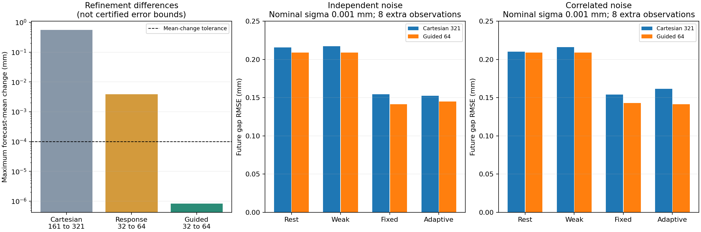

# 관측식을 이용한 상태 적분과 예측 안정화

**기존 입력·관측을 유지한 채 예측 계산의 수치 흔들림을 줄였다.** 2,304개 기록 모두 사전에 정한 세 가지 해상도 비교 기준을 통과했고, 미리 선택한 48개 기록도 다른 바깥 적분기와의 대조를 통과했다. 이는 같은 알려진 스칼라 법칙·Gaussian 관측 근사의 수치 검증이며, 새로운 관측·실물 정확도·형식적인 적분 오차 보장이나 알고리즘 신규성을 입증한 결과는 아니다.



## 해결한 문제

[이전 관측 예산 실험](OBSERVATION_BUDGET.md)에서 0.001mm 조건은 격자를 161²→321²로 바꾸면 개별 미래 예측이 크게 달라지고 정책 순위도 바뀌었다. 관측이 허용하는 물성 E·준비 이력 H의 좁은 띠를 Cartesian 격자가 충분히 해상하지 못한 것으로 진단했다.

처음에는 H를 관측 반응에 맞는 좌표로만 바꿨다. 이 방식도 큰 흔들림을 줄였지만 최고 두 해상도 비교에서 **171/2,304개가 기준 미달**, 선택한 바깥 적분 대조에서도 **8/48개가 기준 미달**이었다. 원본 결과를 보관하고, 재료 방향에서도 좁아지는 우도 구간을 관측식으로 찾아 나누도록 보완했다. 오차 기준과 입력·관측은 바꾸지 않았다.

| 수치 비교 | 기록 전체의 미래 평균 예측 최대 변화 | 기준 미달 |
| --- | ---: | ---: |
| 기존 Cartesian 161²→321² | 0.559834mm | 기존 단계의 격자 차이 진단 |
| 반응 좌표만 사용, level32→64 | 0.00382543mm | 171 / 2,304 |
| 관측식으로 E 구간도 분할, level32→64 | 0.000000830639mm | **0 / 2,304** |
| 후자의 level64와 adaptive outer 대조 | 0.000000130285mm | **0 / 48** |

위 수치는 **수치 계산끼리의 차이**다. 정답 오차나 카메라 정밀도가 아니다. 작은 수치 차이가 물리 예측의 높은 정확도를 의미하지 않는다.

## 실제 구현한 계산 흐름


표준 Gauss–Legendre 적분, Gaussian CDF 좌표 변환, 알려진 모드 경계와 우도 구조에 따른 구간 배치를 결합한 수치 기준선이다. 재료·이력의 단일 최적값을 구하는 방식이 아니라 가중 물리 상태들을 적분한다. 현재 제안기나 연속 영역 위험 검증기는 변경하지 않았다.

### 사전분포를 보존하는 H → q 변환

E는 fracture energy, H는 준비 단계의 최대 원격 구동 변위다. S는 peak traction, K는 tensile stiffness, A는 면적, Ks는 직렬 스프링 강성이다. 알려진 안정 준정적 모형에서 다음을 둔다.

```text
f = 2E/S
d0 = S/K
c = AS/Ks
U0 = d0 + c
alpha = (f-d0)/(f-U0)
beta = cf/(f-U0)
```

손상 준비 구간 U0 < H < f에서는 무차원 반응 q가 `q = alpha-beta/H`이고, 관측 입력 a의 유지 벌어짐은 해당 이력이 지배하는 구간에서 `a*q`다. 따라서 `H = beta/(alpha-q)`이며 변환 가중치는 `dH/dq = beta/(alpha-q)^2`다.

이 가중치를 넣어 **물리 E/H에서 균일한 연속 사전분포**를 보존한다. 기존 균일 격자는 같은 연속 목표의 수치 근사로 비교한다. H ≤ U0의 손상되지 않은 구간은 q가 일정하지만 원래 H 구간의 확률 질량을 그대로 포함한다. 이 구간을 제거하거나 q에 균일한 사전을 새로 주지 않는다.

관측별 최대 실행 입력에서 H 구간을 나누면, 각 구간에서 예측은 `u*q + v(E)` 꼴이다. 기존 shared-bias Gaussian 근사에서 q의 조건부 우도는 Gaussian이므로, 물리 H 구간에 대응하는 CDF 구간으로 적분한다. 여기서 Gaussian을 자르는 이유는 **물리 사전 구간**이며, 관측 잡음 모델을 잘린 정규분포로 바꾼 것이 아니다.

### E 방향의 좁은 구간 찾기

각 역학 모드 안에서 `t = 1/(f-U0)`를 쓰면 v(E)도 t에 대해 affine이다. 이 구조로 q 구간 경계의 Gaussian 표준화 값과, q 방향을 제거한 나머지 Gaussian 우도가 좁아지는 위치를 계산한다. 표준화 값 0·±1·±3·±6·±10에 대응하는 E 위치와 알려진 분리 모드 경계를 적분 구간에 포함한다.

t는 E 구간을 배치하는 데 사용한다. 실제 바깥 적분의 측도는 dE이며, E/H 사전분포가 바뀌지 않는다. 구간 위치는 공개 관측과 알려진 법칙에서 계산하고 숨은 정답을 사용하지 않는다.

현재 버전은 전체 사전에서 안정한 유일 준정적 가지와 **준비 단계에서 완전히 분리되지 않은 상태**를 요구한다. 이번 미래 입력 2.6·3.1·3.5mm는 사전의 최대 준비 변위 2.3mm보다 크다. 이 예측 질의에서는 H를 먼저 주변화해도 평균 벌어짐·분리 가중치를 계산할 수 있다. 일반 관성 운동·3D 균열로 확장한 것이 아니다.

## 수렴을 어떻게 확인했나

네 적분 해상도를 모두 실행했다. level 숫자는 주로 안쪽 차수를 구분하는 이름이며, E 패널 수와 바깥 차수도 설정에 함께 기록했다. 조기 종료나 결과가 좋은 수준만 선택하는 방식은 쓰지 않았다.

최고 두 해상도의 기준은 다음과 같고, 초기 방식의 실패 후에도 유지했다.

- 미래 평균 벌어짐 최대 차이 ≤ **0.0001mm**
- 분리 가중치 최대 차이 ≤ **0.00001**
- 같은 관측의 상대 정규화 분모 log 값 차이 ≤ **0.0001**

보완 후 실제 최댓값은 각각 **0.000000830639mm**, **0.00000204921**, **0.00000521985**였다. relative log integral은 theta에 일정한 Gaussian 정규화 상수를 제외하므로 다른 관측 길이·잡음 모델 사이의 model evidence로 사용하지 않는다.

선택한 48개는 생성 순서 0·8·16번 상태, 실제 편향 0, 8회 관측, 모든 정책·잡음 크기·상관 조건이다. 정답 오차를 보고 선택하지 않았다. SciPy quad_vec의 adaptive outer 적분과 비교한 최댓값은 평균 **0.000000130285mm**, 분리 가중치 **0.000000291021**, log 값 **0.000000767425**였다.

이 대조는 **H 조건부 적분 구현을 공유**하므로 완전히 독립적인 전체 해석기는 아니다. 보완으로 기존 cycle solver와의 순방향 비교, 물리 H 좌표의 직접 적분, 사전 질량·모멘트·elastic 질량·분리 사건 경계 테스트를 수행했다. 해상도 일치와 quad_vec의 오차 추정치는 형식적인 전역 오차 증명이 아니다.

## 안정화한 계산으로 다시 본 입력 정책

관측·입력을 새로 만들지 않았다. 이전의 24개 개발 상태·768개 실행에서 얻은 2·4·8회 시점 2,304개 공개 이력을 재계산했다. 아래 각 칸은 24상태×2편향=48조건의 평균 RMSE이며 독립 시편 48개가 아니다. 8회 관측 결과다.

| nominal sigma | 잡음 | 무하중 반복 | 약한 입력 반복 | 고정 제안 + 검증 | 적응 선택 + 검증 |
| --- | --- | ---: | ---: | ---: | ---: |
| 0.001mm | 독립 | 0.2088 | 0.2088 | 0.1413 | 0.1448 |
| 0.001mm | 상관 | 0.2088 | 0.2088 | 0.1427 | 0.1411 |
| 0.020mm | 독립 | 0.2064 | 0.2083 | 0.2077 | 0.2108 |
| 0.020mm | 상관 | 0.2056 | 0.2086 | 0.2084 | 0.2079 |

오차 단위는 mm다. 저잡음에서 고정 제안과 적응 선택 모두 반복 관측보다 낮은 오차를 보였다. 하지만 적응 선택이 고정 제안보다 좋다는 근거는 확보하지 못했다. 저잡음의 adaptive−fixed 차이는 독립 +0.00357mm, 상관 −0.00159mm이며, 20개 생성 cluster의 서술적 재표집 범위는 모두 0을 포함했다.

고잡음 0.020mm에서는 기존의 실패 결론이 유지됐다. 수치 적분을 안정화하는 것만으로 현재 입력 선택의 정보 부족·보수성이나 상관 잡음에서의 우도 근사 문제를 해결하지 않았다. 상관 조건에서도 가중치는 기존 iid Gaussian+shared bias 근사이므로 posterior 보정도 주장하지 않는다.

새 출력은 미래 평균과 분리 가중치다. 이 단계에서는 새로운 명목 95% 구간을 계산하거나 보정하지 않았다. 기존 위험 검증 결과는 실제 입력이 같기 때문에 유지되지만, 적분 가중치가 연속 영역의 위험 상한을 대신하지 않는다.

## 실행·재현·다음 단계

초기 실행은 `20261029T033625187304Z-response-quadrature`, 보완 실행은 `20261029T034401273351Z-guided-quadrature`다. 보완의 네 해상도·48개 대조 계산은 143.87초, 평가까지 145.77초였다. CPU 실행이며 GPU·신경망 학습은 사용하지 않았다. 평균 적분 시간은 조건·정책별로 다르고, 기존 격자 방식보다 빠르다는 짝지은 속도 비교는 수행하지 않았다. 전체 테스트 **200개**를 통과했다.

[보완 보고서](results/guided-quadrature.json) · [해상도별 전체 검사](results/guided-quadrature-refinement-checks.json) · [adaptive 대조](results/guided-quadrature-adaptive-checks.json) · [조건별 정답 평가](results/guided-quadrature-evaluation-rows.json) · [입력·기존 예측 묶음](results/guided-quadrature-inputs.json) · [초기 방식의 실패](results/response-quadrature.json)

핵심은 `wmfracture/response_quadrature.py`와 `wmfracture/guided_quadrature.py`다. 실제 입력 선택기에 연결하기 전에 고정 공개 이력에서 적분 자체를 검증했다. 다음 작업은 이 적분 상태를 입력 제안기에도 연결하고, 단순 고정 계획과 비교하면서 **목표 미래의 불확실성 감소와 누적 손상**을 함께 고려하는 선택 기준을 실험하는 것이다. 표준 수치적분 구현의 성공만으로 논문 신규성이 생겼다고 결론 내리지 않는다.

과거 개인 실행 폴더 없이 공개 입력으로 두 방식을 재현할 수 있다. [CPU 환경](REPRODUCING.md)을 준비한 뒤 실행한다.

```bash
PYTHONPATH="$PWD" python scripts/response_quadrature_evaluate.py \
  --inputs docs/results/guided-quadrature-inputs.json
PYTHONPATH="$PWD" python scripts/response_quadrature_evaluate.py \
  --config config/guided-quadrature.json \
  --inputs docs/results/guided-quadrature-inputs.json
# 보완 실행의 OUTPUT 경로를 RUN에 넣는다.
PYTHONPATH="$PWD" python scripts/report_response_quadrature.py --run RUN
```

초기 실행 비교 막대까지 재현하려면 보고서 명령에 `--coordinate-run INITIAL_RUN`을 추가한다. 추론은 공개 이력만 읽고 모든 예측을 고정한 뒤 평가 단계에서 합성 정답을 재생성한다. 원본 관측·기존 예측·입력 결정은 변경하지 않았다.
