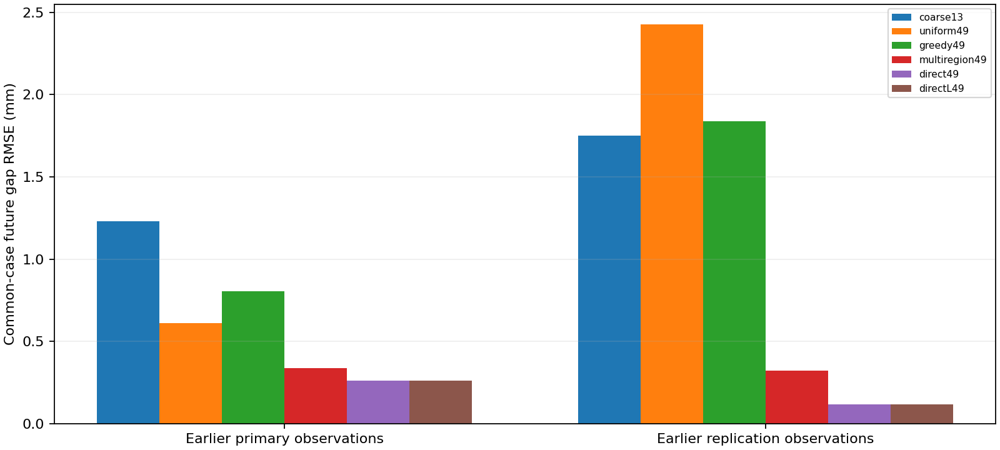

# 결과표와 해석

모든 수치는 합성 두 블록·한 접합면·1차원 병진 문제의 결과다. 보류 이력/물성은 설정에서 분리했지만 독립적인 실물 물체나 일반 3D 균열 실험은 아니다.

## 1. 강한 전역 최적화 기준선

앞선 두 시험 관측을 재사용한 비교다. 새로운 보류 시험이 아니다. 오차는 미래 접합면 틈의 RMSE이며 낮을수록 좋다.

| 방법 | 첫 시험 RMSE (mm) | 추가 시험 RMSE (mm) |
| --- | ---: | ---: |
| coarse13 | 1.231 | 1.752 |
| uniform49 | 0.612 | 2.428 |
| greedy49 | 0.805 | 1.838 |
| multiregion49 | 0.336 | 0.322 |
| direct49 | 0.262 | 0.117 |
| directL49 | 0.262 | 0.117 |

DIRECT가 두 시험 모두 가장 작았다. 적응형 세분화의 새로운 최적화 알고리즘으로서의 우수성은 확보하지 못했다.

## 2. 전체 후보의 미래를 8개 상태로 요약

전체 후보 집합을 가상 충격으로 비교해 일부 상태를 남긴다. `표현 오차`는 전체 후보의 각 곡선에서 가장 가까운 선택 곡선까지의 RMS 중 최댓값을 구하고 문제별로 평균한 값이다. 정답과의 오차가 아니다.

`정답 최근접 후보 오차`는 평가 정답을 보고 집합에서 가장 가까운 곡선을 찾는 진단이다. 실제 예측 시 이 후보를 알아낼 수 없으므로 점 예측 성능으로 해석하지 않는다.

| 관측 충격 | 균일 후보에서 선택법 | 표현 오차 (mm) | 정답 최근접 후보 RMSE (mm) | 범위 폭 (mm) | 시점 포함률 |
| --- | --- | ---: | ---: | ---: | ---: |
| 0.04m/s | residual8 | 5.533 | 0.713 | 9.98 | 86.6% |
| 0.04m/s | parameter8 | 5.461 | 2.141 | 11.72 | 80.9% |
| 0.04m/s | response8 | 3.470 | 1.850 | 14.48 | 91.5% |
| 0.04m/s | random8-17 | 3.838 | 1.950 | 12.80 | 87.8% |
| 0.04m/s | random8-37 | 4.199 | 1.600 | 11.41 | 83.1% |
| 0.04m/s | random8-59 | 5.849 | 2.793 | 9.99 | 77.0% |
| 0.04m/s | full | 0.000 | 0.572 | 14.70 | 94.5% |
| 0.12m/s | residual8 | 12.890 | 1.273 | 16.10 | 84.8% |
| 0.12m/s | parameter8 | 7.499 | 2.339 | 17.67 | 76.5% |
| 0.12m/s | response8 | 4.497 | 1.789 | 23.59 | 84.8% |
| 0.12m/s | random8-17 | 7.181 | 2.380 | 18.11 | 80.6% |
| 0.12m/s | random8-37 | 4.650 | 1.518 | 21.27 | 86.0% |
| 0.12m/s | random8-59 | 8.006 | 1.839 | 16.22 | 73.4% |
| 0.12m/s | full | 0.000 | 0.851 | 24.30 | 97.1% |

반응 다양성은 전체 미래 집합의 표현에 도움이 됐지만, 관측 잔차 순서의 단순 선택보다 정답 근처 후보를 잘 남긴다는 결과는 아니다. 넓은 범위는 보정된 신뢰구간이 아니다. 전체 집합 `full`은 더 큰 상태 수를 쓰는 참고값이다.

## 3. 추가 관측 충격 선택과 실제 손상

각 정책은 물체에 서로 다른 충격을 준다. 표의 관측 전·후는 **같은 정책이 선택한 충격을 받은 정답**과 비교한다. 정책 간 RMSE만으로 정보 획득의 인과 효과를 비교하면 안 된다. 여기서 MAP라는 원시 필드명은 최저 관측 잔차의 대표 후보를 가리키며 보정된 사후분포를 뜻하지 않는다.

추가 손상은 추가 충격 없이 같은 시각까지 진행한 대조군에 대한 손상도 D 증가다. D는 0~1의 무차원 값이며 후보 제약값은 0.02다. 각 표는 실제 재료/이력 8개×미래 충격 3개를 재사용한다. 무작위 seed와 방법을 독립 물체 실험으로 세지 않는다.

### uniform49 / full

| 정책 | 관측 전 RMSE (mm) | 관측 후 RMSE (mm) | 평균 추가 손상 D | 실제 제약 위반 | 평균 남은 후보 |
| --- | ---: | ---: | ---: | ---: | ---: |
| none | 4.860 | 5.561 | 0.0000 | 0/8 | 6.50 |
| weak | 6.146 | 7.348 | 0.0000 | 0/8 | 8.75 |
| strong | 8.414 | 8.990 | 0.0664 | 6/8 | 9.00 |
| random-11 | 6.992 | 5.863 | 0.0584 | 4/8 | 8.00 |
| random-23 | 7.363 | 10.138 | 0.0383 | 3/8 | 7.62 |
| random-47 | 8.429 | 10.120 | 0.0491 | 5/8 | 8.38 |
| disagreement | 4.860 | 5.561 | 0.0000 | 0/8 | 6.50 |
| guarded | 4.860 | 5.561 | 0.0000 | 0/8 | 6.50 |

### uniform49 / response8

| 정책 | 관측 전 RMSE (mm) | 관측 후 RMSE (mm) | 평균 추가 손상 D | 실제 제약 위반 | 평균 남은 후보 |
| --- | ---: | ---: | ---: | ---: | ---: |
| none | 4.860 | 5.478 | 0.0000 | 0/8 | 1.75 |
| weak | 6.146 | 7.029 | 0.0000 | 0/8 | 2.25 |
| strong | 8.414 | 7.120 | 0.0664 | 6/8 | 2.25 |
| random-11 | 6.992 | 4.820 | 0.0584 | 4/8 | 2.25 |
| random-23 | 7.363 | 6.537 | 0.0383 | 3/8 | 2.00 |
| random-47 | 8.429 | 6.662 | 0.0491 | 5/8 | 2.25 |
| disagreement | 6.705 | 5.283 | 0.0360 | 2/8 | 1.75 |
| guarded | 4.860 | 5.478 | 0.0000 | 0/8 | 1.75 |

### direct49 / full

| 정책 | 관측 전 RMSE (mm) | 관측 후 RMSE (mm) | 평균 추가 손상 D | 실제 제약 위반 | 평균 남은 후보 |
| --- | ---: | ---: | ---: | ---: | ---: |
| none | 4.605 | 5.028 | 0.0000 | 0/8 | 15.50 |
| weak | 6.409 | 6.659 | 0.0000 | 0/8 | 19.00 |
| strong | 8.482 | 5.658 | 0.0664 | 6/8 | 19.12 |
| random-11 | 9.493 | 6.939 | 0.0694 | 6/8 | 19.12 |
| random-23 | 7.824 | 5.000 | 0.0426 | 4/8 | 20.12 |
| random-47 | 7.595 | 7.280 | 0.0258 | 4/8 | 18.75 |
| disagreement | 6.807 | 5.751 | 0.0360 | 2/8 | 14.88 |
| guarded | 4.605 | 5.028 | 0.0000 | 0/8 | 15.50 |

### direct49 / response8

| 정책 | 관측 전 RMSE (mm) | 관측 후 RMSE (mm) | 평균 추가 손상 D | 실제 제약 위반 | 평균 남은 후보 |
| --- | ---: | ---: | ---: | ---: | ---: |
| none | 4.605 | 4.830 | 0.0000 | 0/8 | 2.25 |
| weak | 6.409 | 6.512 | 0.0000 | 0/8 | 2.50 |
| strong | 8.482 | 6.233 | 0.0664 | 6/8 | 2.38 |
| random-11 | 9.493 | 7.674 | 0.0694 | 6/8 | 2.38 |
| random-23 | 7.824 | 5.343 | 0.0426 | 4/8 | 2.62 |
| random-47 | 7.595 | 7.774 | 0.0258 | 4/8 | 2.50 |
| disagreement | 7.307 | 5.091 | 0.0375 | 2/8 | 2.00 |
| guarded | 5.315 | 5.399 | 0.0016 | 0/8 | 2.25 |

이번 실행에서는 모든 정책의 관측 후 예측이 가능했다. 다만 후보 수 감소가 정확도 개선을 보장하지 않았다.

손상 제한 정책은 대부분 0 충격을 골랐고, DIRECT response8 조건에서만 8상태 중 2개에 0.20m/s를 골랐다. 제약 위반은 없었지만, 그 사실만으로 정보 획득·안전성·예측 개선이 입증되는 것은 아니다. 고정 0.20m/s는 실제 8상태 중 6개에서 손상 증가 0.02를 넘겼다.

## 데이터와 검증

[전체 원시 요약 JSON](results/active-probe.json) · [독립 물리 감사](results/active-probe-integrity-checks.json) · [사후 실패 진단](results/active-probe-failure-diagnostics.json)

사후 진단은 방법/임계값을 바꾸는 데 쓰지 않았다. 관측 잔차가 낮다는 이유로 정답 미래에 가까운 후보를 제거하는 경우와, 8개 압축 집합이 전체 집합의 최악 손상을 과소평가하는 경우를 기록한다. 가설 집합 안의 손상 제약은 참 물체의 안전 보장이 아니다.

## 후속 스칼라 관측·위험 검증 실험

[새 상태의 손상·예측 비교](CONTINUOUS_RISK_EVALUATION.md) · [동일 판정의 계산 재사용](RISK_REUSE.md) · [관측 횟수·입력 선택 비교](OBSERVATION_BUDGET.md) · [관측식 기반 적분 안정화](RESPONSE_QUADRATURE.md) · [목표 미래를 고려한 폐루프 관측](TASK_AWARE_PILOT.md) · [무하중/검증 입력 교대 기준선](ALTERNATING_FRONTIER.md) · [손상 한도·식별 가능성 진단](PROBE_IDENTIFIABILITY.md) · [조건별 수치](results/continuous-risk-evaluation-evaluation-rows.json)

후속 단계는 합성 gap 값과 알려진 준정적 법칙을 사용한다. 이 페이지의 앞선 Gaussian 영상 실험과 관측·역학 조건이 다르다.
