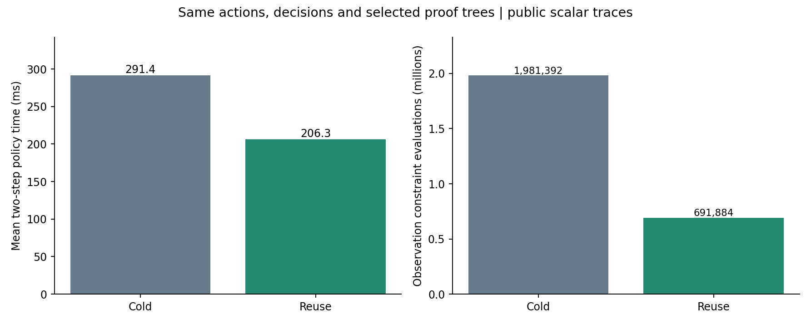

# 같은 판정을 유지하는 검증 계산 재사용

**같은 공개 관측에서 행동·판정·위험 상하한·위반 지지점·선택된 증거 구조를 유지하면서, 평균 2단계 정책 시간을 291.37ms에서 206.35ms로 줄였다.** 시간 감소는 약 29.2%, 전체 시간 비율은 1.41배다. 표준 메모이제이션의 공학적 기준선이며 새 알고리즘의 신규성을 입증한 결과는 아니다.



## 무엇을 재사용하나

영역과 지지점마다 관측에 맞는 공통 측정 편향의 구간을 저장한다. 같은 관측 이력의 다음 입력 질의에서는 그 구간을 재사용하고, 실제 입력을 실행해 관측이 추가되면 새 관측 제약만 교차시킨다. 한 번 관측과 모순된 영역은 관측을 추가해도 모순이다.

**이전 입력의 안전 판정은 재사용하지 않는다.** 위험 상한과 새로운 분리 가능성은 현재 행동·실행 이력으로 매번 계산한다. 검색기와 증거 재검사기는 별도 캐시를 갖고, 재검사기는 검색기가 주장한 수치를 신뢰하지 않는다. 물리 상수·사전 영역·잡음/편향 한도·손상 한도·기준 이력 또는 과거 관측이 바뀌면 세션 재사용을 거부한다.

모든 질의에서 분할 순서·예산·보수적인 bisection은 그대로다. 논리적으로 방문한 영역 수는 줄지 않았다. 줄어든 것은 같은 영역에 같은 관측 제약을 반복 계산하는 횟수다. 기존 cold 기준선도 한 filter 내부의 손상 계산과 지지점 계산 일부는 이미 캐시하므로, 모든 캐시를 제거한 인위적인 기준선과 비교한 것이 아니다.

## 비교 설계와 결과

[이전 새 상태 평가](CONTINUOUS_RISK_EVALUATION.md)의 verified_filter 공개 기록 **192개, 각 2단계**를 그대로 재생했다. 동일한 24개 물리 상태에 대응하는 잡음·편향·잡음 방식 반복 조건이며 독립 시편 192개가 아니다. 두 방법을 각각 두 번 실행하고, 각 기록에서 실행 순서를 번갈아 배치하며 두 번째 반복에서는 순서를 뒤집었다. 캐시는 각 기록·방법·반복마다 새로 시작하며 그 안의 두 단계 사이에서만 유지한다.

| 지표 | 기존 cold 검사 | 관측 계산 재사용 |
| --- | ---: | ---: |
| 2단계 실행 평균 | 291.37ms | 206.35ms |
| 2단계 실행 중앙값 | 247.83ms | 179.05ms |
| 2단계 실행 p95 | 784.03ms | 553.85ms |
| 총 관측 제약 계산 | 1,981,392 | 691,884 |
| 논리 영역 평가 | 458,212 | 458,212 |
| 검사 질의 수 | 4,692 | 4,692 |

횟수는 두 반복을 합친 값이다. 검색과 재검사기의 영역·지지점 관측 제약을 함께 세었으며 약 **65.1% 감소**했다. 분할 수나 물리 상태 수가 65.1% 줄었다는 의미는 아니다. 전체 시간 비율은 반복별 1.411배/1.413배, 기록별 시간 비율의 중앙값은 1.338배였다.

시간에는 제안, public warm bank, 모든 중간 영역 검사와 증거 재검사, 선택한 증거의 JSON 저장을 포함했다. 행동·증거 동일성 assertion과 마지막 독립 cold 재검사는 시간 표에서 제외했다. 동일성 검사까지 포함한 재생은 192.90초, 추가 독립 재검사는 8.69초였다. 단일 개발 머신의 CPU wall 측정이다. 반복 순서를 균형 있게 배치했지만 여러 하드웨어의 독립 성능 평가나 실물 제어 지연을 측정한 것은 아니다. 이전 보고서의 255.85ms는 다른 실행에서 bounded 조건만 평균한 값이므로 이번 전체 조건 cold 시간과 직접 속도비를 계산하지 않는다.

## 같은 증거인지 어떻게 확인했나

1. 공개 이력에서 입력 제안을 다시 계산하고, 기존 제안과 정확히 일치함을 확인했다.
2. 모든 중간 질의의 입력·판정·상하한·영역 수·지지점을 이전 기록과 비교했다.
3. 실제 선택된 전체 증거에서 계측 필드인 `point_evaluations`, `reuse_stats`만 제외한 내용의 해시를 비교했다. 입력 문맥·분할 구조·정확한 유리수 상한·지지점은 그대로다.
4. 재사용 방식의 선택 증거 **768개**를 캐시가 없는 새 검사기로 다시 검사했다. 이는 기존 384개 단계의 두 번 재생이며 768개의 독립 물리 실험은 아니다.
5. 입력의 원본 설정·관측 결정 파일 해시가 유지됨을 확인했다. 숨은 물성·이력 정답, 미래 궤적이나 평가 label은 재생에 사용하지 않았다.

행동이 같기 때문에 앞선 관측·예측 결과는 그대로 적용되지만 **새로운 예측 성능 실험을 한 것은 아니다.** 새로운 분포·새 관측·더 긴 이력에서의 효용은 별도 문제다. 검사기 자체도 일반 Python 코드이며 형식 검증된 theorem prover는 아니다. 보장은 알려진 안정 준정적 스칼라 cohesive 법칙과 선언한 유계 관측 오차·편향 범위에 조건부다.

## 코드와 공개 재현 입력

핵심은 `wmfracture/continuous_risk.py`의 관측 구간 캐시와 `wmfracture/verified_policy.py`의 `RiskReuseSession`이다. 기본 호출은 기존 cold 동작을 유지하고, 세션을 명시했을 때 재사용한다. 변경된 가정·과거 입력·과거 관측을 거부하는 테스트, 새 관측에 의한 지지점 제외, 현재 이력의 위험 재계산, 위조 증거 거부, 두 단계 행동·증거 동일성 테스트를 추가했다.

[보고서 JSON](results/risk-reuse.json) · [반복별 시간](results/risk-reuse-analysis-summary.json) · [공개 재생 입력](results/risk-reuse-inputs.json) · [계측 설정](results/risk-reuse-config.json)

공개 입력만 있으면 이전 개인 실행 폴더나 GPU 없이 재생한다. [CPU 환경 준비](REPRODUCING.md)를 따라 설정한 뒤 실행한다.

```bash
PYTHONPATH="$PWD" python scripts/benchmark_risk_reuse.py \
  --inputs docs/results/risk-reuse-inputs.json --repetitions 2
```

WSL 환경에서는 다음 명령을 사용한다.

```powershell
.\scripts\run-wsl.ps1 python scripts/benchmark_risk_reuse.py --inputs docs/results/risk-reuse-inputs.json --repetitions 2
.\scripts\run-wsl.ps1 test -q
```

실행 `20261028T160515021615Z-risk-reuse`는 한국 시각 2026-10-29에 수행했다. 원본 실행 폴더에는 전체 선택 증거·계측 행·소스 snapshot을 보관한다. 공개 저장소에는 요약·공개 재생 입력·그림을 포함하며 전체 원본 실행은 포함하지 않는다.

## 다음 연구 판단

재사용으로 반복 계산은 줄었지만 관측 오차 0.020mm에서의 정보 부족은 해결하지 않았다. 다음 우선순위는 동일 손상 한도에서 추가 관측 횟수·입력 순서가 실제 예측 효용을 높이는지, 더 긴 이력에서도 캐시의 비용과 메모리가 감당되는지 비교하는 것이다. 신규성을 주장하려면 이 표준 기준선 이후에도 남는 문제와 그 문제를 해결하는 구체적인 방법이 필요하다.
