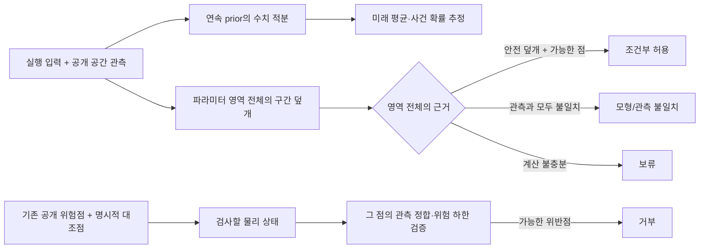
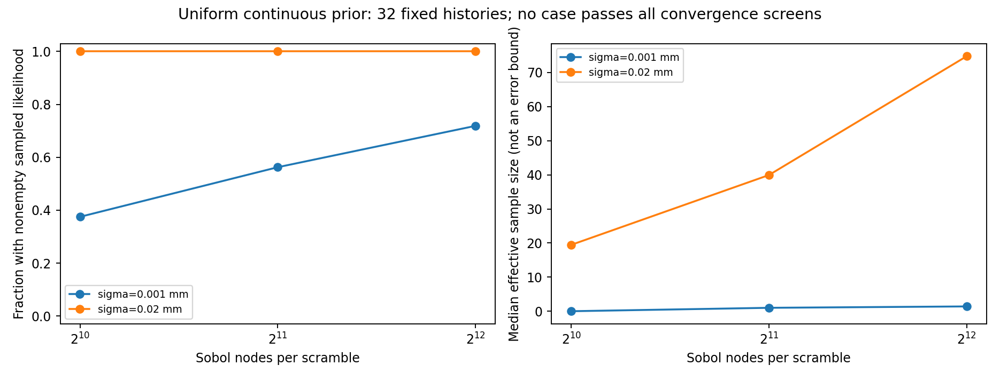

# 연속 물성 추정과 조건부 위험 상한의 첫 구현

2026-10-29. [유한 후보 목록 밖의 실패](SPATIAL_OBSERVATION.md)를 이어서, **연속 사전분포의 수치 추정과 전체 파라미터 영역의 구간 검사**를 별도로 구현했다. 중요한 진전은 판단 근거를 분리한 것이고, 넓은 영역에서 유용한 상한과 안정적인 추정을 얻는 문제는 아직 해결하지 못했다.

이번 단계에서 새 탐침 정책을 실행하거나 이전 행동·결과를 수정하지 않았다. 기존 관측 이력의 재추정과, 기존 위험점 및 명시적인 대조군의 검사다. 새로운 알고리즘의 우위·학습 World Model·Gaussian 영상·실물 안전의 결과가 아니다.

## 두 계산을 섞지 않는 파이프라인



샘플에서 보인 최댓값이나 높은 posterior 확률을 위험 상한으로 사용하지 않는다. 샘플을 못 찾았다고 가능한 상태가 없다고 하지 않는다. 실제 실험에서는 두 경로의 구성요소를 각각 검사했고, 위험점은 기존 공개 반례와 명시적인 대조점을 사용했다. QMC 출력이 새 행동의 위험 검사로 이어지는 폐루프를 실행한 것은 아니다.

## 1. 연속 prior로 같은 관측을 재추정

미지수는 `E, 준비 구동 uL, 준비 구동 uR`의 세 연속 변수다. prior는 `E∈[1.3,2.8] J/m²`, 각 준비 입력 `u∈[0.8,1.8]mm`의 균일 분포다. 각 점의 손상은 같은 장치의 준비 하중·제하를 재생해 만든다. 무작위 손상 벡터를 직접 넣지 않는다. 한 번의 준비 cycle이라는 프로토콜 가정은 유지한다.

이전 목록 밖 물체 네 개의 endpoints·유한 검사 규칙 실행 **32개 관측 이력**을 모두 재사용했다. 두 잡음·두 편향·두 잡음 반복을 포함한다. 낮은 잡음에서 이전 규칙이 중단했던 짧은 이력도 그대로 포함한다. 새 독립 물체 시험이나 새로운 입력 선택 실험이 아니다.

동일한 연속 prior에서 scrambled Sobol 1,024→2,048→4,096점과 독립 난수 묶음 두 개를 사용했다. 각 점은 같은 부피 가중치를 갖고 관측 likelihood를 적분한다. 표준 QMC 비율 적분이며 새로운 추정 방법이 아니다. 노드를 늘려도 prior를 바꾸지 않는다. 앞선 29개 이산 prior와는 **분포 자체가 다르므로** 오차 차이를 알고리즘 개선만의 효과로 해석하지 않는다.

관측 likelihood는 이전과 같은 channel별 지속 bias와 ±3sigma 제한 잡음을 사용한다. 미래 예측을 파일로 고정한 뒤 참 물성·준비 입력을 읽어 평가했다. 비교 이력 선택은 이미 본 개발 데이터의 메타데이터를 사용했으므로 맹검 보류 시험이라고 부르지 않는다.

### 결과와 수렴 실패

아래는 첫 번째 사전 지정 난수 묶음의 4,096점 결과다. ESS는 likelihood 가중치의 유효 표본 수다.

| nominal sigma | 추정값을 구한 이력 | ESS 중앙값 | 가용 이력의 미래 RMSE | 수치 검사 통과 |
| --- | ---: | ---: | ---: | ---: |
| 0.001mm | 11/16 | 1.15 | 0.19049mm | 0/16 |
| 0.020mm | 16/16 | 73.61 | 0.09846mm | 0/16 |

**추정값이 나왔다는 것과 안정적인 추정이라는 것은 달랐다.** 검사는 두 난수 묶음의 마지막 두 해상도 모두에서 ESS≥40, 미래 평균 범위≤0.005mm, 사건 확률 범위≤0.02를 요구했다. 이는 사전에 정한 경험적 수렴 검사이며 엄밀한 적분 오차 상한은 아니다.

높은 잡음에서도 비교한 평균의 최대 범위는 약 0.02542mm, 사건 확률의 최대 범위는 약 0.21794였다. 두 기준을 동시에 만족하는 이력은 없었다. 낮은 잡음은 가능한 영역을 노드가 놓치거나 가중치가 한두 점에 집중했다. 노드가 없는 다섯 이력도 연속 영역 전체가 불가능하다는 뜻은 아니다.

따라서 위 RMSE를 안정적인 성능 개선으로 주장하지 않는다. 가용 이력만의 값이며 미예측을 숨겨 전체 성능으로 바꿀 수 없다. 샘플 envelope도 실제 가능한 모든 미래의 외곽이나 보정된 신뢰구간이 아니다. 새 정책의 실제 손상 감소를 측정한 실험도 아니다.



그림은 두 난수 묶음을 합친 가용 비율과 ESS 중앙값을 보여준다. 표는 사전에 지정한 첫 묶음의 수치이므로 집계 단위가 다르다. [전체 추정](results/spatial-continuous-predictions.json) · [해상도·난수 비교](results/spatial-continuous-evaluation-rows.json)

## 2. 연속 파라미터 영역의 구간 계산

별도 `spatial_intervals.py`는 파라미터 상자에서 가능한 접촉·제하·연화·분리 모드를 포함하고, 2×2 평형식과 구역별 최대 벌어짐을 구간으로 전파한다. 덧셈·뺄셈·곱셈·나눗셈 뒤에 `nextafter`로 binary64 경계를 바깥으로 반올림한다. NaN 등 결정 근거가 없는 연산은 실패로 처리한다.

모형의 상수는 소스의 float를 정확한 실수로 해석하고 `d0=S/K`, `f=2E/S` 같은 비율을 구간 연산으로 평가한다. 여기서 다루는 대상은 **상승 64증분·하강 64증분으로 정한 안정 준정적 실수 모형**이다. 기존 일반 수치 solver의 모든 부동소수점 실행, 연속 하중 경로, 관성 충격, 실제 물체까지 인증하는 계산이 아니다. 구현 자체가 정리 증명기로 검증된 interval library도 아니다.

### 모드별 평형을 포함하는 근거

길이 단위의 좌표 `q=[z,L*theta]`와 구역 위치 `B=[(1,-1),(1,0),(1,1)]`를 사용한다. 각 모드의 힘이 `k_i*gap_i+b_i`이면:

```text
A00 = 10000+kL+kC+kR
A11 = 10000+kL+kR
A01 = -kL+kR
rhs = [5000*(uL+uR)-bL-bC-bR,
       5000*(uR-uL)+bL-bR]
```

연화 접선의 가장 음수인 값이 `s_min=-area*S/(f_min-d0)`일 때, 모든 모드의 접선은 `diag(10000+3*s_min,10000+2*s_min)` 이상이다. 양의 하한 `m`을 검사하고 determinant의 하한 `m²`를 사용한다. 또한 원점의 내부 힘이 0이므로 강한 단조성에서 `||q||₂≤||load||₂/m≤||load||₁/m`인 외곽을 얻는다. 임의 중심 샘플의 최대를 상한으로 바꾼 것이 아니다.

모드별 해 구간과 해당 접촉·손상 구간의 필요한 조건을 교차한다. 가능한 모드는 합집합으로 유지하고, 최대 벌어짐은 모드별 irreversible update를 포함한다. 제하·탄성·접촉만 가능한 경우에는 손상도가 변하지 않는다는 관계를 보존해 불필요한 손상 차이를 줄인다.

추가 D는 독립적인 두 D 범위의 차이만 쓰지 않는다. `b≤a`인 준비/후속 최대 벌어짐에 대해 `D(f,a)-D(f,b)`는 f 방향에서 `f=clip(a,[f_min,f_max])`에서 최대가 되고, 최소는 f 구간 끝점에 있다. 이 구조와 준비/후속 최대 벌어짐의 구간을 사용해 같은 E에서의 손상 차이를 포함한다.

### 관측 가능 영역과 판정

공통 bias는 channel별로 모든 관측을 동시에 설명해야 한다. 영역을 버릴 때는 예측 구간의 **외측 bias 조건**이 서로 만나지 않는 경우만 사용한다. 고정된 점이 실제로 가능하다고 확인할 때는 예측 구간 전체에서 오차 경계를 만족하는 **내측 bias 교집합**을 요구한다. 두 조건의 논리 방향이 다르다.

- `reject`: 관측에 맞는 검증된 점의 손상 **하한**이 0.02 초과.
- `allow`: 파라미터 영역 전체가 안전/관측 불일치 상자로 덮이고, 가능한 검증 점이 하나 이상 존재.
- `inconsistent`: 영역 전체를 관측 불일치로 제외.
- `abstain`: 그 외. 계산 예산 소진이나 샘플 탐색 실패는 허용이 아니다.

상자 분할은 부모를 두 자식으로 덮고, 증거 파일의 모든 분할과 구간 계산을 별도 프로세스에서 다시 검사한다. 고유한 root가 있다는 조건과 덮개가 있다는 조건을 실제 오차·모형 가정 밖으로 확대하지 않는다.

## 3. 판정 실험: 거부는 확인했지만 넓은 영역의 허용은 실패

| 질의 묶음 | 수 | 결과 | 해석 |
| --- | ---: | --- | --- |
| 이전 공개 위험점 | 8 | 모두 거부 | 기존 수치 반례의 정합과 위험 하한을 구간 계산으로 재확인 |
| 명시적으로 좁게 준 대조 영역 | 3 | 모두 허용 | 전체 덮개와 가능한 점을 모두 확인 |
| 넓은 prior·7개 상자 예산 | 2 | 모두 보류 | 유용한 위험 상한을 얻지 못함 |
| 불가능한 관측 대조 | 1 | 불일치 | 빈 집합을 안전하다고 부르지 않음 |

이전 위험점은 실패 후 선택했던 8개 공개 질의와 이미 찾은 점을 사용했다. 새 독립 반례 탐색의 성능이나 위험 상태 8개의 독립 발견으로 세지 않는다. 한 예의 추가 D 하한은 약 0.14236880798317로 한도 0.02를 넘었다. 같은 입력 반복으로 기존 위반이 이어진 질의도 포함한다.

허용 대조군의 범위는 `E=2±0.00001 J/m²`, 각 준비 입력 `1.8mm±0.00001mm`다. 준비 입력 허용 폭은 **±10nm**로 매우 좁다. 이 영역을 관측으로 복원한 결과가 아니라 검사를 위한 설계 입력이다. 이를 넓은 prior에서의 안전한 능동 관측 성공이라고 주장하지 않는다.

넓은 영역 두 질의는 7개 상자에서 위험 상한이 1에 머물렀다. 실패를 본 뒤 별도로 시행한 **31개 상자 민감도 검사도 두 질의 모두 보류·상한 1**이었다. 원래 결과를 덮어쓰지 않고 별도 보고서로 남겼다. 더 큰 예산에서도 영원히 실패한다는 근거는 아니다.

보고서의 시간은 동시 실행한 진단과 CPU 부하의 영향도 받는다. 방법 간 속도 비교나 실시간 성능으로 사용하지 않는다.

무하중 제안도 보류될 수 있다. 예산은 지금부터의 추가 손상만이 아니라 준비 이후 전체 누적 손상이다. 이미 실행한 약한 입력의 손상 상한을 충분히 제한하지 못하면, 무하중을 준다고 그 불확실성이 사라지지는 않는다. 이는 무하중이 실제로 손상을 만들었다는 결과가 아니라 검사가 충분히 좁은 근거를 얻지 못한 결과다.

[14개 원본 질의·증거](results/spatial-risk-proofs.json) · [31개 상자 후속 검사](results/spatial-risk-refinement.json)

## 4. 현재 병목과 다음 방법 개발

수치 적분은 얇은 관측 가능 영역을 충분히 표현하지 못했고, 구간 전파는 같은 물성·준비 입력의 시간적 상관관계를 잃으면서 범위가 부풀었다. 자연 구간식과 민감도 기반 확장 prototype만으로 이 문제를 해결하지 못했다. 작동하지 않은 민감도 prototype을 최종 판정 경로에 넣지 않았다.

다음 후보는 초기 두 위치의 반응을 좌표로 삼는 **모드별 반응 좌표 변환**과, 같은 파라미터가 만드는 이력을 함께 보존하는 영역 표현이다. 단순한 노드 증가는 기준선으로 유지한다. 새 좌표를 쓰더라도 원래 균일 물성 prior의 Jacobian·탄성 plateau 질량·여러 역상과 rank 부족 모드를 보존해야 한다. 이 변환이나 효율 개선은 아직 구현·입증하지 않았다.

이번 단계는 불충분한 계산이 잘못된 허용으로 이어지지 않게 하는 구성요소를 만든 것이다. **넓은 연속 영역에서 충분히 정확하고 저렴하게 판단하는 방법은 여전히 주 연구 과제**이며, 새 논문의 기여가 확보됐다는 결과가 아니다.

## 검증과 재현

binary64 primitive를 정확한 Fraction 값과 대조하고, 모드 전환을 포함한 내부 샘플·기존 batch solver·점 이력·bias 조건·누적 손상을 검사했다. 위조된 위험값·분할 누락·공개 입력 교체·비어 있는 집합의 허용도 테스트했다. 이번 신규 테스트는 15개이며 전체 257개를 통과했다. 샘플 대조 자체를 전체 상한의 증명으로 계산하지 않는다.

```powershell
.\scripts\run-wsl.ps1 python scripts/spatial_continuous_evaluate.py
.\scripts\run-wsl.ps1 python scripts/report_spatial_continuous.py
.\scripts\run-wsl.ps1 python scripts/spatial_risk_evaluate.py
.\scripts\run-wsl.ps1 python scripts/spatial_risk_evaluate.py --followup-cells 31
.\scripts\run-wsl.ps1 python scripts/spatial_risk_evaluate.py --replay docs/results/spatial-risk-proofs.json
.\scripts\run-wsl.ps1 test -q tests/test_spatial_continuous.py tests/test_spatial_intervals.py tests/test_spatial_risk.py
```

GPU·외부 엔진·실제 촬영·추가 패키지 설치는 사용하지 않았다. 판정 재검사는 공개 질의와 증거만 읽으며 참 상태 파일을 필요로 하지 않는다.

[설정](../config/spatial-continuous.json) · [연속 추정](../wmfracture/spatial_continuous.py) · [구간 전파](../wmfracture/spatial_intervals.py) · [판정과 재검사](../wmfracture/spatial_risk.py) · [추정 결과](results/spatial-continuous.json) · [위험 판정](results/spatial-risk.json)
