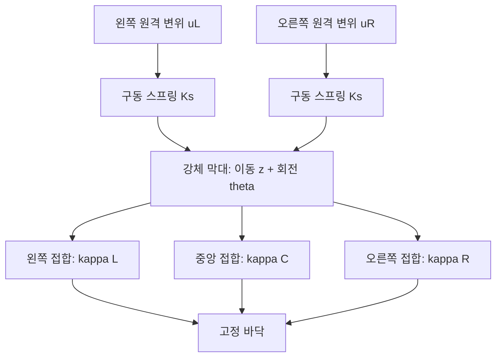
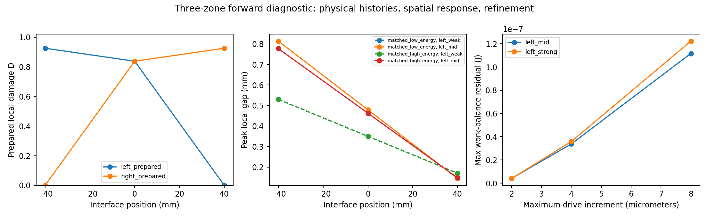

# 세 구역 접합면과 이동·회전 순방향 모형

2026-10-29. [다음 연구계획](RESEARCH_REVIEW_NEXT.md)의 첫 구현이다. **두 구동 스프링과 세 cohesive 접합 구역을 갖는 작은 공간 물리 모형을 구현하고, 실제 구동 경로로 이력을 준비했다.** 아직 영상 관측·상태 추정·탐침 정책은 넣지 않았다. 표준 구성식을 사용하는 모형 확장이며 새 파괴 법칙이나 논문 novelty를 입증한 결과가 아니다.

## 무엇이 달라졌나

기존 스칼라 모형은 접합면 하나가 벌어지는 양만 계산했다. 이번 모형은 고정 바닥 위 강체 막대의 **수직 이동 z와 작은 회전 theta**를 계산한다. 접합 구역은 `x=[-40,0,+40]mm`, 구동 스프링은 양 끝에 있다. 각 구역의 면적은 `0.01/3 m²`, 구동 스프링은 각각 `5000 N/m`이다. 세 구역은 각자 과거 최대 벌어짐을 기억한다.



가운데 구동은 양 끝에 같은 변위를 주고, 좌우 탐침은 양 끝의 입력을 다르게 준다. 물체 위치나 손상을 직접 지정하지 않는다. 인장 softening·제하·완전 분리와 분리 후 압축 penalty 접촉을 처리한다. 일반적인 2D/3D bulk 균열이나 파편 생성, 관성 충격 시뮬레이션은 구현 범위에 포함하지 않는다.

좌표는 `q=[z,L*theta]`, `L=40mm`로 두었다. 각 접합의 벌어짐은 `delta_i=[1,x_i/L]q`다. 변위와 회전 좌표를 같은 길이 단위로 계산하고, 일반화 힘의 두 번째 성분을 L배해 실제 모멘트 잔차를 구한다.

## 해법과 안정성 범위

이전 최대 벌어짐을 고정한 한 증분에서 각 구역의 힘은 압축·제하/탄성·새 연화·분리의 구간별 일차식이다. 가능한 모드 조합을 열거하고, 2×2 평형식을 풀어 각 구간의 유효 범위와 실제 traction 잔차를 검사한다. 손상은 평형 결과의 양의 벌어짐으로만 증가한다.

구동 강성에서 모든 구역의 가장 음수인 연화 접선 기여를 뺀 행렬이 양의 정부호인 경우만 허용한다. 이 조건은 **고정된 이전 이력에 대한 증분 평형의 유일성과 안정성을 위한 보수적 조건**이다. 불안정한 장치는 현재 solver에서 거부한다. 점프·snap-through의 동적 해를 임의로 선택하지 않는다. 이번 다섯 사례의 최소 접선 하한은 6000 N/m이었다.

증분의 끝점 해가 유일해도 중간 경로의 극값과 외부 일 적분을 정확히 알 수 있는 것은 아니다. 실제 진행은 작은 원격 변위 증분으로 나누고, 이력·관측·에너지의 해상도 수렴을 확인한다. 외부 일은 구동 반력의 사다리꼴 적분이다. 이는 연속 경로 오차의 엄밀한 상한이 아니다. 기존 1D 연속 위험 증거 검사기를 이 모형에 적용하지 않았다.

## 같은 장치로 준비한 다섯 사례

변위 증분 8/4/2마이크로미터에서 같은 실험을 반복했다. 준비 하중 15회와 분기 계산 195회는 **다섯 설계 사례의 해상도·입력 반복**이며 독립 시편 실험 210개가 아니다. 분기 계산은 8종 탐침·3종 후속 질의·2단계 순차 탐침으로 구성된다.

| 사례 | 준비 구동 (왼쪽, 오른쪽), mm | 준비 후 구역별 D (왼쪽, 중앙, 오른쪽) |
| --- | --- | --- |
| 미손상, E=2 | (0,0) | (0,0,0) |
| 왼쪽 사전 하중, E=2 | (1.83,0.81) | (0.92573,0.83809,0) |
| 오른쪽 사전 하중, E=2 | (0.81,1.83) | (0,0.83809,0.92573) |
| 같은 강성 쌍 A, E=1.3 | 약 (1.48571,1.48571) | (0.9,0.9,0.9) |
| 같은 강성 쌍 B, E=2.8 | 약 (1.72308,1.72308) | (0.9,0.9,0.9) |

E의 단위는 J/m²다. 같은 강성 쌍의 준비 입력은 알려진 순방향 법칙으로 계산했지만, **손상을 0.9로 대입하지 않고 미손상 상태부터 그 입력의 하중·제하를 진행했다.** 미지수를 이미 아는 설정의 합성 데이터 생성이지 추정 방법의 성공이 아니다.

각 별도 탐침·후속 질의는 준비를 마친 상태의 독립 복사본에서 시작한다. 서로 다른 복사본의 결과를 한 물체에서 연속으로 관측했다고 부르지 않는다. 별도로 실행한 좌→우 순차 탐침 안에서는 하나의 상태와 준비 직후의 손상 기준을 계속 유지했다. 물리 상태에는 자세·현재 구동 변위·구역별 최대 벌어짐·증분 번호·누적 외부 일이 있다. 준정적 모형이므로 속도나 물리 시각은 상태에 포함하지 않는다.

## 결과: 약한 응답은 같지만 탐침과 후속 작업에서 달라졌다



같은 강성 쌍 A/B에 동일 입력을 가했다. 손상 증가는 준비 직후를 기준으로 한 **각 구역의 D 증가 중 최댓값**이다. 단계별 증가량을 초기화하지 않으며, 구역 평균이나 에너지 증가와 다른 지표다.

| 별도 탐침의 구동 (왼쪽, 오른쪽), mm | 세 관측 위치의 최대 gap 차이 | 두 상태 중 최대 추가 D | 두 상태만 볼 때 0.02 이내 |
| --- | ---: | ---: | --- |
| 약한 중앙 (0.8,0.8) | 수치 오차 수준 | 0 | 예 |
| 약한 왼쪽 (1.0,0.4) | 수치 오차 수준 | 0 | 예 |
| 중간 왼쪽 (1.45,0.4) | **0.036541mm** | **0.012242** | 예 |
| 강한 왼쪽 (1.8,0.4) | 0.156648mm | 0.054020 | 아니오 |
| 강한 중앙 (1.8,1.8) | 0.311111mm | 0.057895 | 아니오 |

오른쪽 대응 입력은 좌우 대칭 결과를 냈다. 약한 입력의 최대 차이는 약 1.2×10⁻¹⁸m였다. 중간 왼쪽 입력의 **중앙 위치만** 비교한 차이는 0.016610mm다. 세 위치에서의 최대 차이를 중앙 센서의 신호 차이라고 해석하면 안 된다.

새 중앙 구동 (3.1,3.1)mm에서는 A의 세 구역이 모두 분리됐고, B는 모두 미분리였다. 새 왼쪽 구동 (3.2,0.6)mm에서는 A의 왼쪽만 분리됐고 B는 모두 미분리였다. 이 후속 질의는 손상 한도 아래의 탐침이 아니라, 준비 상태에서 별도 실행한 큰 작업의 결과다. 아직 탐침 관측으로 이 사건을 얼마나 잘 예측하는지는 평가하지 않았다.

**위 표의 작은 손상은 설계한 두 상태에서만 확인한 결과다.** 모든 가능한 물성·공간 이력의 안전 보장이 아니다. 합성 gap 값을 직접 비교했으며 카메라·Gaussian 영상·관측 잡음도 아직 넣지 않았다. 앞선 높은 잡음 문제를 해결했다는 결론으로 확대하지 않는다.

## 위치가 달라지면 손상 비용도 달라진다

왼쪽 사전 하중 사례는 약한 중앙 입력에서 중앙 gap 약 0.26299mm를 냈고, 오른쪽 사전 하중 사례도 같은 중앙 값을 냈다. 그러나 회전과 양 끝의 gap은 달랐다. **전체 자세나 양 끝을 관측할 때도 두 사례가 비식별적이라는 예제가 아니다.**

| 준비 이력 | 중간 왼쪽 탐침의 최대 추가 D | 중간 오른쪽 탐침의 최대 추가 D |
| --- | ---: | ---: |
| 왼쪽 사전 하중 | 0 | 0.871792 |
| 오른쪽 사전 하중 | 0.871792 | 0 |

같은 입력 크기라도 위치와 준비 이력에 따라 추가 손상이 달랐다. D=0.871792는 완전 분리 비율이나 에너지 87%를 의미하지 않는다. 이 구성식의 강성 감소형 D 지표이며, 작은 벌어짐 부근에서 빠르게 증가할 수 있다. 기존에 손상된 쪽이 모든 작업에서 더 안전하다는 일반 주장도 아니다.

이 대조군은 위치 선택 문제의 근거지만, **약한 중앙 입력의 기울기만 읽고 방향을 정하는 단순 규칙**도 강한 기준선으로 넣어야 한다. 복잡한 추정·적응 점수의 독자적인 필요를 입증한 것은 아니다.

## 검증 결과와 남은 일

| 검사 | 결과 |
| --- | --- |
| 힘 / 모멘트 평형 최대 잔차 | 약 6.4×10⁻¹⁴N / 1.5×10⁻¹⁵N·m |
| 외부 일−저장 에너지−소산의 최대 절대 잔차 | 약 1.79×10⁻⁷J, 세 해상도 전체 |
| 완전 제하 / 비가역 이력 | 제하 후 gap 0, 단계별 최대 벌어짐 감소 없음 |
| 4→2마이크로미터 증분 비교 | 최대 이력 차이 약 1.36×10⁻⁹m, 검사한 peak gap·D·분리 마스크 유지 |
| 최대 회전 | 약 0.03489rad, 선언한 0.1rad 범위 안 |
| 독립 대조 | 기존 scalar cycle 환원, 별도 비선형 root 해법 25입력, 좌우 대칭, 전체 상태 복원 |

이 수치는 작은 모형의 수치 검사다. 실물 정확도·진짜 crack path·연속 안전성의 근거가 아니다. 구성한 다섯 사례 밖의 모드 경계·물성 불일치는 추가 검증이 필요하다.

**다음은 관측 인터페이스와 순차 추정이다.** 참 E·준비 이력을 정책에 주지 않고 중앙 관측·양 끝 관측을 나눠 입력·관측 이력만 전달한다. 먼저 무하중 보정·고정 좌우 탐침·기울기 기반 단순 규칙을 비교한다. 현재 solver의 안정 조건을 유지하고, 1D 위험 증거를 재사용했다고 표시하지 않는다. Gaussian 연결은 실제로 관측 오차·가림 또는 국소 변형 관측에서 필요한 부분을 확인한 뒤 진행한다.

## 재현

새 설치·GPU·Houdini·Unreal·실제 촬영은 필요 없다.

```powershell
.\scripts\run-wsl.ps1 python scripts/spatial_fixture_evaluate.py
.\scripts\run-wsl.ps1 test -q tests/test_spatial_fixture.py
```

[설정](../config/spatial-fixture.json) · [물리 모형](../wmfracture/spatial_fixture.py) · [실행 코드](../scripts/spatial_fixture_evaluate.py) · [결과·가정](results/spatial-fixture.json) · [분기별 수치](results/spatial-fixture-evaluation-rows.json) · [준비 이력](results/spatial-fixture-preparations.json)
