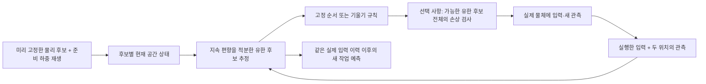
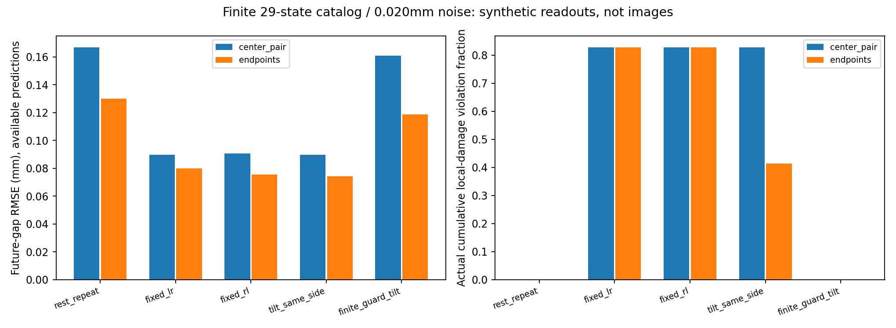

# 공간 관측 → 유한 후보 추정 → 실제 탐침의 첫 연결

후속 [연속 prior·조건부 구간 판정](SPATIAL_CONTINUOUS.md)을 구현했다. 수렴 실패와 넓은 영역의 보류를 포함한 현재 판단은 새 문서에서 다루며, 아래는 이산 후보 단계의 기록이다.

2026-10-29. [공간 순방향 모형](SPATIAL_FIXTURE.md)에 **입력·관측만 받는 추정기와 두 단계 탐침 규칙**을 연결했다. 물체가 어느 재료·준비 이력인지 정책에 전달하지 않았다. 후보 목록 안에서는 실행 가능한 연결을 확인했지만, 목록 밖에서는 위험과 예측 범위를 놓쳤다. 새 추정 알고리즘·일반화 성능·연속 영역 안전성을 입증한 결과는 아니다.

## 이번 파이프라인



현재 관측은 Gaussian 영상이 아니라 합성 변위 readout이다. 위치·방향을 선택하는 물리 파이프라인을 먼저 연결한 단계다. 신경망 학습이나 실제 촬영은 사용하지 않았다.

## 유한 후보라는 가정을 명시했다

목록은 `E=[1.3,2.0,2.8] J/m²`, 좌우 준비 입력 각각 `[0.8,1.2,1.8]mm`의 27조합과, 서로 다른 E에서 같은 D=0.9가 되도록 준비한 2조합으로 만든 **29개 물리 상태**다. 각 후보는 미손상 상태부터 같은 장치의 준비 하중·제하를 거친다. 하나의 준비 cycle로 도달하는 상태만 다룬다.

각 후보의 사전확률은 1/29다. **연속 물성·이력 사전을 근사하는 격자 적분이라고 해석하지 않는다.** 후보의 개수나 배치를 바꾸면 다른 이산 사전이 된다. 이전 1D 저잡음 격자 수렴 문제를 작은 공간 격자가 해결했다고 표시하지 않았다.

목록 안의 29개 상태를 모두 참 상태로 번갈아 사용하고, 목록에 없는 4개 상태를 별도 stress 조건으로 생성했다. 후자는 같은 E·준비 입력 범위 안의 중간 값이다. 알려진 29개 가설 중 참 index를 숨기는 실험이며, 새로운 미지 재료에 일반화한 검증이 아니다. 설정·prior·정책·잡음 seed는 실행 전에 파일로 고정했다.

## 관측 수를 맞춘 두 모달리티

| 관측 | 한 frame에서 읽는 값 | 의미 |
| --- | --- | --- |
| center_pair | 중앙 gap을 두 번 독립 측정 | 같은 수의 readout을 갖는 이상적인 중앙 반복 대조군 |
| endpoints | 왼쪽·오른쪽 gap을 각각 측정 | 이동과 기울기의 정보를 함께 포함 |

두 방식 모두 한 frame당 두 scalar readout이다. center_pair는 실제 한 영상에서 독립 잡음을 갖는 추적기가 자동으로 생긴다는 주장이 아니다. 독립 Gaussian 잡음의 합성 대조군이다. endpoints를 넣었다는 이유만으로 실제 카메라나 Gaussian 표현의 이득을 확보했다고 부르지 않는다.

관측은 `y[t,c]=gap[t,c]+bias[c]+error[t,c]`다. 각 channel의 bias는 한 실행 내내 유지된다. 추정 사전은 sigma_b=0.05mm의 Gaussian을 ±0.15mm로 제한했고, 실제 bias는 `(0,0)` 또는 `(+0.03,-0.03)mm`다. 잡음은 nominal sigma 0.001/0.020mm의 Gaussian을 ±3sigma에서 제한했다. 두 잡음 반복·편향 조건을 사용했다.

추정은 같은 bias가 모든 frame을 설명하도록 가능한 구간을 교차하고, 그 구간에서 Gaussian bias를 적분한다. 비제한 Gaussian 우도의 조건부 bias CDF를 이용해 해당 제한 잡음 모형의 likelihood를 계산했다. 과거 관측을 중복해서 likelihood에 곱하지 않는다. 확률 질량이 0인 닫힌 오차 경계도 유한 위험 검사에서는 버리지 않도록 확률 가중치와 가능 집합을 구분했다. 수치 계산은 별도의 1차원 bias 적분과 대조했다. 고정 bias의 개발 반복에서 posterior calibration까지 입증한 것은 아니다.

## 비교한 다섯 규칙

모든 실행은 무하중 영점 관측과 약한 중앙 입력 `(0.8,0.8)mm`의 관측으로 시작하고 추가 관측 두 번을 시도한다. 손상 기준은 이 초기 관측 이전의 **준비 제하 직후**에 고정한다. 초기 관측의 손상을 예산 밖으로 숨기지 않는다.

| 규칙 | 추가 입력 |
| --- | --- |
| rest_repeat | 무하중 두 번 |
| fixed_lr | 왼쪽 중간 → 오른쪽 중간 |
| fixed_rl | 오른쪽 중간 → 왼쪽 중간, 고정 순서 민감도 대조 |
| tilt_same_side | 초기 영점으로 bias를 보정한 약한 응답에서 더 열린 쪽을 선택. 차이가 2sigma 이내면 고정 좌→우로 복귀 |
| finite_guard_tilt | 같은 제안을 가능한 **유한 후보 전체**에서 검사. 불가하면 같은 쪽 약한 입력, 그다음 무하중. 가능 후보가 없거나 모두 부적합하면 기권 |

중간 왼쪽은 `(1.45,0.4)mm`, 약한 왼쪽은 `(1.0,0.4)mm`이며 오른쪽은 좌우 대칭이다. 중앙만 두 번 읽는 관측에는 방향 정보가 없으므로 tilt 규칙은 fixed_lr로 복귀한다. 이 대조 264쌍의 입력·관측이 정확히 일치했다.

검사 기준은 준비 상태 이후 `max_i(D_i-D_i_ref)≤0.02`와 새 분리 없음이다. 유한 후보 검사는 작은 posterior 가중치의 가능 후보도 버리지 않는다. 후보 목록에 참 상태가 있다는 조건을 벗어나면 보호 근거가 없다. 1D 연속 위험 증거를 공간 모형에 적용한 것이 아니다.

## 목록 안의 결과

2모달리티×5규칙×2잡음×2편향×2잡음 반복으로 **목록 안 2,320개, 목록 밖 320개**, 총 2,640개 실행을 수행했다. 33개 물리 상태의 조건 반복이며 독립 시편 2,640개가 아니다. 실제 결정은 5,258개였다. 참 index·재료·준비 입력·잡음 seed·정답 미래를 결정 함수에 전달하지 않았고, 공개 후보와 관측만으로 모든 결정을 재생했다.

아래는 nominal sigma 0.020mm·endpoints 결과다. 각 행의 116조건은 **목록의 29상태×2편향×2잡음 반복**이다. 이 표에서는 모든 예측과 관측 예산이 채워졌다.

| 규칙 | 미래 gap RMSE (mm) | 실제 누적 손상 위반 / 116 |
| --- | ---: | ---: |
| 무하중 반복 | 0.12991 | 0 |
| 고정 좌→우 | 0.07979 | 96 |
| 고정 우→좌 | 0.07562 | 96 |
| 기울기 규칙 | 0.07421 | 48 |
| 유한 전체 검사 + 기울기 | 0.11879 | 0 |

유한 검사는 더 작은 예측 오차를 내는 공격적 탐침을 제한했다. 기울기 규칙은 이 개발 목록에서 위반을 줄였지만 안전 규칙이 아니었다. 유한 검사의 무하중 대비 점 추정 개선을 일반적 우위나 새로운 정책 기여로 확대하지 않는다. 손상이 다른 실행들의 RMSE만 비교해 정보 획득의 우위를 주장하지 않는다.

같은 유한 검사 규칙의 중앙 반복/양 끝 RMSE는 높은 잡음에서 0.16089/0.11879mm, 낮은 잡음에서 0.07326/0.05437mm였다. 두 readout을 어느 위치에서 얻는지가 이 목록의 추정에 영향을 줬다. 낮은 잡음·공격적 입력의 RMSE=0 조건은 유한 목록에서 예측 대상이 식별된 결과다. 실물의 무오차 예측이나 연속 추론 정밀도가 아니다.



미래 질의는 중앙 `(3.1,3.1)mm`, 왼쪽 `(3.2,0.6)mm`, 오른쪽 대칭의 세 작업이며 세 위치의 gap을 평가했다. 후보별 물리 상태를 실제 실행 이력 이후까지 전진시키고 **미래 출력에 가중 평균**을 냈다. 평균 물리 상태를 만들어 시뮬레이션하지 않는다. `before_gap_mse`는 같은 실제 입력 이력·같은 변경된 참 상태에서 처음 두 관측의 가중치를 유지한 대조다. 정책 간 인과적 정보 이득의 정리가 아니다.

목록 안에서는 가능한 참 후보가 모두 유지됐고, 후보 전체가 만드는 미래 envelope의 동시 포함률은 100%였다. 이는 **참 상태가 목록에 있고 오차 경계를 지킨 설정에서 예상되는 집합 성질**이다. 새 보정 방법이나 일반적인 확률적 coverage 결과로 계산하지 않는다. Brier·구간 폭·가용 예측 수는 [전체 표](results/spatial-observation-analysis-summary.json)에 함께 있다.

## 목록 밖에서 드러난 실패

아래는 endpoints·유한 검사 규칙의 네 목록 밖 물체 결과다. 각 16조건은 네 물체×두 편향×두 잡음 반복이다.

| nominal sigma | 예측 가능 / 16 | 관측 예산 미충족 / 16 | 실제 손상 위반 / 16 | 가용 예측의 envelope 포함 |
| --- | ---: | ---: | ---: | ---: |
| 0.001mm | 0 | 16 | 0 | 계산 불가 |
| 0.020mm | 12 | 2 | **4** | **1/12** |

낮은 잡음에서는 목록에 맞는 상태가 없어 기권했다. 높은 잡음에서는 틀린 후보도 관측에 맞아 보이면서 과도하게 좁은 예측과 잘못된 허용을 만들었다. 네 위반은 **같은 목록 밖 물체 하나의 네 편향·잡음 조건**에서 발생했고, 실제 추가 D는 약 0.040334였다. 네 독립 물체에서 발생한 실패로 세지 않는다. 미예측·기권을 제외한 RMSE만으로 성공을 주장하지 않는다.

따라서 공간 관측을 더 많이 활용하는 것만으로 모델 누락 문제가 해결되지는 않았다. 목록 안에서의 0위반·100% 포함률을 연속 물성·실물의 보장으로 사용할 수 없다.

## 공개 관측만으로 추가 위험 상태를 찾아본 후속 진단

실패가 발생한 위 네 실행을 **결과를 본 뒤 선택**하고, 그 안에서 실행한 비영점 입력 8개를 검사했다. 검색 함수에는 해당 시점의 공개 관측·입력·제안 행동만 주고 참 물성이나 정답 미래를 주지 않았다. E와 좌우 준비 입력의 연속 범위 안에 미리 고정한 Sobol 2,048점을 두었다.

8개 질의 모두에서 관측 오차·공통 bias 조건에 맞으면서 추가 D가 0.02를 넘는 점을 찾았다. 별도의 기존 순방향 모형으로 4/2마이크로미터 증분에서 준비 이력과 전체 공개 입력을 재생해 확인했다. 한 예는 `E≈1.38039`, 준비 `(1.44465,1.24448)mm`이며, 실제 참 상태를 모른 채 찾은 이 상태의 추가 D는 약 **0.142369**였다. 두 channel 중 좁은 bias 가능 구간도 약 0.002885mm의 폭을 유지했다.

8개 중 5개 질의의 반례는 그 행동에서 손상 한도를 새로 넘었다. 나머지 3개는 같은 입력 반복 전에 이미 가능한 위반 상태였으며, 기존 누적 위반이 유지된 사례다. 독립적인 손상 발생 8건으로 세지 않는다.

이것은 **유한 후보의 허용을 반박하는 수치적 반례**다. 표준 Sobol 탐색이며 새 검증 알고리즘이 아니다. 점을 못 찾았다고 안전 상한을 얻는 것은 아니고, 수치 replay를 정리 증명으로 부르지 않는다. 실패 뒤 선택한 질의이므로 새로운 정책의 독립 성능 시험도 아니다. 원래 실행한 행동과 결과표를 고치지 않았다. [검색 설정·선택 기준](../config/spatial-failure-search.json) · [반례와 독립 재생](results/spatial-failure-search-witnesses.json)

## 구현 검사와 다음 과제

고정된 세 구역 모형을 NumPy로 batch 계산했다. 별도 모드 열거 solver와 endpoint/contact/failure를 대조했고, 작은 변위 증분의 준비·순차 경로와도 비교했다. 실험의 별도 9상태·36시점 대조, 64→128증분의 전체 후보 이력·posterior·유한 검사 결정 대조를 통과했다. 이 실험의 해상도 차이가 0인 것은 구간별 선형 끝점 계산의 결과이며 연속 파라미터 적분 수렴이나 물리 오차가 0이라는 뜻은 아니다.

관측·추정·기울기 규칙·유한 검사에 새 테스트 10개를 추가했다. 공개 관측으로 5,258개 결정을 별도 프로세스에서 재생했다. 첫 실행과 재실행의 관측·개별 평가·집계 JSON도 정확히 일치했다. 물리 cache는 실행 간 공유했으므로 기록된 결정별 시간을 정책 간 공정한 전체 비용 비교로 사용하지 않는다.

다음은 **목록 밖에서도 가능한 물리 상태를 유지하는 추정과 위험 판단**이다. 우선 같은 준비 프로토콜의 연속 E·좌우 준비 입력을 다루고, 관측에 맞는 영역을 근거 없이 버리지 않는지 검증해야 한다. 반례 검색은 거부 근거로 활용할 수 있지만 허용에는 별도 상한 계산이 필요하다. 이를 해결하지 않은 채 후보 몇 개를 추가하거나 Gaussian 렌더러를 붙여 일반 안전성·novelty를 주장하지 않는다.

## 재현

```powershell
.\scripts\run-wsl.ps1 python scripts/spatial_observation_evaluate.py
.\scripts\run-wsl.ps1 python scripts/spatial_policy_replay.py
.\scripts\run-wsl.ps1 python scripts/spatial_failure_search.py
.\scripts\run-wsl.ps1 test -q tests/test_spatial_observation.py
```

공개 결정 재생은 truth/evaluation 파일을 읽지 않는다. 전체 재실행·반례 검색은 위 순서로 실행한다. 기존 WSL NumPy/SciPy/Matplotlib만 사용하며 GPU·외부 엔진·실제 촬영은 필요 없다.

[설정](../config/spatial-observation.json) · [추정과 정책](../wmfracture/spatial_observation.py) · [공개 결정 재생](../scripts/spatial_policy_replay.py) · [결과](results/spatial-observation.json) · [목록·참 상태 설정](results/spatial-observation-case-config.json)
