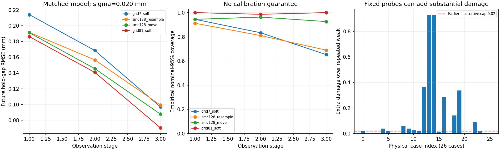

# 외부 데이터 없는 합성 추정 실험

현재 모형의 천천히 가하는 하중에서 벌어짐 관측을 합성했다. Houdini·Unreal·촬영·GPU·신경망을 사용하지 않는다.



26개 물리 사례(사전 범위 안 24개, 밖 2개)를 2개 입력 프로토콜·3개 잡음·2개 관측 모델 조건으로 비교했다. 312개 관측 조건은 312개 독립 시편이 아니다. SMC 세 seed도 독립 물리 사례를 늘리지 않는다.

## 비교 방법

- grid7 hard: 49개 고정 후보에서 매 관측의 ±3σ를 만족하는 후보만 유지. 빈 집합은 그대로 기록하며 대체 후보를 몰래 넣지 않는다.
- grid7/41/81 soft: 각각 49/1,681/6,561개 후보에 같은 Gaussian likelihood를 적용한다.
- SMC128 resample: 128개 연속 파라미터 후보, ESS 기준 재표집.
- SMC128 move: 같은 초기 후보와 재표집에 관측 단계마다 2회 Metropolis 이동을 추가. 제안마다 준비부터 현재까지 전체 이력을 재생한다.

사전분포는 Gc와 관측하지 못한 과거 구동부 최대 변위에 균등하다. 숨은 손상도에 균등한 사전분포가 아니다. Hard filter 후보 개수 비율을 분리 확률로 평가하지 않는다.

## 대표 조건: 범위 안 24개 사례, 관측 σ=0.020mm, 3회 관측 후

세 미래 입력의 유지 시점 벌어짐을 평가했다. 경험적 95% 포함률은 각 확률 방법의 명목 구간 안에 정답이 든 비율이며 보장이 아니다. Hard filter에는 95% 확률 구간을 붙이지 않고, 전체 유지 집합의 포함률을 별도로 기록했다. Hard filter의 점 예측은 후보들의 단순 산술 평균이며 비어 있지 않은 조건에서만 오차를 계산하므로 빈 집합 비율도 함께 읽어야 한다.

| 관측 조건 | 입력 | 방법 | 미래 벌어짐 RMSE (mm) | 명목 95% 포함률 | 분리 Brier | 빈 집합 |
| --- | --- | --- | ---: | ---: | ---: | ---: |
| 오차 모델 일치 | 약한 입력 반복 | grid7_hard | 0.1981 | — | — | 12.5% |
| 오차 모델 일치 | 약한 입력 반복 | grid7_soft | 0.2261 | 80.6% | 0.1880 | 0.0% |
| 오차 모델 일치 | 약한 입력 반복 | smc128_resample | 0.1992 | 88.0% | 0.1344 | 0.0% |
| 오차 모델 일치 | 약한 입력 반복 | smc128_move | 0.1992 | 94.9% | 0.1257 | 0.0% |
| 오차 모델 일치 | 약한 입력 반복 | grid81_soft | 0.1872 | 100.0% | 0.1064 | 0.0% |
| 오차 모델 일치 | 고정 탐색 입력 | grid7_hard | 0.1114 | — | — | 20.8% |
| 오차 모델 일치 | 고정 탐색 입력 | grid7_soft | 0.0968 | 65.3% | 0.0434 | 0.0% |
| 오차 모델 일치 | 고정 탐색 입력 | smc128_resample | 0.0992 | 69.0% | 0.0601 | 0.0% |
| 오차 모델 일치 | 고정 탐색 입력 | smc128_move | 0.0877 | 92.6% | 0.0276 | 0.0% |
| 오차 모델 일치 | 고정 탐색 입력 | grid81_soft | 0.0703 | 100.0% | 0.0156 | 0.0% |
| 미반영 +0.030mm bias | 약한 입력 반복 | grid7_hard | 0.1766 | — | — | 12.5% |
| 미반영 +0.030mm bias | 약한 입력 반복 | grid7_soft | 0.2543 | 68.1% | 0.1814 | 0.0% |
| 미반영 +0.030mm bias | 약한 입력 반복 | smc128_resample | 0.2205 | 83.3% | 0.1481 | 0.0% |
| 미반영 +0.030mm bias | 약한 입력 반복 | smc128_move | 0.2081 | 90.7% | 0.1268 | 0.0% |
| 미반영 +0.030mm bias | 약한 입력 반복 | grid81_soft | 0.1919 | 95.8% | 0.1063 | 0.0% |
| 미반영 +0.030mm bias | 고정 탐색 입력 | grid7_hard | 0.1034 | — | — | 25.0% |
| 미반영 +0.030mm bias | 고정 탐색 입력 | grid7_soft | 0.1166 | 65.3% | 0.0509 | 0.0% |
| 미반영 +0.030mm bias | 고정 탐색 입력 | smc128_resample | 0.1191 | 68.1% | 0.0798 | 0.0% |
| 미반영 +0.030mm bias | 고정 탐색 입력 | smc128_move | 0.0903 | 79.6% | 0.0557 | 0.0% |
| 미반영 +0.030mm bias | 고정 탐색 입력 | grid81_soft | 0.0842 | 80.6% | 0.0545 | 0.0% |

## 계산 비용

최종 단계까지 SMC resample은 384회, resample-move는 1,152회의 파라미터-prefix 계산을 수행했다. 49개 고정 후보보다 계산량이 크다. 동일 예산 우위나 새 알고리즘의 개선으로 해석하지 않는다. 각 prefix 계산에는 준비와 그때까지의 모든 행동 재생이 포함되므로 root 계산 수도 JSON에 별도로 기록한다.
격자 bank는 여러 사례와 잡음에 재사용했다. library-cost.json은 실제 공유 bank 비용, fit-packets.json은 각 방법을 독립 실행한다고 가정한 논리 비용이다. 전체 fit 시간만으로 SMC 대 격자의 속도 우위를 주장하지 않는다.

## 해석식과 기존 동적 계산기 비교

선택한 4개 사례·2개 시간 간격에서 유지 시점 벌어짐의 최대 차이는 0.000003180mm였다. 실제 이력 최대값의 차이는 0.000006409mm였다. 선택한 느린 안정 분기의 수치 검증이며 빠른 충격이나 실물 검증은 아니다.

## 손상 비용

고정 탐색의 수동 대조군 대비 추가 D 최댓값은 0.928318였다. 앞서 고른 두 예제에서 약 0.0125였다는 결과가 전체 상태의 작은 손상으로 일반화되지 않았다. 이 정책을 안전하다고 부르지 않는다.

## 조밀한 격자도 정답 보장은 아니다

처음 41×41과 81×81 비교에서 평균 미래 벌어짐의 최대 차이는 0.5693mm, 분리 질량 차이는 0.9673였다. 아래 추가 검사는 관측 3단계에서만 수행했고, 위 원래 표를 수정하지 않았다.

| 격자 비교 | 최대 예측 평균 차이 (mm) | 최대 분리 질량 차이 |
| --- | ---: | ---: |
| 81² → 161² | 0.16058 | 0.30732 |
| 161² → 321² | 0.02360 | 0.07692 |
| 321² → 641² | 0.00101 | 0.02881 |

수렴 차이는 조건별로 additional-grid-refinement.json에 남겼다. 작은 관측 잡음, 미반영 bias, 사전 범위 밖 상태를 분리해서 읽어야 한다. 두 격자 사이 차이가 작아도 연속 영역의 인증된 경계는 아니다.

## 이번 결과로 할 수 있는 판단

1. 고정 후보를 제거하기만 하는 방식 대신 표준 resample-move를 강한 기준선으로 사용한다. 현재 결과로 새 압축법의 기여를 주장하지 않는다.
2. 반복 관측은 잡음을 줄일 수 있지만 관측 자체가 구별하지 못하는 물성/이력을 유일하게 만들지는 않는다.
3. 강한 탐색이 예측을 개선하더라도 비가역 손상까지 계산해야 한다. 다음 단계는 전체 후보 위험 검사와 정보 목적함수를 분리하는 것이다.
4. 관측 bias를 모델링하지 않으면 조밀한 후보도 명목 포함률을 잃는다. 다음 단계에는 공통 bias를 추정하는 단순 기준선이 필요하다.
5. 2개 범위 밖 사례는 스트레스 사례일 뿐 모집단 성능을 추정하는 표본이 아니다. 참 상태가 사전 범위 밖이면 후보 이동만으로 해결할 수 없다.

안정적인 단일 접합면에서는 단조 완전 분리의 구동 변위 기준이 재료의 최종 벌어짐으로 정해진다. 이번 미래 분리 평가는 재료/이력의 결합 모호성을 다루며, 같은 재료에서 이력만 바꿔 완전 분리 기준이 달라짐을 보인 실험이 아니다.

이 결과는 새 방법·일반 3D 파괴·학습 월드모델의 검증이 아니다. 방법 개발 전에 병목을 분리하는 개발 진단이다.

## 실행과 결과 위치

2026-10-28 실행 `20261028T112246469806Z-synthetic-filter-benchmark`의 결과다. 초기 26개 상태 생성부터 추정·예측·평가까지 약 34.4초, 추가 격자 검사는 약 4.7초였다. CPU에서 수행했으며 GPU 성능 측정은 아니다.

```powershell
.\scripts\run-wsl.ps1 synthetic-filter-benchmark
# 첫 명령이 출력한 OUTPUT 경로를 --run에 넣는다.
.\scripts\run-wsl.ps1 python scripts/synthetic_filter_report.py --run /home/richard/research/world-model-research/runs/20261028T112246469806Z-synthetic-filter-benchmark
.\scripts\run-wsl.ps1 test -q
```

실험 설정은 `config/synthetic-filter-benchmark.json`, 해석식·표준 추정기는 `wmfracture/compliant_inference.py`, 단계별 실행기는 `scripts/synthetic_filter_benchmark.py`다. 두 번째 명령은 첫 명령의 추정·예측 파일을 변경하지 않고 별도 수렴 검사를 덧붙인다.

`artifacts/synthetic-filter-benchmark/`에는 최신 report.json·summary.md·comparison.png·개별 평가·손상 비용·격자 수렴 검사가 있다. 실행 원본에는 noisy observations, private-cases, posteriors, fit-packets, sealed forecasts, 소스 해시가 각각 저장된다. 추정기는 private-cases나 미래 정답 없이 동작하고, 미래 행동은 추정 후 별도 예측 단계에서 적용한다.

## 다음 구현 순서

1. **공통 측정 bias를 포함하는 표준 추론 — 구현 완료:** [공통 편향과 무하중 보정 기준선](BIAS_AWARE_FILTER.md)에서 같은 관측과 추가 영점 관측을 분리해 비교했다. 후보를 늘리는 것으로 관측 모델 오류까지 해결했다고 착각하지 않는다.
2. **전체 후보에 대한 탐색 위험 검사 — 유한 격자 기준선 구현:** [누적 손상 검사](FINITE_DAMAGE_GUARD.md)에서 정보 목적과 위험 집합을 분리했다. 샘플 최댓값은 해당 샘플에 대한 검사이며 연속 영역 상한이라고 하지 않는다.
3. **새 행동을 순차 선택하는 폐루프 — 2단계 기준선 구현:** 같은 후속 실험에서 관측 후 행동을 다시 선택했다. 무하중 반복·전체 검사·top8·단순 위험 증거의 예측·손상·기권·논리 계산량을 비교했다. 전체 검사는 보수적이었고 유용한 정보 획득은 여전히 과제다.

이 세 기준선은 촬영이나 외부 엔진 없이 수행했다. Gaussian 영상과 일반 3D 확장은 이 진단의 관측·추론 문제를 분리한 뒤 별도 단계에서 검증한다.
