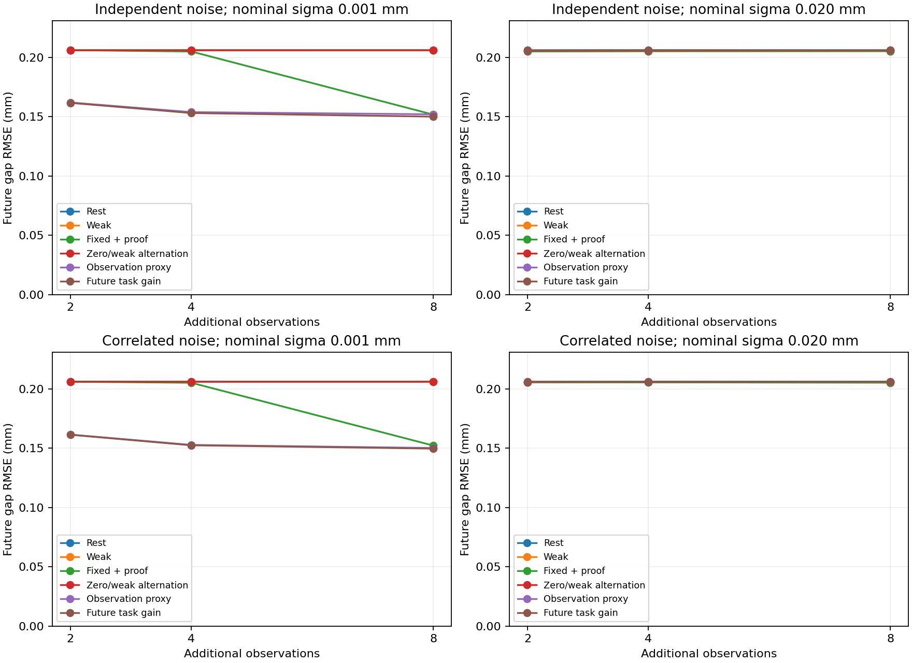

# 목표 미래의 예측 위험을 줄이는 관측 파이프라인

안정화한 물리 상태 적분을 실제 입력 선택에 연결했다. 공개 관측으로 가중 상태를 갱신하고, 연속 영역 위험 검증을 통과한 후보 중 다음 관측이 목표 미래 예측에 얼마나 도움이 될지 비교한 뒤 실제로 입력한다. 새로운 학습 모델·Gaussian 영상 추론이나 일반 3D 파괴를 구현한 단계는 아니다.

**폐루프 연결과 수치·위험 검사는 통과했지만, 주 비교 조건에서 고정 계획보다 나은 예측 성능은 확보하지 못했다.** 낮은 잡음에서 점 추정 개선은 작았고, 작은 개발 집합에서의 보조 결과다. 코드의 새 기능과 논문 신규성은 구분한다.



## 주요 결과

새로운 12개 상태×2 nominal sigma×2편향×2잡음 상관 조건×6정책으로 **576개 실행**을 수행했다. 모두 추가 관측 8회를 채웠고, 실행 증거 **4,608개**가 새 cold 검사기를 통과했다. 실제 누적 손상 한도 위반·미충족 관측 예산·적분/점수 때문에 선택을 보류한 횟수는 모두 0이었다. 1,728개 checkpoint의 최종 예측도 32·64 해상도 검사에 모두 통과했다.

8회 관측의 미래 벌어짐 RMSE는 다음과 같다. 단위는 mm이며 각 칸은 같은 12개 상태를 두 편향에서 반복한 24조건이다.

| 정책 | 0.001mm 독립 | 0.001mm 상관 | 0.020mm 독립 | 0.020mm 상관 |
| --- | ---: | ---: | ---: | ---: |
| 무하중 반복 | 0.20610 | 0.20610 | 0.20603 | 0.20569 |
| 약한 입력 반복 | 0.20611 | 0.20612 | 0.20533 | 0.20532 |
| 고정 증가 제안 + 검증 | 0.15179 | 0.15228 | 0.20536 | 0.20539 |
| 무하중/약한 입력 교대 | 0.20611 | 0.20611 | 0.20594 | 0.20607 |
| 관측 불일치 + 검증 | 0.15207 | 0.15023 | 0.20623 | 0.20611 |
| **목표 미래 점수 + 검증** | **0.15011** | **0.14970** | **0.20595** | **0.20616** |

사전에 정한 주 비교는 0.020mm·8회에서 future_task−fixed_ramp다. 독립 잡음은 **+0.00059mm**, 상관 잡음은 **+0.00077mm**였으며 두 점 추정 모두 고정 계획보다 작지 않았다. 10개 생성 cluster를 재표집한 서술적 95% 범위는 각각 [−0.00054, +0.00228]mm, [−0.00029, +0.00226]mm로 0을 포함했다. 높은 잡음에서의 예측 개선 주장은 하지 않는다.

0.001mm에서는 고정 계획 대비 점 추정 오차가 약 1.1%/1.7% 줄었지만 재표집 범위는 두 조건 모두 0을 포함했다. 관측 불일치 기준과 비교하면 독립 저잡음의 작은 개선이 있었으나, 주 비교의 실패를 대체하는 최종 검증으로 해석하지 않는다. 2·4회에서의 이른 개선도 관측 불일치 정책에 함께 나타나므로 새 미래 점수만의 기여라고 부르지 않는다.

추가 관측 8회 중 약한 기준을 넘는 입력 수는 저잡음에서 future_task가 평균 **4.25/4.04회**, fixed_ramp가 **8회**였다. 이 수치는 기준보다 큰 입력의 횟수이며 실제 힘·에너지·작업 시간 측정이 아니다. 동등한 예측 품질을 보장하는 비열등성 검증도 수행하지 않았다. 무하중과 큰 검증 입력을 번갈아 쓰는 단순 기준선을 추가해야 이 행동 차이의 독자 가치를 판단할 수 있다.

## 선택이 실제로 달라졌나

두 적응 정책의 768개 대응 라운드 중 552개는 같은 입력을 골랐다. 공개 이력이 완전히 같은 451쌍 중 **68쌍은 다른 입력**을 골랐다. 점수의 이름만 바꾼 재계산이 아니라 실제 관측을 생성하는 행동이 바뀐 폐루프 실행이다.

선택한 공개 이력 48개에서 추정 해상도를 높여도 선택은 선언한 동률·최소 이득 기준 안에서 유지됐다. future_task 24개를 더 세밀한 관측 평균 구간·가상 관측 적분으로 대조해도 선택은 같은 기준 안에서 유지됐고, 참조 점수의 수치 보류는 없었다. 최대 참조 regret은 약 **0.0000000499mm²**다. 이는 현재 Gaussian proxy와 유한 후보 안의 경험적 점검이며 최적성 증명이 아니다.

고잡음 future_task의 입력 상한 제안 384회 중 첫 검사는 허용 124·거부 257·보류 3회였다. 거부는 관측 제약에 맞는 위반 가설이 확인됐다는 뜻이며 참 시편이 반드시 위험하다는 뜻은 아니다. 모든 제안 거부를 계산 예산 부족으로 해석하면 안 된다. 채택 가능한 상한은 유한 격자 제안의 평균 약 99.57%였지만, 이 비율만으로 작은 추가 구동 여유가 충분히 해상됐다고 판단할 수도 없다.

## 비용과 현재 판단

주 실행의 순차 제어는 **516.91초**, 선택 점수의 posterior 해상도 대조는 **1.87초**, 공통 최종 예측은 **40.05초**였다. 증거의 추가 cold 재검사와 평가 비용은 별도다. 저잡음 독립 조건의 평균 8단계 정책 시간은 fixed_ramp 약 **1,536ms**, future_task 약 **2,251ms**였다. 고잡음에서는 약 **749ms / 1,331ms**였다. 시간에는 제안·상태 적분·모든 후보 검증·점수 계산·선택 증거 저장을 포함한다. 고정 실행 순서의 CPU wall 기록으로 엄밀한 속도 우위 검증은 아니다.

전체 테스트 **210개**를 통과했다. 실행은 `20261029T041131768466Z-task-aware-pilot`이며 이전 결과는 변경하지 않았다. 다음으로는 **무하중/큰 검증 입력의 단순 교대 계획**과 비교해 선택 목적함수의 필요성을 확인하고, 잡음·관측의 식별력과 작은 허용 구동 여유를 구분해야 한다. 복잡한 점수를 넣은 것만으로 높은 신규성이나 높은 잡음의 문제 해결을 주장하지 않는다.

[보고서](results/task-aware-pilot.json) · [조건별 평가](results/task-aware-pilot-evaluation-rows.json) · [짝지은 비교와 행동 진단](results/task-aware-pilot-analysis-summary.json) · [점수 해상도 대조](results/task-aware-pilot-score-audits.json) · [더 세밀한 점수 대조](results/task-aware-pilot-tight-score-audits.json) · [설정](results/task-aware-pilot-config.json)

## 구현한 흐름


이전에는 안정화한 적분기를 고정 관측의 예측 재계산에 사용했다. 이번에는 `wmfracture/task_design.py`의 `TaskController`가 이 적분 상태를 입력 선택에 사용한다. 선택 단계는 숨은 물성·준비 이력이나 미래 정답을 받지 않는다. 전체 순차 실행은 `scripts/task_aware_pilot.py`에 있다.

## 비교하는 여섯 정책

| 정책 | 입력 선택 |
| --- | --- |
| rest_repeat | 무하중 반복 |
| weak_repeat | 초기 약한 입력 반복 |
| fixed_ramp | 사전에 정한 증가 입력을 같은 위험 필터에 통과 |
| calibration_alternating | 무하중·약한 입력을 번갈아 관측 |
| observation_disagreement | 새 관측의 예상 불일치가 큰 검증 후보 선택 |
| future_task | 목표 미래의 예상 예측 분산을 줄이는 검증 후보 선택 |

적응적인 두 정책은 같은 안정화한 적분과 후보 생성·검증 절차를 사용하고 점수만 다르다. 고정 정책도 같은 누적 손상 한도와 연속 위험 검증기를 사용한다. 후보는 유한 집합이며 연속 행동 전체의 최적화를 주장하지 않는다.

## 미래 예측용 점수

물리 상태 theta에 대한 가중치는 w이고 목표 미래 입력별 벌어짐 예측 벡터를 F(theta)로 둔다. 후보 입력 a에서 가상 관측 z를 얻었을 때 갱신한 미래 평균을 m(z,a), 현재 미래 평균을 m으로 두면 점수는 다음과 같다.

```text
G(a) = E_z [ mean_over_future_commands (m(z,a) - m)^2 ]
```

같은 Bayesian proxy 안에서는 현재 미래 분산에서 관측 이후의 예상 분산을 뺀 값과 같다. 미래 벌어짐은 mm로 계산하므로 점수 단위는 mm²다. 실제 정답 오차를 보고 선택하는 것이 아니라 현재 물리 가설이 예측하는 가상 관측으로 계산한다. 분리 사건의 Brier score는 평가 지표이며 이 입력 점수의 최적화 목표에 포함하지 않는다.

공통 측정 편향 b를 관측마다 독립적으로 새로 뽑지 않는다. n개 관측 이후 각 물리 가설의 조건부 편향 평균과 분산은 기존 Gaussian 근사에서 다음과 같다.

```text
mean_b(theta) = tau² * sum(y - f(theta)) / (sigma² + n*tau²)
var_b         = tau² * sigma² / (sigma² + n*tau²)
z | theta    ~ Normal(g(theta,a) + mean_b(theta), sigma² + var_b)
```

이 조건부 밀도로 가상 관측 이후의 물리 가중치를 갱신한다. 전체 관측에 한 프레임을 추가해 직접 계산한 Gaussian likelihood와 같은 갱신이 되는지 테스트했다.

물리 상태 수가 많아지면 가상 관측 적분 비용이 커지므로 관측 평균을 작은 구간으로 묶고 질량·관측 평균·미래 평균을 보존한다. 구간 폭과 관측 적분 차수를 높여 점수 변화를 확인한다. 미세한 점수 차이는 경험적 수치 차이로 정한 동률 규칙에서 작은 입력을 우선한다. 이 점수 근사는 안전 상한이나 엄밀한 획득함수 오차 보장이 아니다.

## 위험 검증과 수치 보류

유한 후보 집합은 관측에 맞는 격자 상태가 제안한 입력 상한과 0·약한 입력·현재까지의 입력·상한의 일부 비율로 구성한다. 격자 상한은 제안일 뿐이며 연속 영역 위험 상한으로 사용하지 않는다. 상한과 다른 후보는 실제로 실행할 값에서 각각 검사한다.

허용 증거를 받은 실제 후보만 점수를 계산한다. 제안이 위험 필터에서 다른 값으로 바뀌면 바뀐 값의 점수를 사용한다. 선택된 입력의 증거는 실행 직전에 이미 재검사한 결과이며, 평가에서도 새로운 cold 검사기로 다시 검사한다. 검색과 재검사기의 캐시는 분리한다.

누적 손상 기준은 최초 무하중·약한 입력의 관측 뒤 상태에 고정한다. 이후 관측마다 한도를 새로 주지 않는다. 적분이나 점수의 수치 비교가 통과하지 못하면 검증된 0 입력을 선택하고 `acquisition_abstained`로 기록한다. 위험 검증 자체의 질의 보류·실행 중단과 구분한다.

## 합성 pilot과 해석 범위

기존 24개와 겹치지 않는 새로운 물성·준비 이력 12개를 생성한다. uniform4·손상 시작 근처4·matched2쌍이며 생성 cluster는 10개다. 새로운 잡음 seed를 사용한다. 작은 같은 법칙의 개발 pilot이며 독립적인 최종 논문 시험은 아니다.

추가 관측은 2·4·8회이고 같은 8단계 실행의 중첩 prefix다. nominal sigma 0.001·0.020mm, 실제 공통 편향 0·+0.030mm, 독립·상관 bounded noise를 사용한다. 동일 조건의 정책은 같은 잡음 스트림을 공유한다. 한 행의 24조건은 같은 12개 상태를 두 편향에서 반복한 결과다.

목표 미래 입력은 2.6·3.1·3.5mm다. 이 실험에서는 미래 입력이 가능한 준비 변위와 관측 입력보다 커서, 해당 법칙의 미래 유지 벌어짐은 물성 E로 정해진다. 따라서 관측 입력이 달라도 같은 상태의 정책들은 같은 목표 정답을 예측한다. 이 특수한 과제를 일반적인 이력 의존 미래 예측 전체로 확장하지 않는다.

생성 잡음은 ±3 nominal sigma 안에 있지만 추론과 가상 관측은 기존 Gaussian 근사를 쓴다. 상관 조건에서도 독립 잡음 covariance 근사를 유지한다. 기대 위험 감소가 실제 분포에서 그대로 맞거나 posterior가 보정돼 있다는 주장은 하지 않는다. 실제 위험의 조건부 검증에는 잡음 경계와 참 상태 포함 여부를 별도로 검사한다.

모든 정책의 최종 예측은 같은 guided 적분기로 계산하고 32·64 해상도를 비교한다. 예측을 고정한 뒤 합성 정답으로 평가한다. 선택한 공개 이력에서는 posterior 해상도를 높이고, 추가 분석에서는 관측 평균 구간 폭과 가상 관측 적분도 더 세밀하게 해 선택이 유지되는지 점검한다. 이 분석은 실행한 행동을 바꾸지 않는다.

## 코드·재현

핵심은 `wmfracture/task_design.py`, 설정은 `config/task-aware-pilot.json`, 분석 항목은 `config/task-aware-analysis.json`이다. CPU NumPy·SciPy 기반이며 GPU·외부 엔진·촬영 데이터가 필요 없다. 그림 보고서에는 matplotlib를 사용한다.

```powershell
.\scripts\run-wsl.ps1 python scripts/prepare_task_references.py
.\scripts\run-wsl.ps1 python scripts/task_aware_pilot.py
# 출력된 OUTPUT 경로를 RUN에 넣는다.
.\scripts\run-wsl.ps1 python scripts/report_task_aware_pilot.py --run RUN
.\scripts\run-wsl.ps1 test -q
```

일반 CPU 환경의 변수 설정은 [재현 안내](REPRODUCING.md)를 따른다. 첫 준비 명령은 새 checkout에 공개된 이전 보고서 사본을 무결성 점검용 참조로 배치한다. 기존 원본 보고서는 그대로 유지한다. 이전 개인 실행 데이터는 필요 없다. 물리 상태와 잡음 seed, 누적 손상 기준, 후보 비율, 적분·점수 수치 기준을 실행 전에 설정으로 고정한다. 숨은 미래 정답으로 후보나 기준을 조정하지 않는다.
